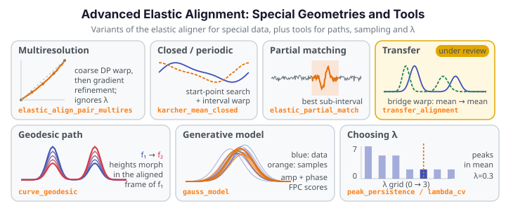

# Advanced Elastic Alignment

The baseline [`karcher_mean`](elastic-alignment.md#group-alignment-karcher-mean) and [`elastic_align_pair`](elastic-alignment.md#pairwise-alignment) cover the common case: curves on one interval, aligned by a warp that minimises the elastic (Fisher–Rao) distance. This page collects the variants for special situations: **closed or periodic** curves, a short curve that matches only **part** of a longer one, **multiresolution** alignment, alignment **across two populations**, **geodesic** paths between curves, **generative** models built on the amplitude/phase split, and **automatic choice of $\lambda$**. Every tool works on the SRSF $q(t)=\operatorname{sign}(\dot f(t))\sqrt{|\dot f(t)|}$, under which the Fisher–Rao metric becomes the $L^2$ metric.

{ .fdars-diagram }

Robust centres (the Karcher median and the trimmed Karcher mean) live on the [Elastic Alignment](elastic-alignment.md#robust-centres-karcher-median-and-trimmed-mean) page; warp optimisers, penalties and the band on [Elastic Optimisers & Penalties](elastic-optimisers.md); elastic depth, outlier detection and shape confidence intervals on [Inference after Alignment](alignment-inference.md); Bayesian pairwise and group alignment on [Bayesian Alignment](bayesian-alignment.md). For which aligner to use in the first place, see [Choosing an Alignment Method](choosing-a-method.md).

The non-executed snippets below refer to this simulated sample:

```python
import numpy as np

rng = np.random.default_rng(42)
n, m = 30, 160
t = np.linspace(0, 1, m)
data = np.zeros((n, m))
for i in range(n):
    data[i] = rng.normal(3.0, 0.5) * np.exp(-((t - rng.normal(0.5, 0.08)) ** 2) / (2 * 0.12 ** 2))
```

---

## 1. Multiresolution alignment (long curves)

Dynamic programming costs $O(m^2)$ per pair. `elastic_align_pair_multires` runs the DP on a grid coarsened by `coarsen_factor`, upsamples the warp, and then refines it on the full grid with `n_refine_steps` sweeps of a descent on the penalised objective

$$
\lVert q_1 - (q_2\circ\gamma)\sqrt{\dot\gamma}\rVert^2 + \lambda \sum_j \Big(\frac{\Delta\gamma_j}{\Delta t_j} - 1\Big)^2 \Delta t_j .
$$

Each sweep moves the warp values one coordinate at a time with backtracking and accepts only strict decreases, so refinement never makes the coarse warp worse, and `lambda_` enters both the coarse DP and the refinement. The refined warp is not restricted to the DP's quantised slopes, so it can end below the exact DP's distance, but it is a local descent from the coarse warp and is not guaranteed to.

```python exec="1" source="above" result="text"
import numpy as np
from time import perf_counter
from fdars.alignment import elastic_align_pair_multires, elastic_align_pair

m = 400
t = np.linspace(0, 1, m)
f1 = np.sin(2 * np.pi * 2 * t) + 0.5 * np.sin(2 * np.pi * 5 * t)
f2 = np.interp(t, np.clip(t + 0.09 * np.sin(np.pi * t), 0, 1), f1)   # non-linear phase distortion

for steps in (0, 3, 10):
    t0 = perf_counter()
    r = elastic_align_pair_multires(f1, f2, t, coarsen_factor=4, n_refine_steps=steps)
    rms = np.sqrt(np.mean((np.asarray(r["f_aligned"]) - f1) ** 2))
    print(f"multires, n_refine_steps={steps:2d}: distance {r['distance']:.3f}  RMS {rms:.4f}  {1e3 * (perf_counter() - t0):5.1f} ms")
t0 = perf_counter()
r = elastic_align_pair(f1, f2, t)
rms = np.sqrt(np.mean((np.asarray(r["f_aligned"]) - f1) ** 2))
print(f"exact DP:                     distance {r['distance']:.3f}  RMS {rms:.4f}  {1e3 * (perf_counter() - t0):5.1f} ms")
print("FDARS_FENCE_OK")
```

The coarse DP alone (`n_refine_steps=0`) is an order of magnitude faster than the exact DP, at about twice its distance: that is the speed option for long curves. The refinement lowers the distance with every sweep (here below the exact DP's), but each sweep is a line search over all $m$ warp values, so a few sweeps already cost about as much as the exact DP, and the cost grows quickly with $m$. Use the coarse DP when speed matters, refinement when you want to improve on the coarse warp without a full-grid DP, and `elastic_align_pair` (or a [band](banded-alignment.md)) as the reference. Returns `f_aligned`, `gamma` and `distance`.

| Parameter | Description |
|-----------|-------------|
| `coarsen_factor` | Grid downsampling factor for the coarse DP (default `4`) |
| `n_refine_steps` | Refinement sweeps on the full grid (default `10`; `0` = coarse DP only) |
| `step_size` | Initial refinement step size (default `0.01`) |
| `lambda_` | Warp penalty, used by the coarse DP and the refinement |

---

## 2. Closed and periodic curves

A periodic signal (a gait cycle, a daily temperature cycle, a contour traced as a 1-D function) has no canonical starting point: the same cycle can start anywhere. `elastic_align_pair_closed` searches over a circular shift of the start index $\theta$ in addition to the warp,

$$
d(f_1, f_2) = \min_{\theta}\;\min_{\gamma\in\Gamma}\big\lVert q_1 - (q_2^{(\theta)}\circ\gamma)\sqrt{\dot\gamma}\big\rVert_{L^2},
$$

where $q_2^{(\theta)}$ is the SRSF of $f_2$ rotated by $\theta$ grid points. Two details matter:

- **The start-point search is heuristic**: a coarse search over shifts, then a fine search around the best one. It is not guaranteed to find the global optimum.
- **The warp is an ordinary interval warp** ($\gamma(0)=0$, $\gamma(1)=1$) applied after the rotation, not a diffeomorphism of the circle.

`karcher_mean_closed` (and `karcher_mean_closed_with_config`, which takes the [optimiser options](elastic-optimisers.md)) runs the Karcher iteration with this aligner and also returns the per-curve `rotations`.

```python exec="1" source="above" result="text"
import numpy as np
from fdars.alignment import elastic_align_pair_closed, karcher_mean_closed, karcher_mean, elastic_distance

m = 101
t = np.linspace(0, 1, m)
cycle = lambda s: np.sin(2 * np.pi * s) + 0.5 * np.cos(4 * np.pi * s)

r = elastic_align_pair_closed(cycle(t), cycle(t - 0.2), t)
print(f"pair: start shift {r['optimal_rotation']} grid points (true 20), closed distance {r['distance']:.3f}, "
      f"open distance {elastic_distance(cycle(t), cycle(t - 0.2), t):.3f}")

rng = np.random.default_rng(1)
X = np.array([rng.uniform(0.9, 1.1) * cycle(t - rng.uniform(-0.3, 0.3)) for _ in range(8)])
ratio = lambda R: np.var(R, 0).mean() / np.var(X, 0).mean()
closed = karcher_mean_closed(X, t, max_iter=10)
opened = karcher_mean(X, t, max_iter=10)
print(f"variance after/before: closed {ratio(np.asarray(closed['aligned_data'])):.3f}, "
      f"interval-only {ratio(np.asarray(opened['aligned_data'])):.3f}")
print("FDARS_FENCE_OK")
```

The closed aligner recovers the 0.2-cycle start shift exactly and removes almost all the variance; the interval aligner, which must keep $\gamma(0)=0$, cannot move features across the boundary. The start-point search costs roughly $(20 + m/10)$ ordinary alignments per pair, so the closed Karcher mean is about 40 times slower than `karcher_mean` at $m = 101$. Returns `f_aligned`, `gamma`, `distance`, `optimal_rotation` (pair) and `mean`, `aligned_data`, `gammas`, `rotations`, `n_iter`, `converged` (Karcher).

For curves in the plane (outlines), where rotation and scale are also nuisance, use the shape-space functions `curve_shape_*(closed=True)` instead.

---

## 3. Partial matching (subsequence search)

When only a *portion* of a longer target matches a shorter query, full alignment is wrong. `elastic_partial_match` finds the best-aligned sub-interval of the target. Here a short query pattern is hidden (time-warped and buried in noise) inside a longer target, and the search recovers exactly where it sits.

```python exec="1" html="1" source="above"
import numpy as np
from docs_fig import fig, render
from fdars.alignment import elastic_partial_match

# short query pattern on its own grid
tt = np.linspace(0, 1, 80)
template = np.exp(-((tt - 0.5) ** 2) / (2 * 0.14 ** 2)) * np.sin(2 * np.pi * 2 * tt)

# longer, noisy target; the pattern is embedded (warped) on the sub-interval [0.45, 0.75]
tg = np.linspace(0, 1, 300)
rng = np.random.default_rng(0)
target = 0.15 * rng.standard_normal(300)
seg = (tg >= 0.45) & (tg <= 0.75); s = (tg[seg] - 0.45) / 0.30
target[seg] += 1.2 * np.interp(np.clip(s + 0.05 * np.sin(np.pi * s), 0, 1), tt, template)

pm = elastic_partial_match(template, target, tt, tg, min_span=0.25)
i0, i1 = pm["start_index"], pm["end_index"]

f, ax = fig()
ax.plot(tg, target, color="#adb5bd", lw=1, label="target (long)")
ax.plot(tg[i0:i1 + 1], target[i0:i1 + 1], color="#fd7e14", lw=2.4, label="matched sub-interval")
ax.axvspan(tg[i0], tg[i1], color="#fd7e14", alpha=0.10)
ax.axvspan(0.45, 0.75, color="#198754", alpha=0.06)     # true location (green)
ax.set(title=f"Query found in {pm['domain_fraction']:.0%} of the target  (d={pm['distance']:.2f})",
       xlabel="t", ylabel="f(t)")
ax.legend(fontsize=8)
print(render(f))

print(f"matched target indices {i0}..{i1}  (t = {tg[i0]:.2f}..{tg[i1]:.2f}; planted at 0.45..0.75)")
```

The orange sub-interval that the search selects overlaps the green planted region almost exactly, and the printed indices confirm it recovers the buried pattern despite the noise and time-warping. Crucially the match spans only a fraction of the target (see `domain_fraction`), which is what distinguishes partial matching from forcing a full-length alignment.

| Key | Description |
|-----|-------------|
| `start_index` / `end_index` | Best-matching sub-interval of the target |
| `domain_fraction` | Fraction of the target domain that matched |
| `gamma` | Warp on the matched segment |
| `distance` | Elastic distance of the match |

`min_span` sets the smallest fraction of the target the match may cover, guarding against trivial tiny matches. The search over windows is heuristic, and **distances of matches of different lengths are not comparable** (a shorter window has less curve to mismatch), so do not rank candidate matches across window lengths by `distance` alone.

---

## 4. Transfer alignment across populations

When curves come from two populations (two sites, two devices), `transfer_alignment` maps the target curves into the source population's time frame. It computes both Karcher means, a bridging warp $\gamma_B$ that aligns the target mean to the source mean ($\mu_T\circ\gamma_B\approx\mu_S$), and each target curve's within-population warp $\gamma_i$ ($f_i\circ\gamma_i\approx\mu_T$), and composes them as $\gamma_i\circ\gamma_B$: first into the target mean's frame, then across the bridge, so that $f_i\circ\gamma_i\circ\gamma_B\approx\mu_S$.

Below, both populations share a two-peak shape with individual timing variation, and the target population additionally runs on a distorted clock:

```python exec="1" source="above" result="text"
import numpy as np
from fdars.alignment import transfer_alignment

rng = np.random.default_rng(0)
m = 120
t = np.linspace(0, 1, m)
mu = lambda s: np.exp(-(s - 0.3) ** 2 / 0.006) + 0.7 * np.exp(-(s - 0.7) ** 2 / 0.006)

def population(n, clock):
    curves = []
    for _ in range(n):
        w = t + rng.uniform(-0.3, 0.3) * t * (1 - t)                     # individual timing
        curves.append(mu(np.clip(w + clock * 0.1 * np.sin(np.pi * t), 0, 1)))
    return np.array(curves)

source, target = population(15, clock=0.0), population(15, clock=1.0)
r = transfer_alignment(source, target, t)
S = np.asarray(r["source_mean"])
sup = lambda X: np.abs(np.asarray(X) - S).max(axis=1)
print(f"sup |f_i - source mean|, before: [{sup(target).min():.3f}, {sup(target).max():.3f}]")
print(f"sup |f_i - source mean|, after:  [{sup(r['aligned_data']).min():.3f}, {sup(r['aligned_data']).max():.3f}]")
print(f"bridging warp: max |gamma_B(t) - t| = {np.abs(np.asarray(r['bridging_gamma']) - t).max():.3f}")
print("FDARS_FENCE_OK")
```

The transferred target curves lie within about 0.05 of the source mean everywhere (against up to 0.96 before), and the bridging warp carries the population-level clock difference. Aligning the target curves straight to the source mean with `align_to_target(target_data, source_mean, t)` gives a similar result on data like these; the two-step transfer additionally returns the population-level warp $\gamma_B$ separately from the individual warps, and its within-population step is anchored at the target's own mean.

| `transfer_alignment` key | Description |
|-----|-------------|
| `source_mean` | Karcher mean of the source population |
| `aligned_data` | Target curves in the source frame, $f_i\circ\gamma_i\circ\gamma_B$ |
| `gammas` | Composed warps $\gamma_i\circ\gamma_B$ |
| `bridging_gamma` | Warp $\gamma_B$ aligning the target mean to the source mean |
| `distances` | `elastic_distance` of each transferred curve to the source mean (which re-optimises a residual warp) |

---

## 5. Geodesic interpolation between curves

A **geodesic** on the elastic manifold is the shortest path between two curves. `curve_geodesic` first aligns $f_2$ to $f_1$ and then interpolates the *amplitude*: the intermediate curves are built from a path in SRSF space between $q_1$ and the aligned $(q_2\circ\gamma)\sqrt{\dot\gamma}$, in $f_1$'s time frame. The last curve is therefore the **aligned** $f_2\circ\gamma$, not $f_2$ itself, and the phase part of the path is carried by the returned `warps`.

```python exec="1" html="1" source="above"
import numpy as np
import matplotlib.cm as cm
from docs_fig import fig, render
from fdars.alignment import curve_geodesic

t = np.linspace(0, 1, 140)
f1 = np.exp(-((t - 0.35) ** 2) / 0.01)
f2 = 0.8 * np.exp(-((t - 0.7) ** 2) / 0.006) + 0.4 * np.exp(-((t - 0.3) ** 2) / 0.01)

geo = curve_geodesic(f1, f2, t, n_points=9)
curves = np.asarray(geo["curves"])
alphas = np.asarray(geo["parameter_values"])

f, ax = fig()
for c, a in zip(curves, alphas):
    ax.plot(t, c, color=cm.viridis(a), lw=1.4)
ax.plot(t, f1, color="#3f51b5", lw=2.4, label="$f_1$ ($\\alpha$=0)")
ax.plot(t, f2, color="#dc3545", lw=2.4, label="$f_2$ ($\\alpha$=1)")
ax.set(title="Elastic geodesic: smooth morph $f_1 \\to f_2$",
       xlabel="t", ylabel="f(t)")
ax.legend(fontsize=9)
print(render(f))
```

The viridis-graded intermediates start at $f_1$ and end at $f_2$ *aligned to $f_1$*: features stay at $f_1$'s times and their heights and widths change along the path. The returned `distances` grow linearly in $\alpha$, the signature of a constant-speed geodesic.

| Key | Description |
|-----|-------------|
| `curves` | Interpolated curves in $f_1$'s time frame, shape `(n_points, m)` |
| `warps` | The intermediate warps |
| `distances` | Cumulative elastic distance along the path |
| `parameter_values` | The $\alpha\in[0,1]$ for each curve |

---

## 6. Gaussian generative model

After separating amplitude and phase, you can *generate* new curves by sampling from the estimated score distributions -- useful for augmentation and simulation. `gauss_model` fits Gaussians to the vertical (amplitude) and horizontal (phase) FPC scores and draws new samples.

```python exec="1" html="1" source="above"
import numpy as np
from docs_fig import fig, render
from fdars.alignment import gauss_model

rng = np.random.default_rng(1)
n, m = 30, 120
t = np.linspace(0, 1, m)
base = np.exp(-((t - 0.5) ** 2) / (2 * 0.12 ** 2))
data = np.array([rng.normal(3, 0.4) * np.interp(
    t, np.clip(t + rng.normal(0, 0.06), 0, 1), base) for _ in range(n)])

gm = gauss_model(data, t, ncomp=3, n_samples=20, max_iter=15, seed=0)
synth = np.asarray(gm["samples"])

f, ax = fig()
ax.plot(t, data.T, color="#3f51b5", lw=0.8, alpha=0.35)
ax.plot(t, synth.T, color="#e8710a", lw=0.8, alpha=0.5)
ax.plot([], [], color="#3f51b5", lw=2, label="original")
ax.plot([], [], color="#e8710a", lw=2, label="generated")
ax.set(title="Gaussian generative model: original vs. synthetic",
       xlabel="t", ylabel="f(t)")
ax.legend(fontsize=9)
print(render(f))
```

The orange synthetic curves occupy the same amplitude-and-timing envelope as the blue originals: the model samples amplitude and phase scores and recombines them (each sampled amplitude is composed with the inverse of a sampled alignment warp), rather than memorising individual curves.

`gauss_model` samples the amplitude and the phase scores **independently**, so any dependence between how tall and how late a feature is in the data is lost. `joint_gauss_model` instead concatenates the amplitude and phase scores (the phase block weighted by `balance_c`) and samples the joint score vector from a Gaussian with its full sample covariance, cross-covariance included; this is equivalent in distribution to sampling the joint FPCA scores, as in fdasrsf. It keeps the amplitude–phase correlation. Below, taller peaks also come later:

```python exec="1" source="above" result="text"
import numpy as np
from fdars.alignment import gauss_model, joint_gauss_model

rng = np.random.default_rng(1)
n, m = 40, 120
t = np.linspace(0, 1, m)
z = rng.standard_normal(n)
data = np.array([(3 + 0.4 * zi) * np.exp(-((t - 0.5 - 0.06 * zi) ** 2) / (2 * 0.1 ** 2)) for zi in z])

def height_location_corr(X):
    X = np.asarray(X)
    return np.corrcoef(X.max(axis=1), t[X.argmax(axis=1)])[0, 1]

print(f"training data:     corr(height, location) = {height_location_corr(data):+.3f}")
for model in (gauss_model, joint_gauss_model):
    samples = model(data, t, ncomp=3, n_samples=200, seed=0)["samples"]
    print(f"{model.__name__:18s} corr(height, location) = {height_location_corr(samples):+.3f}")
print("FDARS_FENCE_OK")
```

Both models reproduce the spread of heights and locations, but only `joint_gauss_model` reproduces their coupling. Use `gauss_model` when amplitude and phase are plausibly independent, `joint_gauss_model` when they are not.

| Key | Description |
|-----|-------------|
| `samples` | Synthetic curves, shape `(n_samples, m)` |
| `warps` | Sampled alignment warps (the samples use their inverses) |
| `scores` | Sampled FPC scores |

---

## 7. Peak persistence for automatic $\lambda$

Choosing the regularization $\lambda$ is usually ad hoc. **Peak persistence** offers a topological criterion: sweep $\lambda$, track when peaks in the Karcher mean are born and die, and pick the $\lambda$ where persistent (genuine) peaks survive but transient (noise) peaks have merged away.

```python
from fdars.alignment import peak_persistence

lambdas = np.linspace(0.0, 3.0, 15)   # must be an ndarray
pers = peak_persistence(data, t, lambdas=lambdas, max_iter=8)
print(f"Optimal lambda: {float(pers['optimal_lambda']):.3f}")
print(f"Peak counts:    {list(np.asarray(pers['peak_counts'], dtype=int))}")
```

| Key | Description |
|-----|-------------|
| `lambdas` | The swept grid |
| `peak_counts` | Number of Karcher-mean peaks at each $\lambda$ |
| `optimal_lambda` / `optimal_index` | Selected regularization and its grid index |

Cross-validation (next section) optimizes a reconstruction score; peak persistence optimizes topological stability. They answer slightly different questions -- use CV when you have a clear predictive target, persistence when you care about recovering the right *number of features*.

---

## 8. Choosing $\lambda$ by cross-validation

`lambda_cv` scores a grid of regularization values by $K$-fold cross-validation over the whole dataset and reports the best one.

```python exec="1" html="1" source="above"
import numpy as np
from docs_fig import fig, render
from fdars.alignment import lambda_cv

rng = np.random.default_rng(7)
n, m = 20, 100
t = np.linspace(0, 1, m)
base = np.exp(-((t - 0.35) ** 2) / 0.01) + 0.6 * np.exp(-((t - 0.7) ** 2) / 0.008)
data = np.zeros((n, m))
for i in range(n):
    warp = t ** rng.uniform(0.7, 1.5)
    warp = (warp - warp.min()) / np.ptp(warp)
    data[i] = np.interp(t, warp, base)

lambdas = np.array([0.0, 0.001, 0.01, 0.05, 0.1, 0.5])   # must be an ndarray
cv = lambda_cv(data, t, lambdas=lambdas, n_folds=3, max_iter=10, tol=1e-3)

best = float(cv["best_lambda"])
f, ax = fig()
ax.plot(cv["lambdas"], cv["cv_scores"], "o-", color="#3f51b5", lw=1.8)
ax.axvline(best, color="#e8710a", ls="--", lw=1.5, label=f"best $\\lambda$={best:g}")
ax.set(title="Cross-validated warp regularization", xlabel="$\\lambda$",
       ylabel="CV score (lower is better)")
ax.legend(fontsize=9)
print(render(f))
```

The orange line marks the selected $\lambda$. Treat it as a lower bound rather than an optimum: the held-out criterion of `lambda_cv` favours flexible warps, so it is **biased toward small $\lambda$** and often returns the smallest candidate. Combine it with `peak_persistence`, with the warp diagnostics on the [Elastic Alignment](elastic-alignment.md#alignment-quality-diagnostics) page, and with a look at the warps. Note also that a numeric $\lambda$ means different things on different grids and optimisers (see [the λ scale](elastic-optimisers.md#the-scale-of-lambda)).

| Key | Description |
|-----|-------------|
| `best_lambda` | Regularization minimizing the CV score |
| `cv_scores` | Mean CV score for each candidate |
| `lambdas` | The candidate grid that was scored |

!!! warning "Array arguments must be `ndarray`"
    `lambda_cv`, `peak_persistence`, and `elastic_align_pair_constrained` reject plain Python lists for their array arguments (`lambdas`, `landmark_targets`, `landmark_sources`) with a `TypeError`. Wrap them with `np.array(...)`.

---

## Pairwise variants

Penalised and landmark-constrained pairwise alignment have moved:

- **Warp penalties** ($\lambda P(\gamma)$ with `penalty="l2gam" | "l2psi" | "roughness" | "geodesic"`) are part of the objective of every `*_with_config` aligner and are documented on [Elastic Optimisers & Penalties](elastic-optimisers.md#warp-penalties).
- `elastic_align_pair_penalized(penalty_type="second_order" | "combined")` is **deprecated**: those options smooth the DP warp *after* the fact instead of penalising it in the objective. Use `elastic_align_pair_with_config(method="rbfgs", penalty="roughness", lambda_=...)` instead. Its default `penalty_type="first_order"` equals `elastic_align_pair` with the same `lambda_`.
- **Landmark-constrained** elastic alignment (`elastic_align_pair_constrained`, `elastic_align_pair_constrained_with_config`) is on [Landmark Registration](landmark-registration.md#landmarks-elastic-between-them).

---

See [Elastic Alignment](elastic-alignment.md) for the baseline aligner and the SRSF/Karcher-mean machinery, [Elastic Optimisers & Penalties](elastic-optimisers.md) for DP, RBFGS and penalties, [TSRVF](tsrvf.md) for linearised statistics, [Shape Analysis](shape-analysis.md) for elastic FPCA, and [Choosing an Alignment Method](choosing-a-method.md) for when to use which aligner.

## References

- Tucker, J.D., Wu, W., Srivastava, A. (2013). *Generative models for functional data using phase and amplitude separation.* Computational Statistics & Data Analysis 61:50-66.
- Srivastava, A., Klassen, E. (2016). *Functional and Shape Data Analysis.* Springer.
