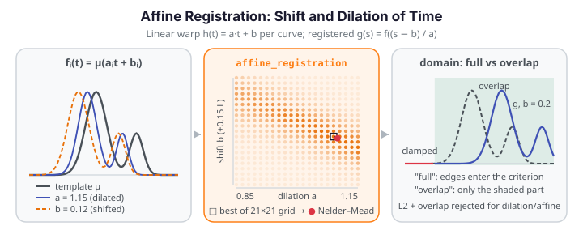

# Affine Registration

Some phase variability is more than a delay but still simple: a movement performed at a different **tempo**, a growth process that runs faster in one subject, a recording sampled with a clock that drifts linearly. A single shift cannot capture a change of speed, and a fully elastic warp is far more flexible than needed. `affine_registration` fits the two-parameter warp in between, a **shift plus a dilation of time** per curve, $h_i(t) = a_i t + b_i$, and estimates a common template at the same time. It follows R's fdacluster and reproduces its reference results.

{ .fdars-diagram }

Left: a template $\mu$ and two copies, one dilated ($a = 1.15$) and one shifted ($b = 0.12$). Middle: the least-squares criterion over the coarse $21 \times 21$ grid of $(a, b)$ values (darker is lower), with the best grid point refined by Nelder–Mead. Right: the two domain options; with `"overlap"` only the shaded part, observed by both curves, enters the criterion.

---

## The model

The data model and the registration are

$$
x_i(t) = \mu(a_i t + b_i) \qquad\Longrightarrow\qquad \tilde x_i(s) = x_i\!\left(\frac{s - b_i}{a_i}\right) = \mu(s),
$$

so `affine_registration` returns `dilations` $a_i$ and `shifts` $b_i$ (in `argvals` units) of the data warp, and the registered curves $\tilde x_i$. The dilation acts **about $t = 0$**: on a domain like $[1, 18]$ (ages), changing $a$ also moves features a long way, so shift and dilation become strongly coupled. Re-express time to start at 0 (pass `argvals - argvals[0]`) to keep the two parameters interpretable.

`warp_class` restricts the family:

| `warp_class` | Warp | Free parameters per curve |
|---|---|---|
| `"none"` | identity | 0 (only the template is estimated) |
| `"shift"` | $t + b$ | 1 |
| `"dilation"` | $a\,t$ | 1 |
| `"affine"` (default) | $a\,t + b$ | 2 |

The parameters are bounded: $a \in [1 - \texttt{max\_dilation},\, 1 + \texttt{max\_dilation}]$ and $|b| \le \texttt{max\_shift} \cdot L$ with $L$ the domain length (both default 0.15).

### Criteria and domains

`metric` sets the distance between a registered curve and the template:

| `metric` | Distance $d(\tilde x_i, \mu)$ | Invariant to |
|---|---|---|
| `"l2"` (default) | $\sqrt{\int (\tilde x_i - \mu)^2}$ | — |
| `"normalized_l2"` | $\sqrt{\int (\tilde x_i - \mu)^2} \,/\, (\lVert\tilde x_i\rVert + \lVert\mu\rVert)$ | — (bounded by 1) |
| `"pearson"` | $\tfrac12 \bigl\lVert \tilde x_i/\lVert\tilde x_i\rVert - \mu/\lVert\mu\rVert \bigr\rVert$ (uncentred) | amplitude scale of $\tilde x_i$, but **not** vertical offsets |

`domain="full"` compares on the whole `argvals` grid, with the uncovered edge filled by `extrapolation` (as for [shift registration](shift-registration.md#mathematical-framework)); `domain="overlap"` interpolates both curves onto $m$ equispaced points of the interval observed by both and compares them there (fdacluster's behaviour). Plain `"l2"` on the overlap is **rejected** for dilation and affine warps: shrinking the curve shrinks the overlap and therefore the criterion, so the optimiser could win by squeezing. Use `"normalized_l2"` or `"pearson"` there.

### The optimiser

For each curve and iteration:

1. **One-parameter classes** (`"shift"`, `"dilation"`): evaluate a grid of `grid_size` (default 21) values, then refine the best one by golden-section search.
2. **Affine**: evaluate a `grid_size` × `grid_size` grid over $(a, b)$, then refine by Nelder–Mead projected onto the box of bounds, to relative tolerance `optim_tol`.

Then the template is re-estimated as the mean of the registered curves and, with `center_warps=True` (default), the warps are **centred** to mean dilation 1 and mean shift 0, so the template does not drift. The loop stops when the parameters change by less than `tol` or after `max_iter` iterations. A fixed `template` (an array, or a callable applied to the registered curves) skips re-estimation and centring.

---

## Recovering known tempo and offset

Twenty curves $x_i(t) = \mu(a_i t + b_i)$ with $a_i \in [0.9, 1.1]$ and $b_i \in [-0.05, 0.05]$. With the true template the parameters are recovered to better than $10^{-3}$; with the re-estimated template they are recovered up to the common frame fixed by centring (one global affine map), which shows as correlations of essentially 1.

```python exec="1" source="above" result="text"
import numpy as np
from fdars import alignment as A

rng = np.random.default_rng(2)
n, m = 20, 101
t = np.linspace(0, 1, m)
mu = lambda s: np.exp(-(s - 0.4) ** 2 / 0.008) + 0.7 * np.exp(-(s - 0.65) ** 2 / 0.006)
a = rng.uniform(0.9, 1.1, n)
b = rng.uniform(-0.05, 0.05, n)
X = np.array([mu(ai * t + bi) for ai, bi in zip(a, b)])

fixed = A.affine_registration(X, t, template=mu(t))
print(f"fixed template: max |a_hat - a| = {np.abs(fixed['dilations'] - a).max():.1e}, "
      f"max |b_hat - b| = {np.abs(fixed['shifts'] - b).max():.1e}")

est = A.affine_registration(X, t)                       # template re-estimated, warps centred
print(f"estimated template: corr(a_hat, a) = {np.corrcoef(est['dilations'], a)[0, 1]:.6f}, "
      f"corr(b_hat, b) = {np.corrcoef(est['shifts'], b)[0, 1]:.6f}; "
      f"mean a_hat = {est['dilations'].mean():.3f}, mean b_hat = {est['shifts'].mean():+.1e}")

ratio = lambda R: np.var(R, 0).mean() / np.var(X, 0).mean()
for wc in ("none", "shift", "dilation", "affine"):
    R = A.affine_registration(X, t, warp_class=wc)["registered_data"]
    print(f"warp_class={wc!r:11s} variance after/before = {ratio(np.asarray(R)):.3f}")
print("FDARS_FENCE_OK")
```

Both one-parameter classes leave about 6 % of the variance: each explains only part of a warp that has two parameters. The affine class removes it entirely.

---

## Amplitude differences: choose the criterion

If the curves also differ in overall size, the $L^2$ criteria try to fix the size mismatch by warping. The Pearson criterion compares unit-normalised curves, so it is blind to scale and recovers the warp regardless (it is uncentred, so it is *not* blind to a vertical offset):

```python exec="1" source="above" result="text"
import numpy as np
from fdars import alignment as A

rng = np.random.default_rng(2)
n, m = 20, 101
t = np.linspace(0, 1, m)
mu = lambda s: np.exp(-(s - 0.4) ** 2 / 0.008) + 0.7 * np.exp(-(s - 0.65) ** 2 / 0.006)
a = rng.uniform(0.9, 1.1, n)
b = rng.uniform(-0.05, 0.05, n)
scale = rng.uniform(0.5, 2.0, n)                         # amplitude varies 4-fold
Y = np.array([s * mu(ai * t + bi) for s, ai, bi in zip(scale, a, b)])

for metric in ("l2", "normalized_l2", "pearson"):
    r = A.affine_registration(Y, t, template=mu(t), metric=metric)
    print(f"metric={metric!r:16s} max |a_hat - a| = {np.abs(r['dilations'] - a).max():.4f}, "
          f"max |b_hat - b| = {np.abs(r['shifts'] - b).max():.4f}")
print("FDARS_FENCE_OK")
```

With a fixed template the two $L^2$ criteria mis-estimate the dilation by up to 0.13–0.18 (most of the allowed range), while Pearson is exact. The same logic motivates the scale-free criterion of [continuous registration](continuous-registration.md).

---

## Clustering with affine warps

The same machinery powers `fdars.clustering.align_cluster_fd(warp_class=...)`: a k-means loop in which each cluster has its own template and every curve is registered to the template of its cluster before the distances are computed. The linear-warp options are passed with an `affine_` prefix (`affine_metric`, `affine_domain`, `affine_grid_size`, …, plus `max_dilation`, `max_shift`, `center_warps`).

```python exec="1" source="above" result="text"
import time
import numpy as np
from fdars.clustering import align_cluster_fd

rng = np.random.default_rng(5)
n, m = 24, 101
t = np.linspace(0, 1, m)
two_bumps = lambda s: np.exp(-(s - 0.4) ** 2 / 0.008) + 0.7 * np.exp(-(s - 0.65) ** 2 / 0.006)
one_bump = lambda s: np.exp(-(s - 0.5) ** 2 / 0.02)
label = np.repeat([0, 1], n // 2)
X = np.array([(two_bumps if g == 0 else one_bump)(rng.uniform(0.9, 1.1) * t + rng.uniform(-0.05, 0.05))
              + 0.02 * rng.standard_normal(m) for g in label])

for wc in ("none", "affine", "elastic"):
    t0 = time.perf_counter()
    r = align_cluster_fd(X, t, k=2, warp_class=wc)
    cl = np.asarray(r["cluster"])
    acc = max((cl == label).mean(), (cl != label).mean())
    print(f"warp_class={wc!r:10s} accuracy {acc:.3f}   {time.perf_counter() - t0:6.2f} s")
print("FDARS_FENCE_OK")
```

Without alignment the tempo variation blurs the two shapes and a few curves land in the wrong cluster. Affine and elastic warps both separate the groups perfectly here, but the affine run is more than twenty times faster, and it returns interpretable per-curve `dilations` and `shifts`. Note that `align_cluster_fd` uses a single random start (`seed`); rerun with several seeds when the clusters are less clear-cut.

---

## API reference

```python
from fdars import alignment as A

r = A.affine_registration(
    data, argvals,
    warp_class="affine",      # "none" | "shift" | "dilation" | "affine"
    template=None,            # None/"mean" (re-estimated), an array (m,), or callable(registered) -> (m,)
    metric="l2",              # "l2" | "normalized_l2" | "pearson"
    domain="full",            # "full" | "overlap"
    extrapolation="boundary", # "boundary" | "linear" | "periodic" | "zeros"
    max_dilation=0.15, max_shift=0.15, grid_size=21,
    max_iter=20, tol=1e-6, center_warps=True, optim_tol=1e-10,
)
X_new = A.affine_warp_curves(data, argvals, dilations, shifts, extrapolation="boundary")
```

| Key | Description |
|---|---|
| `registered_data` | $(n, m)$ registered curves $x_i((s - b_i)/a_i)$ |
| `dilations`, `shifts` | $(n,)$ estimated $a_i$, $b_i$ (shifts in `argvals` units) |
| `template` | $(m,)$ final template |
| `distances` | $(n,)$ criterion value of each curve at the optimum |
| `n_iter`, `converged` | template iterations and convergence flag |

`affine_warp_curves` applies known warps with the same convention: it computes $x_i((s - b_i)/a_i)$, so passing the estimated `dilations` and `shifts` reproduces `registered_data`.

---

## When to use it, and when not

**Use affine registration** when the phase is a delay plus a uniform change of speed: tempo differences in movements or speech, linear clock drift, processes that run faster in some subjects. It is cheap (a few milliseconds for 20 curves), has two interpretable parameters per curve, and keeps the template from drifting.

**Do not use it** when the timing distortion varies along the domain (early in one segment, late in the next): then the residual phase stays in the registered curves. Move to [continuous](continuous-registration.md) or [elastic](elastic-alignment.md) registration. The [method chooser](choosing-a-method.md#same-data-five-methods) quantifies the trade-off: affine is best on shift and affine data and is beaten only on smooth non-linear warps.

Pitfalls:

- **Dilation about $t = 0$** couples shift and dilation on domains far from 0.
- **Bounds.** The defaults allow ±15 % tempo and ±15 % of the domain as offset; estimates at a bound mean the bound is too tight (or the model is wrong).
- **Edges.** With `domain="full"` the extrapolated edge enters the criterion; with `"overlap"`, pick `"normalized_l2"` or `"pearson"`.

## See also

- [Shift Registration](shift-registration.md) — the one-parameter special case with Newton and landmark estimators.
- [Continuous Registration](continuous-registration.md) — smooth non-linear warps with a scale-free criterion.
- [Elastic Clustering](../analyze/elastic-clustering.md) — `align_cluster_fd` and other alignment-aware clustering.
- [Choosing an Alignment Method](choosing-a-method.md).

## References

- Sangalli, L.M., Secchi, P., Vantini, S., Vitelli, V. (2010). k-mean alignment for curve clustering. *Computational Statistics & Data Analysis* 54(5):1219–1233. (Joint clustering and affine alignment, the model behind fdacluster.)
- Ramsay, J.O., Silverman, B.W. (2005). *Functional Data Analysis*, 2nd ed., ch. 7. Springer.
