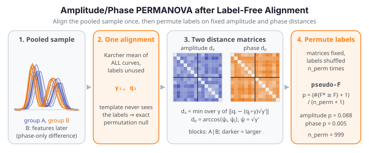
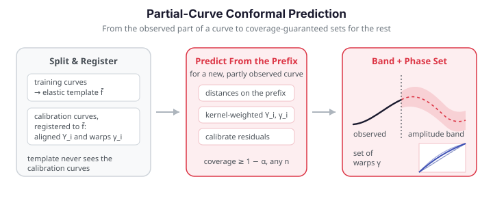

# Inference after Alignment

Once curves are registered, the usual questions come back with a twist: *do two groups differ, and is the difference in amplitude or in timing? Which curves are unusual, and in which way? How uncertain is the mean shape? What will the rest of this half-observed curve look like?* This page collects the tools in fdars that answer them on top of an elastic alignment, and the one rule that makes their answers valid.

{ .fdars-diagram }

Align the pooled sample once, then permute labels on fixed amplitude and phase distances.

---

## The golden rule: align without the labels

Alignment is itself an estimate, and it is estimated from the data. If you align each group to its **own** template and then compare the groups, the registration has already used the group labels: each group's curves are pulled towards its own mean, which exaggerates between-group differences in amplitude and erases them in phase. A permutation test on such data is not valid, because relabelling the curves does not reproduce the alignment step.

**Align the pooled sample once, ignoring the labels; then compare the groups on the aligned data.** Every statistic below that depends on alignment does this internally.

---

## Testing for amplitude and phase differences

`elastic_phase_amplitude_test(data, argvals, labels, n_perm=999, amplitude_metric="pairwise", joint=True)`:

1. aligns all curves jointly to the elastic Karcher mean, **without** the labels;
2. computes two $n \times n$ distance matrices: the **amplitude** distance $d_A(i,j) = \inf_\gamma \lVert q_i - (q_j\circ\gamma)\sqrt{\gamma'}\rVert$ (pairwise elastic distance; `amplitude_metric="template_aligned"` uses the cheaper $L^2$ distance between the template-aligned SRSFs instead) and the **phase** distance $d_P(i,j) = \arccos\langle\psi_i, \psi_j\rangle$ between the warps ($\psi = \sqrt{\gamma'}$); with `joint=True` also $d_J^2 = d_A^2/\overline{d_A^2} + d_P^2/\overline{d_P^2}$;
3. runs a one-way PERMANOVA (Anderson 2001) on each matrix: pseudo-$F = \dfrac{SS_A/(k-1)}{SS_W/(N-k)}$ and the permutation p-value $(\#\{F^* \ge F\} + 1)/(n_{\text{perm}} + 1)$.

The distance matrices depend only on the unlabelled sample, so permuting the labels with the matrices held fixed gives the exact conditional null distribution. Each result (`amplitude`, `phase`, `joint`) reports `statistic`, `p_value`, `r_squared`, the sums of squares and degrees of freedom; the distance matrices and the full alignment are returned too. The generic `fdars.inference.permanova(dist, labels)` runs PERMANOVA on any distance matrix ([Functional Inference](../inference/functional-inference.md#permanova-on-a-distance-matrix)).

!!! note "Reading the p-values"
    PERMANOVA detects any difference in distribution of the distances: a shift of the group centres, and, with unequal group sizes, also a difference in spread. The amplitude and phase p-values use the same permutations, so they are not independent, and no multiplicity correction is applied. With two equal groups the smallest attainable p-value is $2/(n_{\text{perm}}+1)$.

### Example: phase-only differences, and why noise matters

Two groups of 15 curves; group 2 has systematically later features (a phase difference only), and every curve carries random amplitude scaling and white noise. Over several simulated data sets, how often does each test reject at the 5 % level?

```python exec="1" source="above" result="text"
import numpy as np
from docs_fig import fast
from fdars import alignment as A

m = 101
t = np.linspace(0, 1, m)
mu = lambda s: np.exp(-(s - 0.35) ** 2 / 0.008) + 0.7 * np.exp(-(s - 0.68) ** 2 / 0.01)

def simulate(seed):
    rng = np.random.default_rng(seed)
    X, labels = [], []
    for g in (0, 1):
        for _ in range(15):
            c = rng.normal(0.3 * g, 0.15)                       # group 1: later features
            X.append(rng.uniform(0.85, 1.15) * mu(t + c * t * (1 - t)) + 0.01 * rng.standard_normal(m))
            labels.append(g)
    return np.array(X), np.array(labels)

n_sets = fast(10, 4)
rej = {"raw": np.zeros(2), "pre-smoothed": np.zeros(2)}
for seed in range(n_sets):
    X, labels = simulate(seed)
    for name, D in (("raw", X), ("pre-smoothed", np.asarray(A.srsf_presmooth(X, t, smoothing="box", passes=5)))):
        r = A.elastic_phase_amplitude_test(D, t, labels, n_perm=199, joint=False)
        rej[name] += [r["amplitude"]["p_value"] < 0.05, r["phase"]["p_value"] < 0.05]
for name, v in rej.items():
    print(f"{name:13s} rejection rate: amplitude {v[0] / n_sets:.2f}  phase {v[1] / n_sets:.2f}   ({n_sets} data sets)")
print("FDARS_FENCE_OK")
```

The phase test detects the timing difference. On the **raw** curves the amplitude test also rejects far more often than 5 %, although the groups do not differ in amplitude at all: noise in the SRSF interacts with the warps (a stretched stretch of curve has its derivative noise rescaled), so curves warped more strongly look slightly different in amplitude. Light pre-smoothing (`srsf_presmooth`, a few box-filter passes) removes this leak and keeps the phase test's power. Heavy smoothing does the opposite: it flattens the features until the timing difference is hard to see (25 passes on these 101-point curves cut the phase rejection rate by half). Smooth just enough to tame the derivative noise; a finer grid helps too.

---

## Elastic box plots

The **elastic functional box plots** of Xie, Kurtek, Bharath & Sun (2017) (ports of fdasrsf `ampbox` / `phbox`) summarise amplitude and phase separately, after aligning the sample to its Karcher **median**:

- **Amplitude box plot** (`amplitude_boxplot_from_aligned`): distances $\lVert q_{\text{median}} - q_i\rVert$ between aligned SRSFs; the 50 % and $(1-\alpha)$ central regions are the closest $\lceil n/2\rceil$ and $\operatorname{round}(n(1-\alpha))$ curves; the quartile curves Q1/Q3 are chosen inside them to be far from the median in opposite directions; whiskers extend them by `k_a` × the inter-quartile distance; curves beyond the whisker distance are outliers.
- **Phase box plot** (`elastic_phase_boxplot`): the same construction on warps, in the Fisher–Rao geometry of $\psi = \sqrt{\gamma'}$, around the Karcher median warp (Weiszfeld steps); distances are shooting-vector lengths.
- **`elastic_boxplots(data, argvals)`** does the alignment and both plots; its `model.classify(new_data, argvals)` aligns new curves to the template and assigns each to a region (level 1 = inside the 50 % region, 2 = inside the $(1-\alpha)$ region, 3 = within the whiskers, 4 = outlier) and a side (Q1 or Q3), separately for amplitude and phase.

```python exec="1" source="above" result="text"
import numpy as np
from fdars import alignment as A

rng = np.random.default_rng(7)
n, m = 30, 101
t = np.linspace(0, 1, m)
mu = lambda s: np.exp(-(s - 0.35) ** 2 / 0.008) + 0.7 * np.exp(-(s - 0.68) ** 2 / 0.01)
X = np.array([rng.uniform(0.9, 1.1) * mu(t + rng.uniform(-0.3, 0.3) * t * (1 - t))
              + 0.005 * rng.standard_normal(m) for _ in range(n)])
X[4] = mu(t ** 3)                                            # timing outlier: features much later
X[11] = mu(t) + 0.6 * np.exp(-(t - 0.52) ** 2 / 0.004)       # shape outlier: an extra bump

b = A.elastic_boxplots(X, t)
print("amplitude box plot outliers:", [int(i) for i in b["amplitude"]["outlier_indices"]])
print("phase box plot outliers:    ", [int(i) for i in b["phase"]["outlier_indices"]])

new = np.array([mu(t ** 3), mu(t), mu(t) + 0.6 * np.exp(-(t - 0.52) ** 2 / 0.004)])
c = b["model"].classify(new, t)
print("new curves (late / typical / extra bump):")
print("  amplitude regions", [int(v) for v in c["amplitude"]["regions"]], "  phase regions", [int(v) for v in c["phase"]["regions"]])
print("FDARS_FENCE_OK")
```

Each outlier is flagged by the box plot of its own kind: the extra bump in amplitude, the late curve in phase. New curves are classified the same way: the late curve lands in phase region 4 (outlier) and amplitude region 3 (within the whiskers), the extra-bump curve in amplitude region 4, and the typical curve inside the central regions. The phase whiskers are long: the late curve's phase distance is about twice the next largest, yet only just beyond the whisker; lower `k_a` for a stricter phase fence.

**Band-depth phase box plot.** `phase_boxplot(gammas, argvals, factor=1.5)` is a different, simpler construction: it ranks the warps by **modified band depth** (López-Pintado & Romo 2009) as ordinary functions on $[0,1]$, takes the deepest as the median and the 50 % deepest as the central region, and flags warps outside the fences central band ± `factor` × its width. It works in the Euclidean geometry of $\gamma$, not the Fisher–Rao geometry of the elastic phase box plot; `phase_boxplot_classify` classifies new warps (levels 1, 3, 4).

---

## Elastic depth and outlier detection

**`elastic_depth(data, argvals)`** returns, for every curve, an amplitude depth and a phase depth computed from the pairwise amplitude and phase distance matrices,

$$
D_i = \frac{1}{1 + \frac{1}{n-1}\sum_{j \ne i} d_{ij}},
$$

and their geometric mean `combined_depth`. (The crate documentation calls this a lens depth; it is an inverse-mean-distance depth. Amplitude and phase distances live on different scales, so the geometric mean weighs them unevenly: compare amplitude and phase depths separately.) Cost: two $O(n^2)$ pairwise-alignment matrices.

**`elastic_outlier_detection(data, argvals, threshold_method="tukey", tukey_k=1.5)`** (fdasrvf `outlier.detection`) computes each curve's elastic distance to a robust reference, the Karcher **median** by default (`use_median=True`), and flags curves whose distance exceeds a threshold:

- `threshold_method="tukey"` (default): $Q_3 + k\cdot\mathrm{IQR}$ of the distances (`tukey_k`, default 1.5);
- `threshold_method="quantile"`: the empirical $(1-\alpha)$ quantile, which flags about $\alpha n$ curves in **any** sample: a screening rule, not a test.

The elastic distance is invariant to warping, so the threshold catches **shape** outliers only. The result also reports `amplitude_distances` and `phase_distances` to the reference; fence the phase distances yourself to catch timing outliers:

```python exec="1" html="1" source="above"
import numpy as np
from docs_fig import fig, render
from fdars.alignment import elastic_outlier_detection

rng = np.random.default_rng(7)
n, m = 28, 120
t = np.linspace(0, 1, m)
base = np.exp(-((t - 0.5) ** 2) / (2 * 0.12 ** 2))
data = np.array([rng.normal(1, 0.05) * np.interp(
    t, np.clip(t + rng.normal(0, 0.03), 0, 1), base) for _ in range(n)])
data[3] *= 1.8                                         # amplitude (shape) outlier
data[7] = np.interp(t, np.clip(t - 0.18, 0, 1), base)  # phase (timing) outlier

out = elastic_outlier_detection(data, t, threshold_method="tukey", tukey_k=1.5)
amp = np.asarray(out["amplitude_distances"])
pha = np.asarray(out["phase_distances"])

def fence(x, k=2.0):                                   # Tukey upper fence on each component
    q1, q3 = np.percentile(x, [25, 75]); return q3 + k * (q3 - q1)
fa, fp = fence(amp), fence(pha)
amp_out = np.where(amp > fa)[0]
pha_out = np.where(pha > fp)[0]

f, ax = fig()
ax.scatter(amp, pha, s=26, color="#adb5bd", zorder=2)
ax.axvline(fa, color="#3f51b5", ls="--", lw=1, label="amplitude fence")
ax.axhline(fp, color="#e8710a", ls="--", lw=1, label="phase fence")
for i in amp_out:
    ax.scatter(amp[i], pha[i], s=70, color="#3f51b5", zorder=3)
    ax.annotate(f"{i} · shape", (amp[i], pha[i]), (6, 4), textcoords="offset points", fontsize=8, color="#3f51b5")
for i in pha_out:
    ax.scatter(amp[i], pha[i], s=70, color="#e8710a", zorder=3)
    ax.annotate(f"{i} · timing", (amp[i], pha[i]), (6, -11), textcoords="offset points", fontsize=8, color="#e8710a")
ax.set(title="Outlier type: amplitude (shape) vs phase (timing)", xlabel="amplitude distance", ylabel="phase distance")
ax.legend(fontsize=8)
print(render(f))
print(f"<p>built-in (total elastic distance) flags: {[int(i) for i in out['outlier_indices']]}; "
      f"amplitude fence: {[int(i) for i in amp_out]}; phase fence: {[int(i) for i in pha_out]}</p>")
```

The built-in threshold flags the shape outlier (curve 3) and one borderline curve, but not the timing outlier: curve 7 has a large phase distance but an ordinary amplitude distance, and is found only by fencing the phase distances. The reference median is estimated with the outliers included, which can mask a cluster of similar outliers.

---

## Uncertainty of the mean shape

`shape_confidence_interval(data, argvals, n_bootstrap=200, confidence_level=0.95)` bootstraps the elastic Karcher mean: it resamples the curves, computes each resample's Karcher mean, **aligns** it to the full-sample mean (otherwise leftover phase would inflate the band) and reports pointwise percentile bands `lower_band` / `upper_band` and the `bootstrap_means`. The bands are **pointwise**, not simultaneous, and come with no formal coverage guarantee; the cost is `n_bootstrap` Karcher means. For curves in $\mathbb{R}^d$, `curve_shape_confidence_interval` offers a geodesic bootstrap radius and fdasrvf's model-based region ([Shapes of Curves in R^d](curve-shapes.md#confidence-regions-for-the-mean-shape)). For posterior bands on warps and template, see [Bayesian Alignment](bayesian-alignment.md).

---

## Clustering without choosing $k$: elastic DP-means

`elastic_dpmeans(data, argvals, penalty=None)` (port of fdasrsf `kmeans.dpmeans_align`) is the small-variance limit of a Dirichlet-process mixture in the elastic metric (Kulis & Jordan 2012). Each pass aligns every curve to every template, and a curve whose elastic distance to all templates exceeds the `penalty` $\lambda$ opens a **new cluster**; empty clusters are dropped, warps are centred, and templates are the mean aligned SRSFs. The objective is $\sum_i d_i^2 + \lambda^2 K$. The number of clusters is therefore set by $\lambda$, a **distance scale**: a curve farther than $\lambda$ from every template starts its own cluster.

```python exec="1" source="above" result="text"
import numpy as np
from fdars import alignment as A

rng = np.random.default_rng(3)
m = 101
t = np.linspace(0, 1, m)
shapes = [lambda s: np.exp(-(s - 0.5) ** 2 / 0.01),
          lambda s: np.exp(-(s - 0.35) ** 2 / 0.006) + np.exp(-(s - 0.68) ** 2 / 0.006),
          lambda s: np.exp(-(s - 0.3) ** 2 / 0.006) - 0.6 * np.exp(-(s - 0.7) ** 2 / 0.006)]
X, label = [], []
for k, f in enumerate(shapes):                      # 3 shapes x 10 curves, random warps and scales
    for _ in range(10):
        X.append(rng.uniform(0.8, 1.2) * f(t + rng.uniform(-0.4, 0.4) * t * (1 - t)) + 0.01 * rng.standard_normal(m))
        label.append(k)
X, label = np.array(X), np.array(label)

D = np.asarray(A.elastic_self_distance_matrix(X, t))
same = label[:, None] == label[None, :]
print(f"within-shape distances: 95th percentile {np.percentile(D[same & (D > 0)], 95):.2f};"
      f"  between-shape: 5th percentile {np.percentile(D[~same], 5):.2f}")
for penalty in (None, 0.5, 0.8, 2.0):
    r = A.elastic_dpmeans(X, t, penalty=penalty)
    purity = sum(np.bincount(label[r["labels"] == c]).max() for c in np.unique(r["labels"])) / len(label)
    print(f"penalty={str(penalty):5s} (used {r['penalty']:.2f}): k = {r['k']}, purity {purity:.2f}")
print("FDARS_FENCE_OK")
```

Any penalty between the typical within-cluster distance and the typical between-cluster distance recovers the three shapes. Too small a penalty splits clusters (with $\lambda = 0.5$ some curves sit farther than that from their own template), too large a penalty merges everything into one. With `penalty=None` a seeded k-means++ heuristic picks it; it worked here, but on small samples it can be far too small, so read the scale off the distance matrix as above. The result depends on the order of the sweep. For a fixed number of clusters see `align_cluster_fd` and the other methods on [Elastic Clustering](../analyze/elastic-clustering.md).

---

## Predicting the rest of a partially observed curve

When a new curve has been observed only up to time $s$ (or on fragments, or at scattered points), **partial-curve conformal prediction** (Wang, Kurtek & Zhang 2026) predicts the registered version of the *complete* curve with finite-sample guarantees:

- an **amplitude band** $I_t$ with $P\bigl(Y_{n+1}(t) \in I_t\bigr) \ge 1 - \alpha$ for every $t$ (`band="pointwise"`), or for all $t$ simultaneously (`band="simultaneous"`), where $Y_{n+1}$ is the new curve aligned to the template;
- a **phase set** $I_\gamma$ with $P(\gamma^*_{n+1} \in I_\gamma) \ge 1 - \alpha$ for the warp that registers the complete curve (`prediction.phase_set_contains(gamma)` tests membership exactly).

The reference curves are split into a training part, which only estimates an elastic template, and a calibration part, which is registered to it; responses are predicted by Nadaraya–Watson weighting of calibration curves whose observed part resembles the new curve's. The guarantees need exchangeable curves, an observation pattern independent of the curves, and a template independent of the calibration curves.

{ .fdars-diagram }

The functions are `partial_conformal_fit`, `partial_conformal_predict`, `partial_conformal_predict_observed` (prefix, fragments or sparse times) and `partial_conformal_select_bandwidth` in `fdars.conformal`; the full walk-through with a coverage check is on [Partial-Curve Conformal Prediction](../regression/partial-conformal.md).

---

## Other inference built on alignment

- **Conformal elastic regression.** `conformal_elastic_regression` and `conformal_elastic_pcr` (`fdars.conformal`) wrap elastic scalar-on-function regression in split conformal intervals. Test and calibration curves are aligned with $\lambda = 0$ regardless of the fitted model's $\lambda$, and a uniform grid is assumed. See [Conformal Prediction](../regression/conformal-prediction.md).
- **Elastic conformal anomaly detection.** `elastic_conformal_anomaly` (`fdars.tolerance`) computes conformal p-values for new curves from amplitude, phase or combined elastic non-conformity scores against a calibration set. See [Outlier Detection](../analyze/outlier-detection.md).
- **Elastic changepoints.** `elastic_changepoint(data, argvals, kind="amplitude" | "phase" | "fpca")` looks for a single change in a time-ordered sample of curves (Tucker & Yarger 2024): a functional CUSUM on the aligned curves (amplitude), on the warps' shooting vectors (phase), or a Hotelling CUSUM on elastic FPCA scores; the p-value comes from permuting the curves with the alignment held fixed, which assumes no serial dependence under the null.

---

## Summary

| Question | Tool | Notes |
|---|---|---|
| Do groups differ, in amplitude or in timing? | `elastic_phase_amplitude_test` | label-free alignment; pre-smooth lightly; p-values coupled |
| Any distance, any grouping | `fdars.inference.permanova` | [Functional Inference](../inference/functional-inference.md#permanova-on-a-distance-matrix) |
| Visual summary, outliers by type | `elastic_boxplots` (+ `classify`) | amplitude and phase separately |
| Simple phase fences | `phase_boxplot` | band depth on $\gamma$, Euclidean |
| Centrality | `elastic_depth` | inverse mean distance; compare components separately |
| Shape outliers | `elastic_outlier_detection` | Tukey on total elastic distance; fence `phase_distances` for timing |
| Uncertainty of the mean | `shape_confidence_interval`, `curve_shape_confidence_interval`, `bayesian_align_group` | pointwise bootstrap; R^d regions; posterior |
| Clusters without fixing $k$ | `elastic_dpmeans` | penalty = distance scale |
| The rest of a partial curve | `partial_conformal_*` | finite-sample amplitude band and phase set |

## See also

- [Elastic Alignment](elastic-alignment.md), [Bayesian Alignment](bayesian-alignment.md).
- [Functional Inference](../inference/functional-inference.md), [Partial-Curve Conformal Prediction](../regression/partial-conformal.md), [Elastic Clustering](../analyze/elastic-clustering.md).

## References

- Anderson, M. J. (2001). A new method for non-parametric multivariate analysis of variance. *Austral Ecology* 26(1), 32–46.
- Xie, W., Kurtek, S., Bharath, K., Sun, Y. (2017). A geometric approach to visualization of variability in functional data. *Journal of the American Statistical Association* 112(519), 979–993.
- López-Pintado, S., Romo, J. (2009). On the concept of depth for functional data. *Journal of the American Statistical Association* 104(486), 718–734.
- Kulis, B., Jordan, M. I. (2012). Revisiting k-means: new algorithms via Bayesian nonparametrics. *Proceedings of the 29th International Conference on Machine Learning (ICML)*.
- Wang, F., Kurtek, S., Zhang, Y. (2026). Joint registration and conformal prediction for partially observed functional data. *Journal of Computational and Graphical Statistics* 35(4), 1537–1547.
- Tucker, J. D., Yarger, D. (2024). Elastic functional changepoint detection of climate impacts from localized sources. *Environmetrics* 35(1), e2826.
