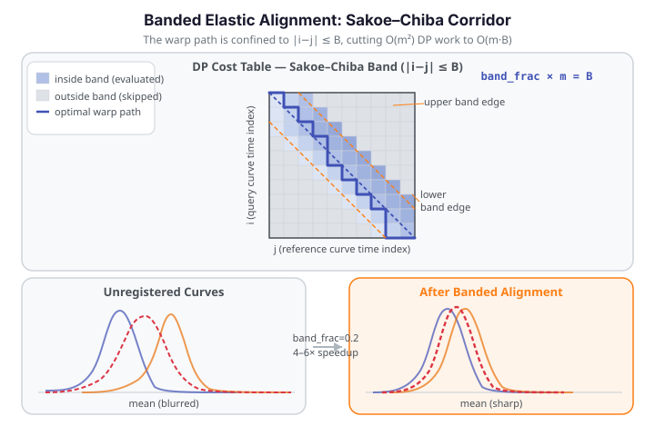

# Banded Elastic Alignment

The elastic dynamic program searches warps over the full $m \times m$ grid of index pairs, which costs $O(m^2)$ per pair of curves. A **Sakoe–Chiba band** restricts the search to a corridor around the diagonal, $|i - j| \le R$ with $R = \lceil \texttt{band\_frac}\cdot m\rceil$, so that the per-pair cost drops to $O(m R)$. For long curves whose phase variation is small compared with the domain, the optimal warp lies inside the band and the result is unchanged.

{ .fdars-diagram }

The diagram shows the DP table: cells inside the diagonal stripe are evaluated, cells outside are skipped, and the warp path has to stay inside the stripe.

The band is one option of the elastic optimiser and is documented with the others on [Elastic Optimisers & Penalties](elastic-optimisers.md#the-band), including how it interacts with RBFGS and a timing/accuracy experiment. This page summarises the practical side.

---

## Two ways to set a band

```python
from fdars import alignment as A

# classic functions
A.karcher_mean_with_band(data, argvals, lambda_=0.0, max_iter=20, tol=1e-4, band_frac=0.2)
A.elastic_self_distance_matrix_with_band(data, argvals, band_frac=0.2)
A.elastic_cross_distance_matrix_with_band(data1, data2, argvals, band_frac=0.2)

# any *_with_config function (DP or RBFGS)
A.karcher_mean_with_config(data, argvals, band_frac=0.2)
A.elastic_align_pair_with_config(f1, f2, argvals, band_frac=0.2, method="rbfgs")
```

`band_frac=None` (in the `*_with_band` functions) or `0.0` (in `*_with_config`) means no band. With the DP optimiser both routes give identical results, and the result dicts have the same keys as `karcher_mean` and the plain distance matrices. The landmark-constrained and curve-shape functions do not accept a band.

---

## What the band does to the model

The band is a **constraint**: the warp can move a time point by at most $R h$ (about `band_frac` of the domain on a uniform grid). Within that constraint the DP is still exact. Therefore:

- If the true displacement is smaller than the band, banded and unbanded results are **identical**, and the band is a free speed-up.
- If it is larger, the warps are clipped at the band edge, residual phase stays in the aligned curves, the Karcher mean blurs, and distances are over-estimated.

Signs of clipping: warps that run along $t \pm$ `band_frac` for a stretch, a variance reduction that drops when the band is narrowed, a mean that changes with `band_frac`.

## Choosing `band_frac`

There is no automatic choice: `band_frac` encodes how far you believe any feature can move. Practical rules:

1. Estimate the largest plausible displacement, for example from an unbanded run on a subsample: `np.abs(gammas - t).max()` (in units of the domain length if $t$ spans $[0, 1]$).
2. Set `band_frac` comfortably above it; check that the mean and the variance reduction do not change when you widen it.
3. If the phase includes a large rigid offset, remove it first with [shift registration](shift-registration.md) and band only the remainder.

The speed-up grows as the band narrows: in the experiment on the optimiser page (20 curves, $m = 201$, displacements up to 0.1), `band_frac=0.1` reproduced the unbanded Karcher mean exactly in a quarter of the time, while `band_frac=0.05` clipped the warps and left 8 % of the variance.

## Worked example: Canadian temperature

Eight stations, 365 days. The warps of an unbanded Karcher mean move points by up to about 19 days, about 5 % of the year; a band of 20 % contains that, a band of 5 % does not.

```python exec="1" source="above" result="text"
import time
import numpy as np
from docs_data import load_canadian_weather
from fdars import alignment as A

day, X, meta = load_canadian_weather("temperature")
rng = np.random.default_rng(7)
Xs = X[rng.choice(X.shape[0], 8, replace=False)]

ref = None
for bf in (None, 0.2, 0.05):
    t0 = time.perf_counter()
    r = A.karcher_mean_with_band(Xs, day, band_frac=bf)
    dt = time.perf_counter() - t0
    ref = r if ref is None else ref
    shift = np.abs(np.asarray(r["gammas"]) - day).max()
    diff = np.abs(np.asarray(r["mean"]) - np.asarray(ref["mean"])).max()
    print(f"band_frac={str(bf):5s} {dt:5.2f} s   max |gamma - t| = {shift:4.1f} days   "
          f"max |mean - unbanded mean| = {diff:.3f} C")

D = np.asarray(A.elastic_self_distance_matrix_with_band(Xs, day, band_frac=0.2))
print(f"banded distance matrix {D.shape}, max asymmetry {np.abs(D - D.T).max():.1e} (upper triangle mirrored)")
print("FDARS_FENCE_OK")
```

With `band_frac=0.2` the mean is unchanged and the run is about twice as fast. At 0.05 the band ($\lceil 0.05\cdot 365\rceil = 19$ days) is right at the size of the largest warp: the largest displacement is cut and the mean moves. Note that `converged` is `False` for these runs at the default `max_iter=20`; raise `max_iter` (the Karcher iteration reports, but does not raise, non-convergence).

## See also

- [Elastic Optimisers & Penalties](elastic-optimisers.md) — DP, DP2, RBFGS, penalties, the λ scale, and the band under RBFGS.
- [Elastic Alignment](elastic-alignment.md) — the unbanded Karcher mean and the SRSF framework.
- [Choosing an Alignment Method](choosing-a-method.md).

## References

- Sakoe, H., Chiba, S. (1978). Dynamic programming algorithm optimization for spoken word recognition. *IEEE Transactions on Acoustics, Speech, and Signal Processing* 26(1):43–49.
- Srivastava, A., Klassen, E. (2016). *Functional and Shape Data Analysis.* Springer.
