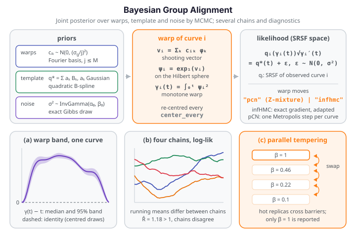

# Bayesian Alignment

Every other aligner in fdars returns **one** warp per curve. That point estimate hides two things you sometimes need to know: how *certain* the timing is (a warp estimated from a flat stretch of curve is not), and whether the data support *several* different alignments (a curve with two similar peaks can be matched either way). Bayesian alignment answers both by sampling the **posterior distribution** of the warps, and of the template, by Markov chain Monte Carlo.

fdars has two samplers: `bayesian_align_pair` for one pair of curves, and `bayesian_align_group`, a port of fdasrsf's `time_warping_bayes` / `time_warping_bayes_infHMC` for a whole sample with a jointly estimated template, several chains, convergence diagnostics and parallel tempering.

{ .fdars-diagram }

Fourier tangent warps, a B-spline template and Gibbs $\sigma^2$; check $\hat R$ across chains, temper if stuck.

---

## Group alignment: the model

`bayesian_align_group(data, argvals, ...)` models the SRSF of each curve, after warping, as a common template plus noise:

$$
q^*(t_j) = q_i\bigl(\gamma_i(t_j)\bigr)\sqrt{\gamma_i'(t_j)} + \varepsilon_{ij}, \qquad \varepsilon_{ij} \sim N(0, \sigma^2) \text{ iid},
$$

where $q_i$ is the SRSF of curve $i$ and $q^*$ the template SRSF. Three blocks of unknowns are sampled jointly:

- **Warps.** Each warp is parametrised on the Hilbert sphere of $\psi = \sqrt{\gamma'}$: $\psi_i = \exp_1(v_i)$, $\gamma_i(t) = \int_0^t \psi_i^2$, with the shooting vector $v_i = \sum_k c_{ik}\phi_k$ in the Fourier tangent basis $\sqrt2\sin(2\pi jt), \sqrt2\cos(2\pi jt)$, $j = 1, \dots, M$ (`n_warp_harmonics`, default 10). The prior is $c_{ik} \sim N\bigl(0, (\sigma_g / j)^2\bigr)$ with $\sigma_g$ = `warp_prior_sd` (default 4), so higher harmonics are shrunk harder.
- **Template.** A quadratic B-spline $q^* = \sum_k a_k B_k$ with `n_template_basis` functions (default 30) and prior $a_k \sim N\bigl(0, (\sigma_q/\lceil k/2\rceil)^2\bigr)$, $\sigma_q$ set from the spread of the observed SRSFs.
- **Noise.** $\sigma^2 \sim \text{InvGamma}(\alpha_0, \beta_0)$ (`alpha0`, `beta0`, default 0.1 each), drawn exactly by a Gibbs step.

Warps and template are only identified up to a common warp; every `center_every` iterations (default 100) the warps are re-centred so that their Karcher mean is the identity, and by default (`center_draws=True`) every retained draw is re-centred exactly before it is summarised. The chains start from the DP alignment (`init_dp=True`; fdasrsf starts at the identity).

### Two samplers

- **`sampler="pcn"`** (default): a Z-mixture preconditioned Crank–Nicolson proposal $c' = \sqrt{1-\beta^2}\,c + \beta\,\xi$, $\xi$ drawn from the prior, with $\beta$ drawn from a mixture (`pcn_betas` = 0.5, 0.5, 0.005, 0.0001 with probabilities `pcn_probs` = 0.1, 0.1, 0.7, 0.1): small steps explore locally, large ones jump. One Metropolis–Hastings step per curve per iteration. Cheap per iteration, but it mixes slowly when the posterior is concentrated.
- **`sampler="infhmc"`**: infinite-dimensional Hamiltonian Monte Carlo (Beskos et al. 2011) for each curve's warp coefficients, with the exact gradient of the SRSF likelihood: the Gaussian prior part of the dynamics is integrated exactly by a rotation, the likelihood enters through half kicks, the number of leapfrog steps is drawn from $1, \dots,$ `hmc_max_leapfrog`, and per-curve step sizes are adapted by dual averaging during burn-in (Hoffman & Gelman 2014). The template is drawn exactly from its Gaussian full conditional. infHMC always restricts warps to $\lVert v\rVert < \pi$ (`injective_warps`). It targets the same posterior as pCN with a much higher effective sample size per iteration.

### Several chains and the diagnostics

With `n_chains = K`, chain $k$ runs with seed `seed + k` (in parallel; results do not depend on the thread count). The result reports:

| Diagnostic | Meaning | Look for |
|---|---|---|
| `rhat_sigma2`, `rhat_log_likelihood`, `rhat_warps` (per curve) | split-$\hat R$ (BDA3 form); a single chain is split into halves | $\le 1.01$–$1.05$ |
| `ess_sigma2`, `ess_log_likelihood`, `ess_warps` | Geyer effective sample size, summed over chains | hundreds or more |
| `mode_spread` (per curve) | largest $L^2$ distance between the chains' mean warps | below about 0.01 |
| `warp_bimodality`, `multimodal_curves` | Sarle's bimodality coefficient of each curve's pooled draws (≈ 1/3 for a Gaussian), flagged above 5/9 | flags = chains in different modes, or a genuinely bimodal warp |
| `chains[k]` | per-chain `log_likelihood_trace`, `sigma2_trace`, `posterior_mean_gammas`, mode, acceptance, `warp_step_sizes`, `swap_acceptance` | a chain whose log-likelihood sits tens of units below the others is in a poor mode |

The summaries are pooled over chains: `gammas` (posterior mean in $\psi$ space), `gammas_median`, pointwise `gammas_lower` / `gammas_upper` at `credible_level`, `aligned_data`, the template (`template`, `template_srsf`, with bands) and $\sigma^2$ (`sigma2_mean`, `_lower`, `_upper`). With `return_draws=True` (default) the draws themselves are returned (`gamma_draws` of shape $(n, \text{draws}, m)$, `template_srsf_draws`, `sigma2_draws`).

---

## Example: reading the diagnostics

Eight noisy two-bump curves with smooth random warps. The posterior is run with infHMC, four chains and four warp harmonics, on the raw curves and on pre-smoothed curves:

```python exec="1" source="above" result="text"
import numpy as np
from docs_fig import fast
from fdars import alignment as A

rng = np.random.default_rng(0)
n, m = 8, 51
t = np.linspace(0, 1, m)
mu = lambda s: np.exp(-(s - 0.35) ** 2 / 0.01) + 0.7 * np.exp(-(s - 0.68) ** 2 / 0.012)
X = np.array([mu(t + rng.uniform(-0.5, 0.5) * t * (1 - t)) + 0.02 * rng.standard_normal(m) for _ in range(n)])
Xs = np.asarray(A.srsf_presmooth(X, t, smoothing="box", passes=25))

def report(label, r):
    ll = [np.mean(c["log_likelihood_trace"]) for c in r["chains"]]           # retained draws
    print(f"{label:30s} Rhat sigma2 {r['rhat_sigma2']:.3f}  loglik {r['rhat_log_likelihood']:.3f}"
          f"  warps(max) {np.max(r['rhat_warps']):.3f}  mode_spread(max) {np.max(r['mode_spread']):.4f}")
    print(f"{'':30s} chain mean log-likelihoods {np.round(ll, 1)}")

common = dict(n_iter=fast(3000, 1500), burn_in=fast(1500, 750), n_chains=4, sampler="infhmc",
              n_warp_harmonics=4, return_draws=False)
report("raw curves", A.bayesian_align_group(X, t, **common))
report("pre-smoothed (box, 25 passes)", A.bayesian_align_group(Xs, t, **common))
print("FDARS_FENCE_OK")
```

On the **raw** curves the chains disagree: $\hat R$ is clearly above 1, `mode_spread` above 0.01, and the chains' average log-likelihoods differ by more than ten units, so they explore different joint modes (some curves aligned to slightly different features, with the template adapted to them). On **pre-smoothed** curves all diagnostics are fine. The reason is the likelihood: it is defined on the SRSF, which differentiates the data, so white noise in the curves becomes rough, heavy-tailed noise in $q$ that creates many small local modes. The crate's documentation recommends modest grids and pre-smoothed curves for exactly this reason.

### pCN or infHMC?

On the pre-smoothed sample, both samplers at the same number of iterations:

```python exec="1" source="above" result="text"
import time
import numpy as np
from docs_fig import fast
from fdars import alignment as A

rng = np.random.default_rng(0)
n, m = 8, 51
t = np.linspace(0, 1, m)
mu = lambda s: np.exp(-(s - 0.35) ** 2 / 0.01) + 0.7 * np.exp(-(s - 0.68) ** 2 / 0.012)
X, H = [], []
for _ in range(n):
    w = t + rng.uniform(-0.5, 0.5) * t * (1 - t)
    X.append(mu(w) + 0.02 * rng.standard_normal(m))
    H.append(np.interp(t, w, t))                                  # true registering warp
X, H = np.array(X), np.array(H)
Xs = np.asarray(A.srsf_presmooth(X, t, smoothing="box", passes=25))
inner = (t > 0.1) & (t < 0.9)

n_iter, burn = fast(3000, 1500), fast(1500, 750)
draws = 4 * (n_iter - burn)
for sampler in ("pcn", "infhmc"):
    t0 = time.perf_counter()
    r = A.bayesian_align_group(Xs, t, n_iter=n_iter, burn_in=burn, n_chains=4, sampler=sampler,
                               n_warp_harmonics=4, return_draws=False)
    G = np.asarray(r["gammas"])
    err = 1000 * np.abs(((G - G.mean(0)) - (H - H.mean(0)))[:, inner]).mean()
    band = (np.asarray(r["gammas_upper"]) - np.asarray(r["gammas_lower"]))[:, inner].mean()
    print(f"{sampler:6s} Rhat loglik {r['rhat_log_likelihood']:.3f}  max Rhat warps {np.max(r['rhat_warps']):.3f}"
          f"  min ESS/draw (warps) {np.min(r['ess_warps']) / draws:.3f}"
          f"  95% band width {band:.4f}  warp error {err:.1f}e-3  ({time.perf_counter() - t0:.1f} s)")
print("FDARS_FENCE_OK")
```

pCN is two to three times faster per iteration, but its slowest-mixing warp has roughly a tenth of infHMC's effective sample size per draw, and its $\hat R$ for the log-likelihood shows it has not converged. infHMC is the better default whenever you report the posterior; use pCN only with long chains and checked diagnostics. Both posterior-mean warps are close to the truth here (the DP point estimate of the same curves has a warp error of about $5\times10^{-3}$).

---

## Multimodality and parallel tempering

infHMC (and, more slowly, pCN) moves **locally**: a chain can settle in a poor, well-separated joint mode and never leave it. The diagnostics above detect this; the principled remedy is **parallel tempering** (Geyer 1991). With `n_temperatures = K > 1`, each chain runs $K$ replicas at inverse temperatures $1 = \beta_0 > \dots > \beta_{K-1} =$ `pt_min_inv_temp`, spaced geometrically ($\beta_k = \beta_{\min}^{k/(K-1)}$). Replica $k$ targets the likelihood raised to $\beta_k$ times the prior, so the hot replicas see a flatter posterior and cross barriers; after every sweep, adjacent replicas swap states with an exact Metropolis–Hastings acceptance. Only the $\beta = 1$ replica is reported, so the posterior is unchanged. The cost is linear in $K$.

`chains[k]["swap_acceptance"]` sizes the ladder: a rate near 0 for a pair of temperatures means the replicas cannot exchange there. The number of temperatures needed grows roughly with $\sqrt{n\,T}$ (the log-likelihood fluctuations grow with the number of observations), so larger problems need longer or narrower ladders.

```python exec="1" source="above" result="text"
import numpy as np
from docs_fig import fast
from fdars import alignment as A

rng = np.random.default_rng(0)
n, m = 8, 51
t = np.linspace(0, 1, m)
mu = lambda s: np.exp(-(s - 0.35) ** 2 / 0.01) + 0.7 * np.exp(-(s - 0.68) ** 2 / 0.012)
X = np.array([mu(t + rng.uniform(-0.5, 0.5) * t * (1 - t)) + 0.02 * rng.standard_normal(m) for _ in range(n)])

common = dict(n_iter=fast(3000, 1000), burn_in=fast(1500, 500), n_chains=4, sampler="infhmc", return_draws=False)
for label, kw in [("no tempering", {}),
                  ("6 temperatures, beta_min 0.1", dict(n_temperatures=6)),
                  ("12 temperatures, beta_min 0.3", dict(n_temperatures=12, pt_min_inv_temp=0.3))]:
    r = A.bayesian_align_group(X, t, **common, **kw)
    ll = [np.mean(c["log_likelihood_trace"]) for c in r["chains"]]           # retained draws
    swaps = r["chains"][0]["swap_acceptance"]
    print(f"{label:30s} Rhat loglik {r['rhat_log_likelihood']:.3f}  chain log-lik spread {np.ptp(ll):5.1f}"
          + (f"  swap rates chain 0: {np.round(swaps, 2)}" if len(swaps) else ""))
print("FDARS_FENCE_OK")
```

The default ladder (6 temperatures down to $\beta = 0.1$) is too coarse for this problem: the swap rates between the coldest replicas are essentially 0, so the $\beta = 1$ chain never receives a state from the hot replicas and tempering cannot help. A narrower, longer ladder (12 temperatures down to 0.3) swaps at rates of about 0.3 throughout and brings the chains much closer together ($\hat R$ 1.09, log-likelihood spread 4 instead of 14), at twelve times the cost. (Here, pre-smoothing fixes the problem more cheaply; tempering is for posteriors that are genuinely multimodal.)

!!! tip "When may a chain be discarded?"
    Only when its log-likelihood is lower by tens of units than that of the other chains *and* the other chains agree with each other: its mode then carries negligible posterior mass (weight about $e^{-\text{gap}}$). If chains split between modes of similar log-likelihood, the posterior itself is multimodal and every mode must be kept.

---

## Calibration: what the bands mean

The crate's own simulation study (data simulated from the model, 5 curves × 31 points) found nominal-95 % pointwise bands to cover the centred warps 0.93–0.96 of the time and the template 0.91–0.95, for infHMC and for long pCN runs. Three caveats remain:

- **$\sigma^2$ is underestimated** when the noise is large (posterior/true ratio 0.90 at SRSF noise 0.1, 0.74 at 0.3), because the likelihood evaluates a linear interpolant of the noisy SRSF at the warped points; warps can lower the residual by "smoothing" the noise. Bands come out slightly narrow.
- **Noise in the curves, not in the SRSF** (the usual case): the SRSF noise is then heteroscedastic, correlated and heavy-tailed where $f' \approx 0$, and warp bands covered only 0.83–0.87. Treat them as approximate; prefer modest grids and pre-smoothed curves.
- **The $\sigma^2$ prior matters when the noise is small:** fdasrsf's $\beta_0 = 0.1$ adds about $2\beta_0/(nT)$ to the posterior $\sigma^2$, which widens the bands (over-coverage). Lower `alpha0` and `beta0` (for example $10^{-6}$) when the SRSF noise is known to be small.

Raw-state bands (`center_draws=False`, fdasrsf's convention) include the non-identified common warp and over-cover (about 0.98).

### Recommended settings

- `sampler="infhmc"`, `n_chains >= 4`; read $\hat R$, ESS, `mode_spread` and `multimodal_curves` together before using the bands.
- Pre-smooth noisy curves (`srsf_presmooth`), and keep $m$ moderate (50–100 points; `n_points` resamples internally).
- Fewer warp harmonics (`n_warp_harmonics` 3–5) when the phase is smooth: fewer parameters, faster mixing.
- Add tempering (`n_temperatures > 1`) when chains disagree on smoothed data; check `swap_acceptance` (aim for roughly 0.2–0.4 between neighbours) and add temperatures or raise `pt_min_inv_temp` if a pair is near 0.
- Increase `n_iter` / `burn_in` until the diagnostics settle; `thin` only saves memory.

---

## Pairwise posterior: `bayesian_align_pair`

For a single pair, `bayesian_align_pair(f1, f2, argvals, n_samples=1000, burn_in=200, step_size=0.1, proposal_variance=1.0, seed=42)` samples the posterior of the warp $\gamma$ that aligns `f2` to `f1`, with likelihood $-\tfrac12\sum_j w_j\bigl(q_{1}(t_j) - (q_2\circ\gamma)(t_j)\sqrt{\gamma'(t_j)}\bigr)^2$ (Simpson weights) and a pCN proposal $v' = \sqrt{1-\beta^2}\,v + \beta\,\xi$ on the tangent space of the $\psi$ sphere ($\beta$ = `step_size`), started from the DP alignment.

!!! note "Limits of the pairwise sampler"
    The noise variance is **fixed at 1**, so the band width depends on the scale of the data (rescale the curves and the band changes). It runs a single chain with no convergence diagnostics, and the credible band is the fixed 2.5 %–97.5 % range of the draws. For calibrated uncertainty use `bayesian_align_group`, which samples the noise variance, runs several chains and reports $\hat R$ and ESS.

```python exec="1" html="1" source="above"
import numpy as np
from docs_fig import fig, render
from fdars.alignment import bayesian_align_pair

t = np.linspace(0, 1, 120)
base = np.exp(-((t - 0.5) ** 2) / (2 * 0.10 ** 2))
f1 = base
f2 = np.interp(t, np.clip(t + 0.08, 0, 1), base)   # phase-shifted target

ba = bayesian_align_pair(f1, f2, t, n_samples=500, burn_in=100, seed=0, step_size=0.85)
f2_aligned = np.asarray(ba["f_aligned_mean"])
gam_lo = np.asarray(ba["credible_lower"])
gam_hi = np.asarray(ba["credible_upper"])
gam_mean = np.asarray(ba["posterior_mean_gamma"])

f, (a1, a2) = fig(ncols=2, figsize=(9.5, 4.0))
a1.plot(t, f1, color="#6c757d", lw=2, label="f1 (reference)")
a1.plot(t, f2, color="#dc3545", lw=1.6, ls="--", label="f2 (original)")
a1.plot(t, f2_aligned, color="#3f51b5", lw=2, label="f2 (aligned)")
a1.set(title=f"Bayesian alignment (accept. {float(ba['acceptance_rate']):.2f})",
       xlabel="t", ylabel="f(t)")
a1.legend(fontsize=8)

a2.fill_between(t, gam_lo, gam_hi, color="#6f42c1", alpha=0.2, label="95% credible")
a2.plot(t, gam_mean, color="#6f42c1", lw=2, label="posterior mean $\\gamma$")
a2.plot([0, 1], [0, 1], color="#6c757d", ls="--", lw=1.2)
a2.set(title="Posterior over the warp", xlabel="t",
       ylabel="$\\gamma(t)$", aspect="equal")
a2.legend(fontsize=8)
print(render(f))
```

The left panel shows the aligned `f2` tracking the reference; the right panel replaces the point-estimate warp with a posterior: the band is the 95 % credible region around the posterior-mean $\gamma$. Where the band hugs the mean, the timing is well determined; where it widens (in the flat tails, where the curves carry no timing information) the data are ambiguous about how much to warp.

| Key | Description |
|-----|-------------|
| `posterior_gammas` | MCMC draws of the warp, shape `(n_samples, m)` |
| `posterior_mean_gamma` | posterior mean warp |
| `credible_lower` / `credible_upper` | pointwise 2.5 % / 97.5 % band on the warp |
| `acceptance_rate` | MCMC acceptance rate; lower `step_size` if it is too low, raise it if too high |
| `f_aligned_mean` | `f2` aligned under the posterior-mean warp |

---

## Parameters of `bayesian_align_group`

| Parameter | Default | Effect |
|---|---|---|
| `n_iter`, `burn_in`, `thin` | 2000, 1000, 1 | chain length, discarded burn-in, thinning |
| `n_chains`, `seed` | 1, 42 | chains (seed + k) |
| `sampler` | `"pcn"` | or `"infhmc"` |
| `alpha0`, `beta0` | 0.1, 0.1 | inverse-gamma prior on $\sigma^2$ |
| `warp_prior_sd`, `n_warp_harmonics` | 4.0, 10 | warp prior scale and Fourier size |
| `n_template_basis` | 30 | template B-splines |
| `n_points` | 0 | internal grid (0 = the input grid; fdasrsf uses 200) |
| `center_every`, `center_draws` | 100, `True` | re-centring of states and of retained draws |
| `credible_level` | 0.95 | pointwise band level |
| `init_dp` | `True` | start from the DP alignment |
| `pcn_betas`, `pcn_probs` | (0.5, 0.5, 0.005, 0.0001), (0.1, 0.1, 0.7, 0.1) | Z-mixture pCN |
| `hmc_step_size`, `hmc_max_leapfrog`, `hmc_adapt`, `hmc_target_accept` | 0.1, 10, `True`, 0.65 | infHMC controls |
| `injective_warps` | `False` | restrict to $\lVert v\rVert < \pi$ (always on for infHMC) |
| `n_temperatures`, `pt_min_inv_temp` | 1, 0.1 | parallel tempering |
| `return_draws` | `True` | `False` drops the large draw arrays |

## When to use it

- **Use it** when you must report uncertainty in the warps or the template, or when you suspect several plausible alignments (similar repeated features).
- **Use a point estimate** ([elastic Karcher mean](elastic-alignment.md)) when you only need registered curves: it is faster and, for well-determined warps, nearly identical to the posterior mean.
- **Cost.** Each iteration updates every warp (pCN: one likelihood evaluation each; infHMC: up to `hmc_max_leapfrog` gradient evaluations), times the number of replicas and chains. The examples above take about a second per run; samples of hundreds of curves on fine grids take much longer.

## See also

- [Elastic Alignment](elastic-alignment.md) — the point-estimate counterpart.
- [Inference after Alignment](alignment-inference.md) — box plots, tests and conformal sets built on aligned data.
- [Uncertainty Quantification](../regression/uncertainty-quantification.md).

## References

- Lu, Y., Herbei, R., Kurtek, S. (2017). Bayesian registration of functions with a Gaussian process prior. *Journal of Computational and Graphical Statistics* 26(4), 894–904.
- Cheng, W., Dryden, I.L., Huang, X. (2016). Bayesian registration of functions and curves. *Bayesian Analysis* 11(2), 447–475.
- Beskos, A., Pinski, F. J., Sanz-Serna, J. M., Stuart, A. M. (2011). Hybrid Monte Carlo on Hilbert spaces. *Stochastic Processes and their Applications* 121(10), 2201–2230.
- Hoffman, M. D., Gelman, A. (2014). The No-U-Turn Sampler: adaptively setting path lengths in Hamiltonian Monte Carlo. *Journal of Machine Learning Research* 15, 1593–1623.
- Geyer, C. J. (1991). Markov chain Monte Carlo maximum likelihood. In *Computing Science and Statistics: Proceedings of the 23rd Symposium on the Interface*, 156–163.
- Gelman, A., Carlin, J. B., Stern, H. S., Dunson, D. B., Vehtari, A., Rubin, D. B. (2013). *Bayesian Data Analysis*, 3rd ed. CRC Press.
