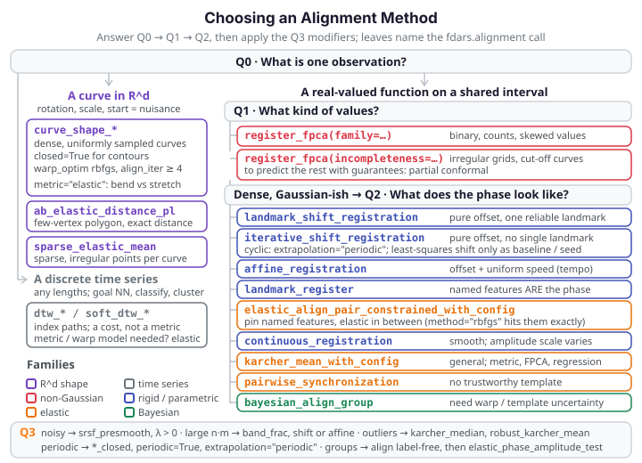
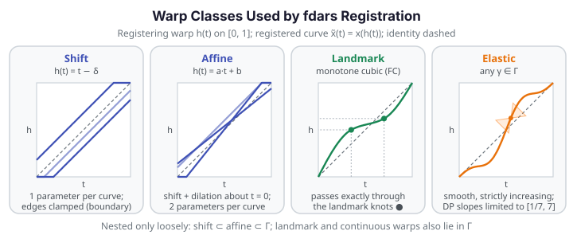

# Choosing an Alignment Method

`fdars.alignment` offers more than a dozen ways to register curves, from one shift per curve to a full posterior over warping functions. They are not interchangeable: each assumes a particular *kind* of phase variability, and each pays for flexibility with variance, cost or interpretability. This page is the map. It asks a few questions about your data, points to the method whose assumptions match, explains why, and lists the traps.

{ .fdars-diagram }

---

## Two questions first

Every registration method splits the variability of a sample into two parts:

- **Amplitude**: how tall or deep the features are.
- **Phase**: *when* the features happen, encoded by a warping function $h_i$ per curve.

Write the registered curve as $\tilde x_i(t) = x_i(h_i(t))$. Methods differ in **which set the warps $h_i$ may come from** and **what criterion picks them**. So before choosing, answer:

1. **What does one observation look like?** A real-valued function on a shared interval, a curve in $\mathbb{R}^d$ whose rotation and size are irrelevant, or a discrete time series that you only want to compare, not model?
2. **What does the phase variability look like?** A constant delay, a delay plus a change of tempo, a few identifiable events, or a smooth but otherwise arbitrary time distortion?

The answer to the second question is a **warp class**. The smaller the class that still contains the true warps, the better: a flexible method fitted to data whose phase is really a shift will "explain" some amplitude noise as phase (over-registration).

{ .fdars-diagram }

The classes are nested only loosely: shift ⊂ affine ⊂ $\Gamma$ (all increasing diffeomorphisms of the interval), and landmark (monotone cubic) and continuous (Ramsay–Li $\int \exp W$) warps are smooth subsets of $\Gamma$. The elastic dynamic program searches a *discretised* $\Gamma$ whose local slopes are limited to $[1/7, 7]$ by default.

---

## The decision tree in words

**Q0. What is one observation?**

- **A curve in $\mathbb{R}^d$** (an outline, a trajectory, handwriting), where rotation, scale or starting point are nuisance: use the shape-space functions `curve_shape_*` (with `closed=True` for contours, and `warp_optim={"method": "rbfgs"}` with `align_iter >= 4` for an accurate reparametrisation). When bending and stretching should cost differently, pass `metric="elastic"` with weights `a`, `b` (planar curves). For small polygons where an exact distance matters, `ab_elastic_distance_pl`. For a few irregularly placed points per curve, `sparse_elastic_align_pair` / `sparse_elastic_mean`. See [Shapes of Curves in R^d](curve-shapes.md) and [Sparse & Irregular Curves](sparse-elastic.md).
- **A discrete time series** (possibly of different lengths) where the goal is nearest-neighbour search, classification or clustering, not a warp model: the DTW family (`dtw_*`, `soft_dtw_*`, the elastic time-series distances in `fdars.metric`). DTW returns a *cost*, not a metric, and it warps amplitude differences away; see [Dynamic Time Warping](dtw.md).
- **A real-valued function on a common interval**: go to Q1.

**Q1. What kind of values?**

- **Binary, counts or positive-skewed** (on/off activity, spike counts): `register_fpca(family="binomial" | "poisson" | "gamma")` registers on the likelihood scale and estimates a generalised FPCA jointly ([Non-Gaussian Registration](expfam-registration.md)).
- **Irregular grids or curves cut off at the start or end**: `register_fpca(incompleteness=...)`; to *predict* the unobserved rest with finite-sample guarantees, the partial-curve conformal tools in `fdars.conformal`.
- **Dense, roughly Gaussian, shared grid**: go to Q2.

**Q2. What does the phase look like?**

| Phase variability | Method | Page |
|---|---|---|
| Pure time offset, one reliable marker | `landmark_shift_registration` | [Shift](shift-registration.md#landmark-shift-registration) |
| Pure time offset, no single marker | `iterative_shift_registration` (`extrapolation="periodic"` for cyclic data); `least_squares_shift_registration` only as a baseline or seed | [Shift](shift-registration.md) |
| Offset plus a uniform change of speed (tempo) | `affine_registration(warp_class="dilation" \| "affine")` | [Affine](affine-registration.md) |
| Named features with known correspondence, and the features *are* the phase | `landmark_register` | [Landmark](landmark-registration.md) |
| Features must be pinned, but the timing between them is free | `elastic_align_pair_constrained_with_config(method="rbfgs")` | [Landmark](landmark-registration.md#landmarks-elastic-between-them) |
| Smooth non-linear phase, classical FDA workflow, amplitude scale varies between curves | `continuous_registration` (`periodic=True` for cyclic data, `r_defaults=True` for R parity) | [Continuous](continuous-registration.md) |
| General non-linear phase; you need a metric, an amplitude/phase split, elastic FPCA or regression | `karcher_mean_with_config` (DP by default; `method="rbfgs"` with a penalty for smooth warps) | [Elastic](elastic-alignment.md), [Optimisers](elastic-optimisers.md) |
| Noisy curves or no trustworthy template; simple, low-dimensional phase | `pairwise_synchronization` (Tang–Müller) | [Pairwise Synchronisation](pairwise-synchronization.md) |
| You must report uncertainty in the warps or the template | `bayesian_align_group` (`sampler="infhmc"`, several chains) | [Bayesian Alignment](bayesian-alignment.md) |

**Q3. Modifiers**, whatever Q2 chose:

- **Noisy curves.** Pre-smooth before any SRSF or derivative-based method (`srsf_presmooth`), and use $\lambda > 0$.
- **Large $n \cdot m$.** A band (`band_frac`), the coarse-to-fine Karcher mean (automatic for $m > 50$), or a cheaper warp class.
- **Outliers.** `karcher_median`, `robust_karcher_mean`; flag them with `elastic_outlier_detection`.
- **Periodic or closed data.** `karcher_mean_closed` / `elastic_align_pair_closed` (elastic), `periodic=True` (continuous), `extrapolation="periodic"` (shift).
- **Groups to compare.** Align *all* curves together without labels, then test with `elastic_phase_amplitude_test` ([Inference after Alignment](alignment-inference.md)).

---

## Comparison table

| Method | Warp class | Criterion | Invariant to | Template | Cost (one pass) | Uncertainty | Typical use |
|---|---|---|---|---|---|---|---|
| `least_squares_shift_registration` | $t-\delta$ | $L^2$ to the raw mean | time translation | fixed raw mean | $O(n\,m\log m)$ per golden-section step | — | quick baseline, seed |
| `iterative_shift_registration` | $t-\delta$ | REGSSE, Newton steps | time translation | re-estimated (or fixed / custom) | $O(\text{iter}\cdot n\,m)$ | — | latency, onset; cyclic data |
| `landmark_shift_registration` | $t-\delta$ | closed form $\tau - t_i$ | time translation | none | $O(n\,m)$ | — | one reliable marker |
| `affine_registration` | $a t + b$ | $L^2$ / normalised $L^2$ / Pearson | shift and dilation (Pearson: also amplitude scale) | re-estimated, centred | grid $G^2$ + Nelder–Mead per curve and iteration | — | tempo plus offset |
| `landmark_register` | monotone cubic | interpolates the landmarks | — | none (target positions) | $O(n\,m)$ | — | interpretable features |
| `elastic_align_pair_constrained_with_config` | elastic between pinned points | SRSF $L^2 + \lambda P$ | reparametrisation between landmarks | pairwise | one DP (+ RBFGS per segment) | — | pinned features, free in between |
| `continuous_registration` | smooth $\int\exp W$ | min-eigenvalue (scale-free) or LS, + roughness | amplitude scale (min-eigenvalue) | given or mean, optional passes | $O(\text{iter}\cdot n_{\text{fine}} K^2)$ per curve | — | classical FDA; periodic |
| `karcher_mean_with_config`, DP | $\Gamma$, slopes $[1/7,7]$ | Fisher–Rao (SRSF $L^2$) $+\lambda P$ | reparametrisation, vertical offset | Karcher mean, centred | $O(\text{iter}\cdot n\, m^2 \cdot 35)$ | `warp_statistics` (pointwise) | default; elastic FPCA, regression |
| same, `nbhd_dim=10, dp_cost="piecewise_linear"` (DP2) | finer $\Gamma$ | same | same | same | ≈ 2–5 × DP | — | lower residual floor, fdasrsf parity |
| same, `method="rbfgs"` | smooth $\Gamma$ | same + roughness / geodesic penalties | same | same | local optimiser seeded by DP | — | smooth warps, exact landmarks |
| same, `band_frac>0` | $\Gamma$ ∩ band | same | same | same | $O(\text{iter}\cdot n\, m R \cdot 35)$ | — | long curves, small phase |
| `karcher_mean_closed` | $\Gamma$ + start-point shift | SRSF $L^2$ | + starting point | Karcher | about $(20 + m/10)$ × DP | — | periodic 1-D signals |
| `curve_shape_*` | $\Gamma$ × rotation × scale (× start point) | arccos on the pre-shape sphere, or $L^2$ | translation, scale, rotation, reparametrisation, start point | Karcher mean or median | `align_iter` × seeds × DP per pair | bootstrap or model-based region, box plot | outlines, trajectories in $\mathbb{R}^d$ |
| same, `metric="elastic"` | as above, planar | $(a,b)$ elastic metric via the F-transform | as above | as above | as above | as above | bending vs stretching weighted |
| `ab_elastic_distance_pl` | monotone matchings | exact $(a,b)$ distance of polygons | translation, reparametrisation | — | $O(N_1^2N_2^2(N_1+N_2))$ | — | small polygons, ground truth |
| `sparse_elastic_*` | closure of $\Gamma$ | polygon-SRV $L^2$ | translation, reparametrisation | spline SRV mean | per curve ∝ points | — | sparse, irregular curves |
| `register_fpca` | monotone B-spline or two-knot inverse warp | exponential-family likelihood + GFPCA | — | subject-specific GFPCA fit | L-BFGS per curve + GFPCA per round | — | binary, count, incomplete curves |
| `pairwise_synchronization` | piecewise linear | penalised pairwise $L^2$ | — | none | $O(n^2)$ pairwise fits | — | noisy samples, template-free |
| `bayesian_align_group` | Fourier tangent warps | posterior | reparametrisation | sampled | MCMC | full posterior, $\hat R$, ESS | warp UQ |
| DTW family | discrete index paths | accumulated cost (no root) | index warping | none | $O(m^2)$ per pair | — | time-series search, classification |

---

## Recommendations, with reasons

1. **Default for dense 1-D functional data: the elastic Karcher mean with DP and $\lambda = 0$, then check the diagnostics.** It is the only family with a proper amplitude metric (Fisher–Rao, invariant to simultaneous reparametrisation), it separates amplitude from phase, and its output feeds `vert_fpca`, `horiz_fpca`, `joint_fpca`, elastic regression and the PERMANOVA test.
2. **Switch to `method="rbfgs"` with `penalty="l2gam"` and $\lambda > 0$ (or `penalty="roughness"`)** when the warps look jagged or pinch, or when landmarks must be hit exactly. DP slopes are quantised and leave a residual floor (about 0.02 in SRSF distance for exactly warped copies); RBFGS is local, but it is seeded by DP and, when penalised, also restarted from the identity. See [Elastic Optimisers](elastic-optimisers.md).
3. **If the phase is a shift, use a shift model.** An elastic warp has hundreds of degrees of freedom and will absorb amplitude noise as phase; the bake-off below shows the elastic warp error is about three times the shift model's on pure-shift data. Iterative shift is interpretable and costs $O(n\,m)$ per iteration. Centre the shifts yourself afterwards: the iterative method does not.
4. **Continuous registration is the right tool when amplitude scale legitimately varies.** Its default min-eigenvalue criterion is zero whenever the registered curve is *proportional* to the target, so it does not warp to fix amplitude, where least-squares and elastic criteria would. Use `r_defaults=True` for results comparable to R `register.fd`; use the default six-basis $W$ only with $\lambda > 0$ (unpenalised, it overfits).
5. **Landmarks first when they exist and are unambiguous.** The warp is interpretable ("age at peak growth velocity"). Detection matches by order, so one spurious peak shifts every pairing after it: always check the detection counts per curve.
6. **Never compute SRSFs of noisy raw data.** The SRSF differentiates the curve. Pre-smooth with `srsf_presmooth(..., smoothing="box", passes=25)` or `smoothing="spline"`; the aligners do *not* smooth for you.
7. **For $\mathbb{R}^d$ outlines use `curve_shape_*`, not the `*_nd_with_config` functions.** The `_nd` aligners share one warp across coordinates but have no rotation or scale quotient, and they normalise each coordinate on its own.
8. **For binary or count curves, `register_fpca` beats aligning `logit(p̂)` or $\sqrt{\text{counts}}$**: it registers on the likelihood scale. Prefer `fpca_type="two_step"` for Gamma and Poisson data, because the variational EM treats them as Gaussian.
9. **For warp uncertainty, use `bayesian_align_group(sampler="infhmc", n_chains>=4)`** and read $\hat R$ and the ESS; add tempering (`n_temperatures>1`) if the multimodality flags fire. Do not trust single pCN chains without diagnostics.
10. **When comparing groups, align all curves together without the labels**, then run `elastic_phase_amplitude_test(amplitude_metric="pairwise")`. Per-group templates break the validity of the permutation test, and noisy curves should be pre-smoothed lightly, or SRSF noise leaks phase differences into the amplitude test ([Inference after Alignment](alignment-inference.md#example-phase-only-differences-and-why-noise-matters)).

---

## Same data, five methods

The claims above can be checked. The block below simulates three samples of 20 noisy two-bump curves whose true phase is, respectively, a **pure shift**, an **affine** warp, and a **smooth non-linear** warp $w(t) = t + c\,t(1-t)$. Each curve also carries ±10 % amplitude scaling and white noise. Five methods register each sample, and the table reports the mean absolute error between the estimated and the true registering warp (on the interior $[0.15, 0.85]$, after removing the common template warp that no method can identify). A `*` marks the best method per column.

```python exec="1" source="above" result="text"
import numpy as np
from fdars import alignment as A

rng = np.random.default_rng(0)
n, m = 20, 101
t = np.linspace(0, 1, m)
mu = lambda s: np.exp(-(s - 0.35) ** 2 / 0.008) + 0.7 * np.exp(-(s - 0.68) ** 2 / 0.01)

def simulate(kind):
    """x_i(t) = a_i * mu(w_i(t)) + noise; returns the data and the registering warps w_i^-1."""
    X, H = [], []
    for _ in range(n):
        if kind == "shift":
            w = t - rng.uniform(-0.06, 0.06)
        elif kind == "affine":
            w = rng.uniform(0.9, 1.1) * t + rng.uniform(-0.05, 0.05)
        else:  # smooth non-linear
            w = t + rng.uniform(-0.6, 0.6) * t * (1 - t)
        X.append(rng.uniform(0.9, 1.1) * mu(w) + 0.02 * rng.standard_normal(m))
        H.append(np.interp(t, w, t))
    return np.array(X), np.array(H)

def warp_error(Hhat, H):
    """Mean |h_hat - h| on [0.15, 0.85] after removing the common (template) warp."""
    inner = (t > 0.15) & (t < 0.85)
    d = (Hhat - Hhat.mean(0)) - (H - H.mean(0))
    return np.abs(d[:, inner]).mean()

def methods(X):
    # registered curve x(h(t)); each method's warp converted to h
    seed = A.least_squares_shift_registration(X, t, 0.15)["shifts"]
    r = A.iterative_shift_registration(X, t, initial=seed, max_iter=20, tol=1e-6)
    yield "iterative shift", t - r["shifts"][:, None]
    r = A.affine_registration(X, t)
    yield "affine", (t - r["shifts"][:, None]) / r["dilations"][:, None]
    r = A.landmark_detect_and_register(X, t, kind="peak", min_prominence=0.2, expected_count=2)
    yield "landmark", r["gammas"]
    r = A.continuous_registration(X, t, lambda_=1e-3, max_template_iter=5)
    yield "continuous", r["warps"]
    yield "elastic (DP)", A.karcher_mean(X, t)["gammas"]

rows = {}
for kind in ["shift", "affine", "smooth"]:
    X, H = simulate(kind)
    for name, Hhat in methods(X):
        rows.setdefault(name, {})[kind] = warp_error(np.asarray(Hhat), H)

print("mean |warp error| x 1000   true warp:   shift   affine   smooth")
for name, r in rows.items():
    best = lambda k: "*" if r[k] == min(v[k] for v in rows.values()) else " "
    print(f"  {name:16s}          " + "".join(f"{1000 * r[k]:8.2f}{best(k)}" for k in ["shift", "affine", "smooth"]))
print("FDARS_FENCE_OK")
```

How to read it:

- **Shift data.** The rigid models (iterative shift, affine) recover the warps to about $1.3$–$1.4 \times 10^{-3}$. The elastic DP is roughly three times worse: with hundreds of free warp values it fits part of the noise and the amplitude scaling as phase. Affine edges out pure shift here only because it re-centres its warps every iteration.
- **Affine data.** The shift model can no longer follow the tempo change (error ×7); affine, the matching model, stays at $1.3 \times 10^{-3}$.
- **Smooth non-linear data.** Shift and affine are now misspecified. The penalised continuous registration and the elastic Karcher mean, whose warp classes contain $t + c\,t(1-t)$, do best. Landmark registration is competitive throughout because the two peaks *are* the phase here, but it uses only two points per curve, so it cannot beat a model that uses the whole curve.

The lesson is the rule of thumb behind the decision tree: **pick the smallest warp class that contains the phase you believe in.** The extra flexibility of elastic alignment is a cost when it is not needed, and a necessity when it is.

---

## Pitfalls

!!! warning "Common ways to get alignment wrong"

    **Template and warp behaviour**

    - **Pinching and over-registration.** At $\lambda = 0$ the elastic DP can compress a whole region down to slope $1/7$, and SRSF alignment can explain amplitude differences as phase. Remedies: $\lambda > 0$, a band, `method="rbfgs"` with `penalty="roughness"`, or a smaller warp class.
    - **$\lambda$ is not portable.** The same number means a different strength on different grids and under DP vs RBFGS. Use `lambda_scale` to convert between optimisers; `lambda_cv` tends to pick the smallest candidate.
    - **Templates drift.** Iterative shift and continuous registration do not centre their warps, so the registered sample can sit early or late as a whole. Affine registration and the elastic Karcher mean centre them.
    - **Boundaries.** Shift and affine registration fill the uncovered edge by clamping (`extrapolation="boundary"`), so flat edges enter the criterion. Use `restrict_domain=True`, `domain="overlap"` or `extrapolation="periodic"` where appropriate.
    - **`converged` is not a quality flag.** In `continuous_registration` it is also `True` when the Levenberg–Marquardt step stalls; in the Karcher mean, `converged=False` is reported, not raised.

    **Distances and metrics**

    - **Elastic distance is only approximately symmetric.** `elastic_distance(f1, f2)` warps `f2` onto `f1`, and the DP is a one-sided discretisation. On coarse grids the asymmetry can be large (a one-bump vs a two-bump curve: 0.56 vs 0.94 at $m = 30$, 0.92 vs 0.94 at $m = 301$). Use fine grids, or symmetrise with $\tfrac12(d_{12} + d_{21})$. The distance-matrix functions compute the upper triangle and mirror it.
    - **DTW costs are not metrics, and fdars DTW costs are not rooted**: tslearn's value is the square root of fdars' for $p = 2$.
    - **SRSFs ignore vertical offsets.** Curves that differ only by $+c$ have elastic distance 0.

    **Method-specific traps**

    - **Landmark detection matches by order** and `landmark_detect_and_register` truncates every curve to the smallest detection count; `landmark_register` returns all-zero warps (not the identity) on invalid input.
    - **The closed-curve start-point search is heuristic** (coarse, then fine).
    - **`elastic_partial_match` distances** are not comparable across window lengths.
    - **`elastic_depth` is not a lens depth**: it is $1/(1 + \text{mean distance})$, separately for amplitude and phase, which live on different scales.

---

## Warp conventions at a glance

All pages show warps as registering warps, $\tilde x_i(t) = x_i(h_i(t))$. The functions return them in their own conventions:

| Family | What is returned | Registered curve |
|---|---|---|
| `least_squares_shift_registration`, `iterative_shift_registration`, `landmark_shift_registration` | `shifts` $\delta_i$ | $x_i(t - \delta_i)$; $\delta > 0$ moves the curve **right** (opposite sign to scikit-fda's `deltas_`) |
| `affine_registration` | `dilations` $a_i$, `shifts` $b_i$ | $x_i((t - b_i)/a_i)$; dilation is about $t = 0$ |
| `landmark_register` | `gammas`, mapping target time to source time | $x_i(\gamma_i(t))$ |
| `continuous_registration` | `warps` $h_i$ | $x_i(h_i(t))$ |
| elastic (`karcher_mean*`, `elastic_align_pair*`) | `gammas` | $x_i(\gamma_i(t))$; `elastic_align_pair(f1, f2)` warps `f2` onto `f1` |
| `register_fpca` | `t_hat`, the **inverse** warp $h_i^{-1}$ at each observation | plot $Y_{ij}$ against $\hat t_{ij}$; see [Non-Gaussian Registration](expfam-registration.md) |
| `pairwise_synchronization` | `warps` and `inverse_warps` | built from the inverse of the averaged pairwise warps |

---

## See also

- [Shift Registration](shift-registration.md), [Affine Registration](affine-registration.md), [Landmark Registration](landmark-registration.md), [Continuous Registration](continuous-registration.md) — the rigid and parametric families.
- [Elastic Alignment](elastic-alignment.md), [Elastic Optimisers & Penalties](elastic-optimisers.md), [Advanced Elastic Alignment](advanced-alignment.md), [TSRVF](tsrvf.md), [Shape Analysis (1-D)](shape-analysis.md) — the Fisher–Rao family.
- [Shapes of Curves in R^d](curve-shapes.md), [Sparse & Irregular Curves](sparse-elastic.md), [Non-Gaussian Registration](expfam-registration.md) — special kinds of data.
- [Pairwise Synchronisation](pairwise-synchronization.md), [Bayesian Alignment](bayesian-alignment.md) — template-free and probabilistic alignment.
- [Dynamic Time Warping](dtw.md) — DTW as an alignment, and when not to use it.
- [Inference after Alignment](alignment-inference.md) — tests, box plots, outliers and conformal sets on aligned data.
- [Comparing Methods](alignment-comparison.md) — eight aligners on one sample with known warps, and on the growth data.
- [Distance Metrics](../represent/distance-metrics.md) — DTW and other curve distances.

## References

- Ramsay, J.O., Silverman, B.W. (2005). *Functional Data Analysis*, 2nd ed., ch. 7–8. Springer.
- Marron, J.S., Ramsay, J.O., Sangalli, L.M., Srivastava, A. (2015). Functional data analysis of amplitude and phase variation. *Statistical Science* 30(4):468–484.
- Srivastava, A., Klassen, E. (2016). *Functional and Shape Data Analysis.* Springer.
