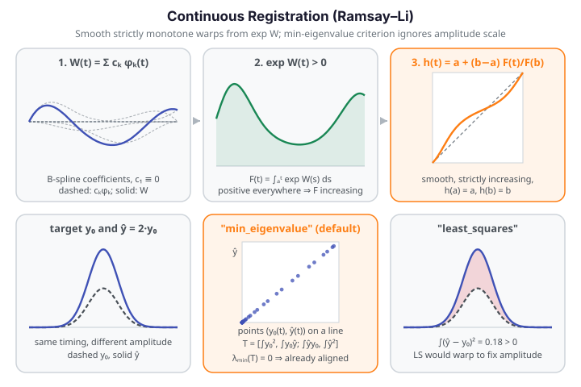

# Continuous Registration

Continuous registration (Ramsay & Li, 1998; R `fda::register.fd`) is the classical FDA answer to smooth, non-linear phase variability. Each curve gets a **smooth, strictly increasing** warp built from an exponentiated B-spline expansion, fitted to a target curve by a penalised Gauss–Newton method. Its default criterion has a property no other aligner in fdars has: it is **blind to the amplitude scale** of the curve, so it does not distort the time axis to compensate for a curve that is simply taller or shorter than the target.

Use it when the phase is smooth but not rigid, when you want warps that are guaranteed smooth and invertible, when amplitude legitimately varies between curves, or when you need results comparable to R's `register.fd`.

{ .fdars-diagram }

Top row: a B-spline expansion $W$ (with its first coefficient fixed at 0) is exponentiated, giving a positive function, whose normalised integral is a smooth monotone warp $h$. Bottom row: for a curve $\hat y = 2 y_0$ with the same timing as the target, the points $(y_0(t), \hat y(t))$ lie on a line, so the minimum-eigenvalue criterion is 0 ("already aligned") while the least-squares criterion is positive and would push the optimiser to warp.

---

## The warp model

For a curve $y_i$ on $[a, b]$, the warp is

$$
h_i(t) = a + (b - a)\,\frac{F_i(t)}{F_i(b)}, \qquad
F_i(t) = \int_a^t \exp W_i(s)\,ds, \qquad
W_i(s) = \sum_{k=1}^{K} c_{ik}\,\phi_k(s),
$$

with $\phi_k$ a clamped B-spline basis (`nbasis` $= K$ functions of order `norder`). Because $\exp W_i > 0$, $F_i$ is strictly increasing, so **every** coefficient vector gives a valid warp: smooth, strictly monotone, with $h_i(a) = a$ and $h_i(b) = b$. No constraint has to be enforced during the optimisation. The first coefficient is fixed at $c_{i1} = 0$, because adding a constant to $W$ multiplies $F$ by a constant that the normalisation cancels.

The registered curve is $\tilde y_i(t) = y_i(h_i(t))$, returned as `registered_data`, with the warps in `warps`, the coefficients in `w_coefficients` and the knot vector in `w_knots`.

---

## The criteria

`criterion` chooses how a registered curve is compared with the target $y_0$ (by default the cross-sectional mean; or pass `target`):

**`"least_squares"`** (R `crit=1`):

$$
\int \bigl(y_0(t) - \tilde y_i(t)\bigr)^2 dt .
$$

**`"min_eigenvalue"`** (R `crit=2`, the default): form the $2\times 2$ cross-product matrix

$$
T_i = \begin{pmatrix} \int y_0^2 & \int y_0\,\tilde y_i \\ \int \tilde y_i\, y_0 & \int \tilde y_i^2 \end{pmatrix}
$$

and minimise twice its **smallest eigenvalue**. $T_i$ is the second-moment matrix of the points $(y_0(t), \tilde y_i(t))$; its smallest eigenvalue is zero exactly when those points lie on a line through the origin, that is when $\tilde y_i = c\,y_0$ for some constant $c$. The criterion therefore measures how far the registered curve is from being *proportional* to the target, and ignores the factor $c$.

Both criteria add a roughness penalty $\lambda \int (D^{L} W_i)^2$, with `lambda_` the weight and `lfd_order` $= L$ the derivative order ($L <$ `norder`).

!!! info "What the scale invariance buys"
    If curve $i$ is a time-warped copy of the target *and* twice as tall, least squares sees a large residual even after perfect alignment, and its optimiser warps the time axis to shrink the residual (for example, compressing the peaks). The min-eigenvalue criterion is already 0 at the correct warp and has no incentive to distort it. It is not invariant to vertical *offsets*: $\tilde y_i = y_0 + c$ does not give a zero eigenvalue.

---

## The optimiser

Each curve is registered independently by penalised Gauss–Newton with Levenberg–Marquardt damping, on a fine grid of `n_fine` points (default $\max(201, m)$):

- each accepted step strictly decreases the penalised criterion;
- coefficients with $|c_k| > 50$ are rejected (R's `climit`), which keeps $\exp W$ finite;
- the iteration stops when the relative decrease falls below `tol` (default $10^{-8}$), when no damping gives a decrease (a **stall**), or after `max_iter` iterations (default 50).

The result records why each curve stopped in `termination[i]`:

| `termination` | Meaning |
|---|---|
| `"converged"` | the relative decrease fell below `tol` |
| `"stalled"` | no damped step decreased the criterion before `tol` was met |
| `"coef_limit"` | a stall in which a candidate step was rejected by the coefficient limit |
| `"max_iter"` | the iteration budget ran out |

`converged[i]` is `True` exactly when `termination[i] == "converged"`. A stall is often a local optimum, but the tolerance was not met. Convergence is a statement about the optimiser, not about the warps: also inspect `criterion` and the warps themselves.

**Template passes.** By default the target is the cross-sectional mean of the *unregistered* curves, which is blurred. `max_template_iter > 1` re-estimates the target as the mean of the registered curves and registers again (a Procrustes-style loop that R does not offer), stopping when the target changes by less than `template_tol`. The warps are not centred, so the registered sample can drift as a whole.

**Periodic data.** With `periodic=True` each curve is treated as one period on $[a, b]$, and the warp gains a free time shift (the first coefficient becomes a shift on the periodic extension, returned in `shift`). The curves should satisfy $y(a) \approx y(b)$. The full timing displacement of curve $i$ at time $t$ is $h_i(t) - t$; `shift` is only its constant part when the warp also has a slope.

### fdars defaults vs R defaults

| | fdars default | `r_defaults=True` (R `register.fd`) |
|---|---|---|
| `nbasis`, `norder` | 6, 4 (cubic B-spline $W$) | 2, 2 (linear $W$) |
| `lfd_order` | 2 | 0 |
| `max_iter` | 50 | 20 |

The fdars default is **much more flexible** than R's: six cubic B-splines let $W$ bend, while R's linear $W$ only allows a monotone change of speed. Explicitly passed values override `r_defaults`. Use the flexible default only with $\lambda > 0$, as the next example shows.

---

## Scale invariance in action

Twenty curves are smooth warps of a two-bump template, $y_i(t) = s_i\,\mu(w_i(t))$, whose amplitude $s_i$ varies more than six-fold. Registered to the *true* template with each criterion, the min-eigenvalue warps match the truth almost exactly, while least squares distorts them:

```python exec="1" source="above" result="text"
import numpy as np
from fdars import alignment as A

rng = np.random.default_rng(3)
n, m = 20, 101
t = np.linspace(0, 1, m)
mu = lambda s: np.exp(-(s - 0.35) ** 2 / 0.008) + 0.7 * np.exp(-(s - 0.68) ** 2 / 0.01)
X, H = [], []
for _ in range(n):
    w = t + rng.uniform(-0.5, 0.5) * t * (1 - t)                 # smooth data warp
    X.append(rng.uniform(0.3, 2.0) * mu(w) + 0.01 * rng.standard_normal(m))
    H.append(np.interp(t, w, t))                                 # true registering warp
X, H = np.array(X), np.array(H)
inner = (t > 0.15) & (t < 0.85)
err = lambda W: 1000 * np.abs((np.asarray(W) - H)[:, inner]).mean()

for crit in ("min_eigenvalue", "least_squares"):
    r = A.continuous_registration(X, t, target=mu(t), criterion=crit)
    print(f"criterion={crit!r:17s} mean |h_hat - h| = {err(r['warps']):6.2f} x 1e-3")
print("FDARS_FENCE_OK")
```

The least-squares warps are about forty times further from the truth: to make a tall curve look like the target, they shrink its peaks by squeezing time. This is the reason the min-eigenvalue criterion is the default.

---

## Regularisation and template passes

The same sample, now registered without knowing the template. Without a penalty the six-function $W$ overfits: noise and the blurred initial target pull the warps around. A small $\lambda$ and a few template passes fix both:

```python exec="1" source="above" result="text"
import numpy as np
from collections import Counter
from fdars import alignment as A

rng = np.random.default_rng(3)
n, m = 20, 101
t = np.linspace(0, 1, m)
mu = lambda s: np.exp(-(s - 0.35) ** 2 / 0.008) + 0.7 * np.exp(-(s - 0.68) ** 2 / 0.01)
X, H = [], []
for _ in range(n):
    w = t + rng.uniform(-0.5, 0.5) * t * (1 - t)
    X.append(rng.uniform(0.3, 2.0) * mu(w) + 0.01 * rng.standard_normal(m))
    H.append(np.interp(t, w, t))
X, H = np.array(X), np.array(H)
inner = (t > 0.15) & (t < 0.85)
# the template is estimated, so compare warps after removing their common part
err = lambda W: 1000 * np.abs(((np.asarray(W) - np.mean(W, 0)) - (H - H.mean(0)))[:, inner]).mean()

for kw in (dict(), dict(lambda_=1e-3), dict(lambda_=1e-3, max_template_iter=5), dict(r_defaults=True, max_template_iter=5)):
    r = A.continuous_registration(X, t, **kw)
    stops = ", ".join(f"{k} {v}" for k, v in sorted(Counter(r["termination"]).items()))
    print(f"{str(kw):45s} warp error {err(r['warps']):6.2f} x 1e-3   {stops}")
print("FDARS_FENCE_OK")
```

The penalty matters most: it cuts the error four-fold. R's linear $W$ (`r_defaults=True`) is stiff enough not to need a penalty, but it cannot express warps that speed up and then slow down, so it stays at a similar error level. The stop reasons show the unpenalised fit running out of iterations on 4 of the 20 curves while every curve meets the tolerance in the other three runs.

---

## Periodic data: the Canadian temperature cycle

Each station's annual temperature cycle is one period. `periodic=True` lets the warp wrap around the year, so a station can be registered by both a delay and a smooth change of pace. With R's linear $W$ and a mild penalty:

```python exec="1" source="above" result="text"
import numpy as np
import pandas as pd
from docs_data import load_canadian_weather
from fdars import alignment as A

day, T, meta = load_canadian_weather("temperature")
r = A.continuous_registration(T, day, periodic=True, r_defaults=True, lambda_=1.0)
lag = (np.asarray(r["warps"]) - day).mean(axis=1)          # mean displacement h_i(t) - t, days
lag -= lag.mean()                                          # relative to the average station

shift = A.iterative_shift_registration(T, day, extrapolation="periodic", max_iter=50, tol=0.5)["shifts"]
shift_lag = -(shift - shift.mean())                        # same sign convention (positive = late)

region = meta["region"].to_numpy()
print("mean lag by region (days; positive = cycle runs late):")
print(pd.DataFrame({"continuous": pd.Series(lag).groupby(region).mean(),
                    "iterative shift": pd.Series(shift_lag).groupby(region).mean()}).round(1).to_string())
print(f"correlation of per-station lags: {np.corrcoef(lag, shift_lag)[0, 1]:.2f}")
print("FDARS_FENCE_OK")
```

Both methods agree on the picture (Atlantic and Arctic stations a few days late, Pacific and continental stations early) and on the per-station ordering. The continuous warps additionally allow the pace to change through the year. Measure lags from $h_i(t) - t$, not from `shift` alone.

---

## API reference

```python
from fdars import alignment as A

r = A.continuous_registration(
    data, argvals,
    target=None,                    # default: cross-sectional mean
    criterion="min_eigenvalue",     # or "least_squares"
    nbasis=None, norder=None,       # default 6, 4  (2, 2 with r_defaults)
    lambda_=0.0, lfd_order=None,    # default L = 2 (0 with r_defaults)
    max_iter=None, tol=1e-8,        # default 50 iterations (20 with r_defaults)
    n_fine=None,                    # default max(201, m)
    max_template_iter=1, template_tol=1e-4,
    initial_coefficients=None,      # (n, nbasis); column 0 = initial shift when periodic
    periodic=False, r_defaults=False,
)
```

| Key | Description |
|---|---|
| `registered_data` | $(n, m)$ registered curves $y_i(h_i(t))$ |
| `warps` | $(n, m)$ warps $h_i$ |
| `w_coefficients`, `w_knots` | coefficients $(n, K)$ and knots of $W_i$ |
| `criterion` | $(n,)$ final criterion values |
| `target` | $(m,)$ final target |
| `n_iter`, `converged` | $(n,)$ per-curve iterations and convergence flags (tolerance met) |
| `termination` | list of $n$ stop reasons: `"converged"`, `"stalled"`, `"coef_limit"` or `"max_iter"` |
| `n_template_iter` | template passes used |
| `shift` | $(n,)$ periodic shift (0 unless `periodic=True`) |

`max_iter=0` returns identity warps.

---

## Continuous or elastic?

Both handle smooth non-linear phase. Choose **continuous registration** when:

- amplitude scale varies between curves and should not be explained as phase (min-eigenvalue);
- you need warps that are smooth and strictly increasing by construction, with a known low-dimensional parametrisation;
- you need parity with R's `register.fd` (`r_defaults=True`).

Choose **[elastic alignment](elastic-alignment.md)** when:

- you need a proper metric between curves, an amplitude/phase decomposition, elastic FPCA, regression or inference;
- the phase is complex (many features moving independently), beyond what a smooth $W$ with few basis functions expresses;
- there is no good target: the Karcher mean estimates the template within the metric.

The [method chooser](choosing-a-method.md#same-data-five-methods) shows penalised continuous registration and the elastic Karcher mean performing alike on smooth non-linear warps, and both beating the rigid models there.

## See also

- [Affine Registration](affine-registration.md) — the linear-warp special case with a scale-free Pearson criterion.
- [Landmark Registration](landmark-registration.md) — smooth monotone warps through chosen features.
- [Elastic Alignment](elastic-alignment.md) and [Choosing an Alignment Method](choosing-a-method.md).

## References

- Ramsay, J.O., Li, X. (1998). Curve registration. *Journal of the Royal Statistical Society, Series B* 60(2):351–363.
- Ramsay, J.O. (1998). Estimating smooth monotone functions. *Journal of the Royal Statistical Society, Series B* 60(2):365–375.
- Ramsay, J.O., Silverman, B.W. (2005). *Functional Data Analysis*, 2nd ed., ch. 7–8. Springer.
