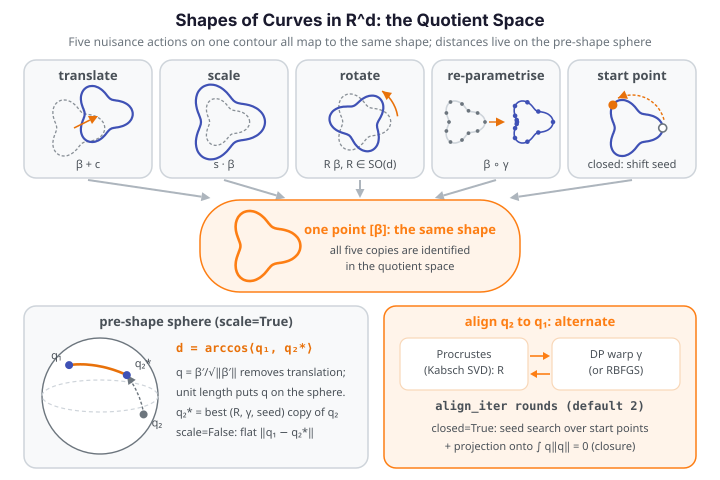
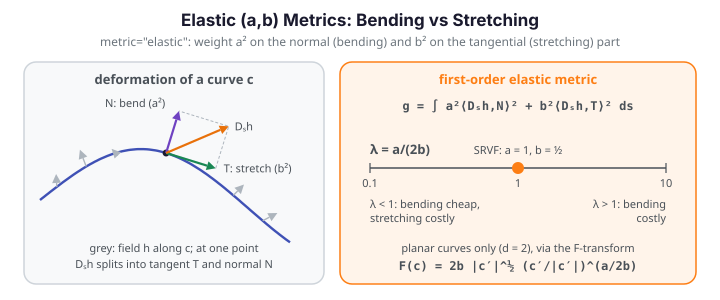

# Shapes of Curves in $\mathbb{R}^d$

An outline, a handwritten letter, a vertebra contour or a movement trajectory is a curve $\beta:[0,1]\to\mathbb{R}^d$. When you compare two of them you rarely care *where* they sit, *how large* they are, *which way* they are turned, *how fast* they were traced or, for a closed contour, *where tracing started*. These are nuisance transformations. Elastic **shape analysis** removes all of them at once and measures what is left: the shape.

The `curve_shape_*` functions in `fdars.alignment` implement this for open and closed curves in any dimension (ports of fdasrsf `curve_functions` / `curve_stats` and fdasrvf `multivariate_karcher_mean`, `curve_depth`, `curve_boxplot` and `shape_CI`), plus the planar $(a,b)$ elastic metrics of Needham & Kurtek and an exact distance for polygons.

{ .fdars-diagram }

Translation, scale, rotation, re-parametrisation and the starting point all map a contour to the same shape; the distance is a great-circle arc on the pre-shape sphere.

!!! tip "Which page?"
    For **real-valued** curves $f(t)$ use the 1-D elastic tools ([Elastic Alignment](elastic-alignment.md), [Shape Analysis (1-D)](shape-analysis.md)). The `*_nd_with_config` functions share one warp across the coordinates of an $\mathbb{R}^d$ curve but have **no rotation or scale quotient** and normalise each coordinate on its own, so they are not shape analysis. For curves observed at a few irregular points, see [Sparse & Irregular Curves](sparse-elastic.md).

---

## Curves as arrays

A curve is a `(d, m)` array: row $k$ holds coordinate $k$ at the $m$ points of an implicit uniform grid $t_j = j/(m-1)$. A set of $n$ curves is an `(n, d, m)` array or a list of `(d, m)` arrays. A **closed** contour repeats its first point at the end, and you pass `closed=True`.

```python exec="1" source="above" result="text"
import numpy as np
from fdars import alignment as A

m = 61
s = np.linspace(0, 1, m)
th = 2 * np.pi * s
star = np.stack([(1 + 0.25 * np.cos(3 * th)) * np.cos(th),
                 (1 + 0.25 * np.cos(3 * th)) * np.sin(th)])     # (2, 61), last point == first

R = np.array([[0, -1], [1, 0]])                                 # rotate by 90 degrees
copy = 3.0 * R @ star + np.array([[5.0], [-2.0]])              # rotate, scale x3, translate
print("same shape, different pose:      d =", round(A.curve_shape_distance(star, copy, closed=True), 4))
print("same pose, rotation not removed: d =", round(A.curve_shape_distance(star, copy, closed=True, rotation=False), 4))
print("FDARS_FENCE_OK")
```

With all quotients on (the default) the rotated, scaled and shifted copy is at distance zero (up to the optimiser's residual). Switching rotation off makes the same pair look very different.

---

## The quotient, one group at a time

Write $q = \beta'/\sqrt{\lVert\beta'\rVert}$ for the **square-root velocity function** (SRVF) of $\beta$. Each nuisance group is removed by one ingredient:

| Nuisance | How it is removed | Option |
|---|---|---|
| **translation** | the SRVF depends only on $\beta'$; returned curves are centred on their arc-length centroid | always |
| **scale** | each curve is rescaled to unit length, so $\lVert q\rVert = 1$: SRVFs live on the unit sphere (the *pre-shape sphere*), and the distance is the great-circle angle $\arccos\langle q_1, q_2^*\rangle$. With `scale=False` the distance is the flat $\lVert q_1 - q_2^*\rVert$ | `scale=True`; `include_length=True` adds the log length ratio, $d = \sqrt{\theta^2 + \ln^2(\lVert q_1\rVert/\lVert q_2\rVert)}$ |
| **rotation** | the best $R \in SO(d)$ by SVD Procrustes (Kabsch); with `allow_reflection=True`, over $O(d)$ | `rotation=True` |
| **re-parametrisation** | the elastic DP over warps $\gamma$, acting as $(q\circ\gamma)\sqrt{\gamma'}$, summed over coordinates; or RBFGS / a finer DP via `warp_optim` | `reparam=True`, `lambda_` penalty |
| **starting point** (closed curves) | a seed search over circular shifts of the sample (stride `seed_step`, then refined around the best seed), plus projection of the SRVF onto the closed-curve manifold $\{q : \int q\lVert q\rVert = 0\}$ | `closed=True`, `seed_search`, `seed_step=4` |

Rotation and warp are estimated **alternately**: Procrustes, then DP, then Procrustes again, for `align_iter` rounds (default 2), keeping the best candidate per seed. With `reparam=False` you get rigid (Procrustes) shape analysis.

The distance is therefore

$$
d([\beta_1],[\beta_2]) = \min_{R,\;\gamma,\;\text{seed}} \arccos\bigl\langle q_1,\; R\,(q_2\circ\gamma)\sqrt{\gamma'}\bigr\rangle ,
$$

computed by `curve_shape_distance`; `curve_shape_align_pair` returns the minimisers too (`rotation`, `gamma`, `seed`, `beta2_aligned`, `q2_aligned`), and `curve_shape_self_distance_matrix` the $n\times n$ matrix (curve $j$ aligned to curve $i$ for $i<j$, then mirrored).

### Example: contours that differ only in pose

Twelve closed contours, six three-lobed and six five-lobed stars, each randomly rotated, scaled, translated, re-parametrised and with a random starting point. With every quotient on, the within-class distances collapse; with rotation left in, they do not:

```python exec="1" source="above" result="text"
import numpy as np
from fdars import alignment as A

rng = np.random.default_rng(1)
m = 81
s = np.linspace(0, 1, m)

def contour(lobes):
    w = s + rng.uniform(-0.08, 0.08) * np.sin(2 * np.pi * s)          # re-parametrise
    th = 2 * np.pi * w
    r = 1 + 0.25 * np.cos(lobes * th)
    pts = np.stack([r * np.cos(th), r * np.sin(th)])[:, :-1]
    pts = np.roll(pts, -rng.integers(0, m - 1), axis=1)                 # new start point
    pts = np.concatenate([pts, pts[:, :1]], axis=1)                     # close the contour
    a = rng.uniform(0, 2 * np.pi)
    R = np.array([[np.cos(a), -np.sin(a)], [np.sin(a), np.cos(a)]])
    return rng.uniform(0.5, 2.0) * R @ pts + rng.normal(0, 1, (2, 1))   # rotate, scale, shift

curves = np.array([contour(3) for _ in range(6)] + [contour(5) for _ in range(6)])
label = np.repeat([0, 1], 6)
same = label[:, None] == label[None, :]
off = ~np.eye(12, dtype=bool)
for rot in (True, False):
    D = np.asarray(A.curve_shape_self_distance_matrix(curves, closed=True, rotation=rot))
    print(f"rotation={rot!s:5}  within-class mean {D[same & off].mean():.3f} (max {D[same & off].max():.3f})"
          f"   between-class min {D[~same].min():.3f}")
print("FDARS_FENCE_OK")
```

With rotation removed, the largest within-class distance is far below the smallest between-class distance, so any distance-based method (k-medoids, hierarchical clustering, 1-NN) separates the two shapes perfectly. Without the rotation quotient, the within-class distances grow five-fold, because they now include the arbitrary orientation, and they overlap the between-class distances: the classes are no longer separable by distance. (The remaining within-class distances of about 0.06 with rotation removed are mostly the DP residual discussed next.)

---

## Getting the warp right: DP floor, RBFGS and DP2

The elastic dynamic program only allows warp slopes from a small set of ratios, so even an *exactly* re-parametrised copy is not matched exactly: the distance stalls at a grid-independent floor of about 0.02 for smooth curves, and more for sharp features. The fix is the same as for 1-D curves (see [Elastic Optimisers](elastic-optimisers.md)): refine with RBFGS (`warp_optim={"method": "rbfgs"}`) and give rotation and warp more alternation rounds (`align_iter >= 4`), or use the finer DP2 lattice.

```python exec="1" source="above" result="text"
import time
import numpy as np
from fdars import alignment as A

m = 81
s = np.linspace(0, 1, m)
def star(w):
    th = 2 * np.pi * w
    r = 1 + 0.25 * np.cos(5 * th)
    return np.stack([r * np.cos(th), r * np.sin(th)])

b1 = star(s)
b2 = star(s + 0.06 * np.sin(2 * np.pi * s))          # the same outline, traced at a different speed
for name, kw in [("DP (default)", {}),
                 ("DP2: nbhd_dim=10, piecewise_linear", {"warp_optim": {"nbhd_dim": 10, "dp_cost": "piecewise_linear"}}),
                 ("RBFGS, align_iter=4", {"warp_optim": {"method": "rbfgs"}, "align_iter": 4})]:
    t0 = time.perf_counter()
    d = A.curve_shape_distance(b1, b2, closed=True, **kw)
    print(f"{name:36s} residual distance {d:.4f}   ({time.perf_counter() - t0:.2f} s)")
print("FDARS_FENCE_OK")
```

The true distance is 0. RBFGS cuts the DP residual about three-fold at no extra cost; DP2 halves it at several times the cost. In `warp_optim`, leave `lambda_` at 0 (the penalty weight is the top-level `lambda_`) and do not set `band_frac` (curves reject a band).

---

## Means, covariance and principal components

`curve_shape_karcher_mean` computes the Fréchet (Karcher) mean on the shape space by gradient descent: every sweep aligns each curve to the current mean (rotation, warp and seed), maps it to the tangent space at the mean with the inverse exponential map (sphere geometry when `scale=True`, flat otherwise, projected to the closed-curve tangent space when `closed=True`), and moves the mean along the average shooting vector. It starts at the **first curve**, and stops when the average shooting vector is shorter than `tol`, when the energy $\sum_i d_i^2$ would increase, or after `max_iter` sweeps.

`curve_shape_karcher_median` minimises $\sum_i d_i$ instead (Weiszfeld steps, started at the medoid) and is robust to outlying shapes; its result is returned in the `mean` field.

The shooting vectors are linear coordinates on which ordinary multivariate statistics work:

- `curve_shape_karcher_covariance(model)` is their $(d\,m)\times(d\,m)$ sample covariance (capped at $d\,m \le 10\,000$);
- `curve_shape_pca(model, ncomp)` is principal geodesic analysis (an $L^2$-weighted PCA of the shooting vectors through the $n\times n$ Gram matrix, no size cap), and `pca["model"].mode_shape(mean_model, k, c)` maps $\bar v + c\sqrt{\lambda_k}\,\phi_k$ back to a curve;
- `curve_shape_tsrvf(model, curves)` gives the tangent vectors of new curves on the same grid (reproducing the training shooting vectors exactly), and `curve_shape_tangent_to_curve` inverts the map.

### Example: a one-parameter family of shapes

Twelve three-lobed contours whose lobe depth varies, each in a random pose. The first principal direction of shape variation should be the lobe depth:

```python exec="1" source="above" result="text"
import numpy as np
from fdars import alignment as A

rng = np.random.default_rng(2)
m = 61
s = np.linspace(0, 1, m)

def contour(depth):
    w = s + rng.uniform(-0.05, 0.05) * np.sin(2 * np.pi * s)
    th = 2 * np.pi * w
    r = 1 + depth * np.cos(3 * th)
    pts = np.stack([r * np.cos(th), r * np.sin(th)])[:, :-1]
    pts = np.roll(pts, -rng.integers(0, m - 1), axis=1)
    pts = np.concatenate([pts, pts[:, :1]], axis=1)
    a = rng.uniform(0, 2 * np.pi)
    return rng.uniform(0.5, 2.0) * np.array([[np.cos(a), -np.sin(a)], [np.sin(a), np.cos(a)]]) @ pts

depth = rng.uniform(0.1, 0.3, 12)
curves = np.array([contour(d) for d in depth])

km = A.curve_shape_karcher_mean(curves, closed=True)
pca = A.curve_shape_pca(km["model"], ncomp=3)
share = np.asarray(pca["eigenvalues"]) / np.sum(pca["eigenvalues"])
print("Karcher mean: n_iter", km["n_iter"], " energy per sweep", np.round(km["energy"], 4))
print("variance share of PC1..PC3:", np.round(share, 3))
print("|corr(PC1 score, lobe depth)| =", round(abs(np.corrcoef(np.asarray(pca["scores"])[:, 0], depth)[0, 1]), 4))
mode = pca["model"].mode_shape(km["model"], 0, 2.0)          # mean + 2 sd along PC1, shape (2, m)
print("mode shape array:", np.shape(mode))
print("FDARS_FENCE_OK")
```

The first component carries most of the shape variance and its scores track the simulated lobe depth almost perfectly, although every contour was in a different pose and traced from a different start. `mode_shape(..., 0, ±2.0)` gives the contours at two standard deviations along that direction, which is how shape PCA results are usually displayed.

!!! note "Initialisation and convergence"
    The Karcher mean starts at the first curve, so with a multimodal energy the result can depend on the order of the curves. `converged=False` usually means the energy would have increased, which is normal near the optimum; check `energy` and `n_iter` rather than the flag.

---

## Depth, outliers and box plots

- **`curve_shape_depth(curves, ...)`** (fdasrvf `curve_depth`) aligns all pairs and returns an **amplitude depth** $1/(1 + \operatorname{median}_j d_{ij})$ and a **phase depth** built from the warps' geodesic distance to the identity, both in $[0, 1]$, plus both distance matrices. Cost: $n(n-1)/2$ alignments.
- **`curve_shape_outlier_detection(curves, centre="median", threshold_method="tukey", tukey_k=1.5)`** computes each curve's distance to a centre (the Karcher median by default, so outliers do not pull it towards themselves) and flags distances above $Q_3 + k\cdot\mathrm{IQR}$ (`threshold_method="quantile"` uses the empirical $1-\alpha$ quantile instead, which flags about $\alpha n$ curves in any sample: a screening rule, not a test).
- **`curve_shape_boxplot(median_model, alpha=0.05, k_a=1.0)`** (fdasrvf `curve_boxplot`) builds the elastic shape box plot around a Karcher **median**: the 50 % and $(1-\alpha)$ central regions are the closest curves, the quartile curves are chosen far from the median in opposite directions, the whiskers extend them by `k_a` times the inter-quartile distance, and curves beyond the whisker distance are outliers. `curve_shape_boxplot_from_aligned` does the same from your own aligned SRVFs.

```python exec="1" source="above" result="text"
import numpy as np
from fdars import alignment as A

rng = np.random.default_rng(4)
m = 61
s = np.linspace(0, 1, m)

def contour(lobes, depth):
    w = s + rng.uniform(-0.05, 0.05) * np.sin(2 * np.pi * s)
    th = 2 * np.pi * w
    r = 1 + depth * np.cos(lobes * th)
    pts = np.stack([r * np.cos(th), r * np.sin(th)])[:, :-1]
    pts = np.roll(pts, -rng.integers(0, m - 1), axis=1)
    pts = np.concatenate([pts, pts[:, :1]], axis=1)
    a = rng.uniform(0, 2 * np.pi)
    return rng.uniform(0.5, 2.0) * np.array([[np.cos(a), -np.sin(a)], [np.sin(a), np.cos(a)]]) @ pts

curves = np.array([contour(3, d) for d in rng.uniform(0.1, 0.3, 12)] + [contour(5, 0.2)])  # curve 12: five lobes
out = A.curve_shape_outlier_detection(curves, closed=True)
print("flagged:", [int(i) for i in out["outlier_indices"]], " Tukey threshold", round(float(out["threshold"]), 3))
print("distance of curve 12 to the median shape:", round(float(out["distances"][12]), 3),
      " largest of the others:", round(float(np.max(out["distances"][:12])), 3))
print("FDARS_FENCE_OK")
```

The five-lobed contour is flagged; its distance to the median shape is about two and a half times the largest among the three-lobed ones.

---

## Confidence regions for the mean shape

`curve_shape_confidence_interval(curves, method=...)` offers two constructions:

- **`method="bootstrap"`** (default): resample the curves `n_bootstrap` times, compute each resample's Karcher mean and align it to the full-sample mean. `radius` is the `confidence_level` quantile of the bootstrap distances (a geodesic ball around the mean shape), and `lower_band` / `upper_band` are pointwise coordinate bands. Cost: `n_bootstrap` Karcher means.
- **`method="model_based"`** (fdasrvf `shape_CI`, requires `scale=True`): fit a Gaussian to the leading `n_components` principal directions at the Karcher median, sample `n_samples` shapes by geodesic shooting, pose them with random warps (from the horizontal FPCA of the median's warps) and random rotations (planar curves), and take the elastic box plot of the samples. The result's `model` holds the box plot, the PCA, the samples and fdasrvf's `Q1a` / `Q3a` as `q1a` / `q3a`. The random streams differ from R, so individual samples are not reproducible across the two libraries; the median and the model covariance are.

```python exec="1" source="above" result="text"
import numpy as np
from docs_fig import fast
from fdars import alignment as A

rng = np.random.default_rng(5)
m = 61
s = np.linspace(0, 1, m)
amp = rng.uniform(0.2, 0.4, 12)
curves = np.array([np.stack([s, a * np.sin(np.pi * s) + 0.1 * np.sin(3 * np.pi * s)]) for a in amp])  # open curves

boot = A.curve_shape_confidence_interval(curves, n_bootstrap=fast(100, 20), seed=1)
model = A.curve_shape_confidence_interval(curves, method="model_based", n_samples=fast(100, 50), seed=1)
print("bootstrap: 95% geodesic radius around the mean shape =", round(float(boot["radius"]), 4))
print("model-based: samples drawn =", np.shape(model["model"]["shape_samples"])[0],
      "  half of them within distance", round(float(model["model"]["boxplot"]["r50"]), 4), "of the median shape")
print("FDARS_FENCE_OK")
```

The bootstrap radius quantifies how far the *mean* shape could move under resampling (it shrinks like $1/\sqrt n$); the model-based region describes the spread of *individual* shapes under a fitted Gaussian model, which is what fdasrvf's `shape_CI` plots, so it is wider.

---

## Elastic metrics with bending and stretching weights

The SRVF distance treats bending and stretching of a curve in a fixed proportion. The **$(a,b)$ elastic metrics** (Needham & Kurtek 2020) let you weight them separately: for a deformation $h$ of a planar curve,

$$
g_c(h, k) = \int a^2 \langle D_s h, N\rangle\langle D_s k, N\rangle + b^2 \langle D_s h, T\rangle\langle D_s k, T\rangle \, ds ,
$$

where $T$ and $N$ are the unit tangent and normal and $D_s$ is the arc-length derivative. The normal part is **bending** (weight $a^2$), the tangential part is **stretching** (weight $b^2$). Only the ratio $\lambda = a/(2b)$ changes the geometry; the SRVF is $a = 1, b = 1/2$, i.e. $\lambda = 1$.

{ .fdars-diagram }

$a^2$ weights bending, $b^2$ stretching; $a/(2b) = 1$ is the SRVF.

They are computed through the **F-transform** $F(c) = 2b\,\lvert c'\rvert^{1/2}\,(c'/\lvert c'\rvert)^{a/(2b)}$ (in complex notation), which maps the metric to a flat $L^2$ metric, so every `curve_shape_*` function accepts `metric="elastic", a=..., b=...` and reuses the same Procrustes / DP machinery. Restrictions and details:

- **planar curves only** ($d = 2$); other dimensions raise `ValueError`;
- for $\lambda \ne 1$ the transform is multivalued; the code uses one branch, and with `rotation=True` the Procrustes step quotients rotations *and* branches. With `rotation=False`, `branch_search=True` also tries the neighbouring branches;
- closed contours use the matching closure condition (`ab_closure_residual`, `ab_project_closed`);
- `ab_transform` / `ab_transform_inverse` expose the transform itself.

```python exec="1" source="above" result="text"
import numpy as np
from fdars import alignment as A

m = 81
s = np.linspace(0, 1, m)
def arc(kappa):                                 # unit-length curve of constant curvature kappa
    th = kappa * (s - 0.5)
    return np.stack([np.cumsum(np.cos(th)), np.cumsum(np.sin(th))]) / (m - 1)
line, bent = arc(1e-6), arc(3.0)
wiggle = np.stack([s, 0.08 * np.sin(4 * np.pi * s)])

print("a/(2b)   d(line, bent arc)   d(line, wiggle)   nearer to the line")
for a in (0.25, 1.0, 4.0):
    d1, d2 = (A.curve_shape_distance(line, c, metric="elastic", a=a, b=0.5, rotation=False, scale=False)
              for c in (bent, wiggle))
    print(f"{a:6.2f}   {d1:17.3f}   {d2:15.3f}   {'bent arc' if d1 < d2 else 'wiggle'}")
print("FDARS_FENCE_OK")
```

The weights change not only the scale of the distances but **which shapes count as similar**: with the SRVF and with cheap bending ($\lambda \le 1$) the gently wiggling curve is nearer to the straight line, with expensive bending ($\lambda = 4$) the smoothly bent arc is. There is no universally right $\lambda$; choose it from the application (is a bend or a stretch the larger change?) or by the downstream performance of, for example, a nearest-neighbour classifier.

---

## Exact distance for polygons

For piecewise-linear curves the $(a,b)$ distance (quotient by translation and re-parametrisation only, **no rotation or scale**) can be computed exactly: `ab_elastic_distance_pl(c1, c2, a, b)` and `ab_elastic_match_pl` (which also returns the optimal matching `path` in normalised arc length and the `similarity`) implement the algorithm of Lahiri, Robinson & Klassen and Bauer et al. (2024). The vertex arrays may have different lengths, in any dimension. The cost is $O(N_1^2 N_2^2 (N_1+N_2))$ for $N_1$, $N_2$ vertices, so it is meant for polygons with tens of vertices; for densely sampled curves use `curve_shape_distance`.

It is a useful ground truth for the discretised DP:

```python exec="1" source="above" result="text"
import numpy as np
from fdars import alignment as A

rng = np.random.default_rng(3)
th = np.linspace(0, np.pi, 8)
P1 = np.stack([np.cos(th), np.sin(th)])                 # 8-vertex polygon (half circle)
P2 = P1 + 0.08 * rng.normal(size=(2, 8))                # a perturbed copy

def subdivide(P, k):                                    # the same polygon, k points per edge
    pts = [P[:, :1]]
    for i in range(P.shape[1] - 1):
        u = np.linspace(0, 1, k + 1)[1:]
        pts.append(P[:, i:i + 1] * (1 - u) + P[:, i + 1:i + 2] * u)
    return np.concatenate(pts, axis=1)

print("exact PL distance:", round(A.ab_elastic_distance_pl(P1, P2, 1.0, 0.5), 4))
for k in (5, 20, 60):
    c1, c2 = subdivide(P1, k), subdivide(P2, k)
    d = A.curve_shape_distance(c1, c2, rotation=False, scale=False)
    print(f"DP on {c1.shape[1]:3d}-point copies:  {d:.4f}")
print("FDARS_FENCE_OK")
```

As the polygons are sampled more finely, the DP distance approaches the exact value, but only to within the DP's own error, in both directions: on coarse samples it comes out *below* the exact value, because the DP differentiates the sampled curve with central differences, which rounds the polygon's corners and makes two polygons look more alike; on fine samples its restricted warp slopes push it slightly *above* (the residual floor of the previous section). Use the exact distance when small differences between polygons matter, or to check a DP configuration.

---

## Parameters

Every `curve_shape_*` function takes the same shape options:

| Parameter | Default | Effect |
|---|---|---|
| `rotation` | `True` | quotient by rotations (Kabsch) |
| `allow_reflection` | `False` | allow reflections too ($O(d)$) |
| `scale` | `True` | unit length, sphere geometry; `False`: flat $L^2$ |
| `include_length` | `False` | add the log length ratio to the distance |
| `closed` | `False` | closed contours: closure projection and start-point search |
| `seed_search`, `seed_step` | `True`, 4 | start-point search (closed curves), coarse stride then refinement |
| `reparam` | `True` | `False` gives rigid Procrustes shape analysis |
| `lambda_` | 0 | warp penalty $\lambda\int(\gamma'-1)^2$ |
| `align_iter` | 2 | Procrustes ↔ warp alternation rounds |
| `metric`, `a`, `b` | `"srvf"` | `"elastic"` with weights `a`, `b` (planar) |
| `branch_search` | `False` | try neighbouring F-transform branches (`metric="elastic"`, `rotation=False`) |
| `warp_optim` | `None` (classic DP) | dict of warp-optimiser options, e.g. `{"method": "rbfgs"}` or `{"nbhd_dim": 10, "dp_cost": "piecewise_linear"}` |

| Function | Returns |
|---|---|
| `curve_shape_align_pair(b1, b2)` | `beta2_aligned`, `q1`, `q2_aligned`, `rotation`, `gamma`, `seed`, `length1/2`, `distance` |
| `curve_shape_distance`, `curve_shape_self_distance_matrix` | float, $(n, n)$ |
| `curve_shape_karcher_mean` / `_median` | `mean`, `mean_srvf`, `aligned_curves`, `rotations`, `gammas`, `seeds`, `shooting_vectors`, `distances`, `energy`, `n_iter`, `converged`, `model` |
| `curve_shape_pca(model, ncomp)` | `scores`, `components`, `eigenvalues`, `cumulative_variance`, `model` (`mode_shape`) |
| `curve_shape_tsrvf(model, curves)`, `curve_shape_tangent_to_curve` | tangent vectors and back |
| `curve_shape_depth`, `curve_shape_outlier_detection`, `curve_shape_boxplot` | see above |
| `curve_shape_confidence_interval` | `mean`, `radius`, `lower_band`, `upper_band`, `bootstrap_means`, `model` |
| `curve_srvf`, `srvf_to_curve`, `optimal_rotation`, `closure_residual`, `project_closed_srvf` | building blocks |
| `ab_transform`, `ab_transform_inverse`, `ab_closure_residual`, `ab_project_closed` | $(a,b)$ building blocks |
| `ab_elastic_distance_pl`, `ab_elastic_match_pl` | exact polygon distance and matching |

---

## When it works, when it fails

- **Works well** for densely and roughly uniformly sampled outlines and trajectories whose differences are genuinely in shape: morphometrics, handwriting, gait and motion paths, contours from segmentation.
- **Sampling.** All curves in a set share the number of points $m$. Resample each curve to $m$ points (by arc length is a good default) before calling. For a few irregular points per curve use the [sparse elastic tools](sparse-elastic.md), which, however, do not quotient rotation or scale.
- **Cost.** Each pair costs `align_iter` × (number of seeds) DP solves; closed curves search about $m/$`seed_step` seeds. Distance matrices are $O(n^2)$ pairs (parallelised). Use moderate $m$ (50–150) and `seed_step` 4–8 for large samples.
- **Residual floor.** For near-identical shapes, distances around 0.02–0.06 can be pure optimiser error. Use `warp_optim={"method": "rbfgs"}, align_iter=4` when small distances matter.
- **Symmetric shapes.** A circle, or a star whose lobes are identical, has many equally good rotations and seeds; the optimal `rotation` and `seed` are then not unique even though the distance is.
- **Reflections.** Mirror-image shapes are different unless `allow_reflection=True`.

## See also

- [Shape Analysis (1-D)](shape-analysis.md) — shape quotients of real-valued curves.
- [Sparse & Irregular Curves](sparse-elastic.md) — elastic means of curves observed at a few points.
- [Elastic Optimisers & Penalties](elastic-optimisers.md) — DP, DP2, RBFGS and the residual floor.
- [Scalar-on-Shape Regression](../regression/scalar-on-shape.md) — shapes as predictors.
- [Choosing an Alignment Method](choosing-a-method.md).

## References

- Srivastava, A., Klassen, E. (2016). *Functional and Shape Data Analysis*, ch. 5–6. Springer.
- Needham, T., Kurtek, S. (2020). Simplifying transforms for general elastic metrics on the space of plane curves. *SIAM Journal on Imaging Sciences* 13(1), 445–473.
- Bauer, M., Charon, N., Klassen, E., Kurtek, S., Needham, T., Pierron, T. (2024). Elastic metrics on spaces of Euclidean curves: theory and algorithms. *Journal of Nonlinear Science* 34(3), 56. arXiv:2209.09862.
- Lahiri, S., Robinson, D., Klassen, E. (2015). Precise matching of PL curves in $\mathbb{R}^N$ in the square root velocity framework. *Geometry, Imaging and Computing* 2(3), 133–186. arXiv:1501.00577.
