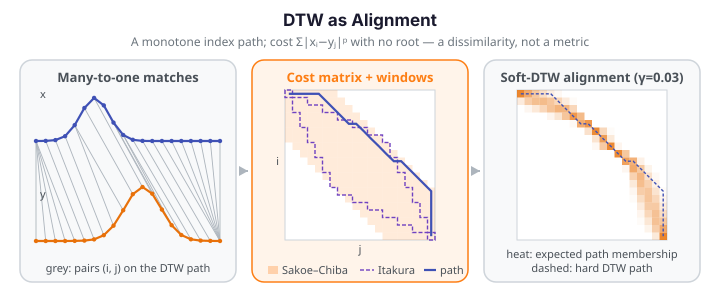

# Dynamic Time Warping

Dynamic time warping (DTW) is the oldest alignment method in signal processing (Sakoe & Chiba 1978) and still the default for comparing time series in classification and search. It finds the cheapest monotone **matching of sample indices** between two sequences and reports its accumulated cost. fdars has the full DTW family in `fdars.metric`: hard DTW with global windows and paths, lower bounds and exact nearest-neighbour search, soft-DTW and its expected alignment, DBA and soft-DTW barycentres, the global alignment kernel, the shape-based distance, multichannel DTW and ten further elastic time-series distances from aeon.

This page is about DTW **as an alignment method**: what its warping path is, how it differs from the warps of the functional-data aligners on the other pages, and when to choose it. The search and distance tools themselves are documented on [DTW Search & Averaging](../represent/dtw-toolkit.md) and [Elastic Time-Series Distances](../represent/elastic-ts-distances.md); clustering with DTW, SBD and k-Shape on [Time-Series Clustering](../analyze/time-series-clustering.md).

{ .fdars-diagram }

DTW: many-to-one matches, a monotone path through the cost matrix, and the soft-DTW expected alignment.

---

## The DTW path is a discrete warp

For sequences $x_1, \dots, x_n$ and $y_1, \dots, y_m$, DTW solves

$$
R(i,j) = c(x_i, y_j) + \min\{R(i-1,j),\; R(i,j-1),\; R(i-1,j-1)\}, \qquad c(a,b) = \lvert a-b\rvert^p,
$$

with $R(0,0) = 0$ and infinite borders. The optimal path $\pi$ (from `dtw_path`) is a staircase of index pairs $(i, j)$ from $(1,1)$ to $(n,m)$, monotone in both coordinates. It is a warp in a discrete, weak sense:

- **Many-to-one matches.** A horizontal or vertical run matches one sample to several: the path can "hold" a curve still while the other moves. Elastic warps can only slow down to a slope of $1/7$ (DP) or any positive slope (RBFGS), never stop.
- **Index space, not time.** The path relates sample *indices*; it ignores `argvals`, so both series must share a sampling rate, but they may have different lengths.
- **Cost, not distance.** fdars reports $\sum_{(i,j)\in\pi}\lvert x_i-y_j\rvert^p$ **without** a $p$-th root (tslearn and dtaidistance report the square root of the $p=2$ cost). The value grows with the number of matched pairs, so it depends on the sampling density, and DTW does not satisfy the triangle inequality: treat it as a dissimilarity.

How does this compare with elastic alignment? Two experiments with a two-bump curve $f_1$: a warped copy $f_2 = f_1 \circ w$ (pure phase) and a scaled copy $f_3 = 1.4\,f_1$ (pure amplitude). A good aligner recovers $w^{-1}$ for the first pair and the identity for the second.

```python exec="1" source="above" result="text"
import numpy as np
from fdars import alignment as A, metric as M

m = 101
t = np.linspace(0, 1, m)
mu = lambda s: np.exp(-(s - 0.35) ** 2 / 0.008) + 0.7 * np.exp(-(s - 0.68) ** 2 / 0.01)
w = t + 0.4 * t * (1 - t)
f1, f2, f3 = mu(t), mu(w), 1.4 * mu(t)          # reference, pure phase, pure amplitude
w_inv = np.interp(t, w, t)

def path_to_warp(path):                          # average matched index of y for each index of x
    P = np.asarray(path)
    return np.array([P[P[:, 0] == i, 1].mean() for i in range(m)]) / (m - 1)

print("                          phase pair: |warp - true|   amplitude pair: |warp - identity|")
print(f"DTW                       {np.abs(path_to_warp(M.dtw_path(f1, f2)['path']) - w_inv).mean():24.4f}"
      f"   {np.abs(path_to_warp(M.dtw_path(f1, f3)['path']) - t).mean():32.4f}")
for wp in (0.1, 1.0):
    a = path_to_warp(M.elastic_ts_alignment_path(f1, f2, "adtw", warp_penalty=wp)["path"])
    b = path_to_warp(M.elastic_ts_alignment_path(f1, f3, "adtw", warp_penalty=wp)["path"])
    print(f"ADTW, warp_penalty={wp:<4}    {np.abs(a - w_inv).mean():24.4f}   {np.abs(b - t).mean():32.4f}")
g2 = np.asarray(A.elastic_align_pair(f1, f2, t)["gamma"])
g3 = np.asarray(A.elastic_align_pair(f1, f3, t)["gamma"])
print(f"elastic (SRSF, DP)        {np.abs(g2 - w_inv).mean():24.4f}   {np.abs(g3 - t).mean():32.4f}")
print("FDARS_FENCE_OK")
```

Both DTW and elastic alignment recover the pure phase difference. But DTW also **warps the pure amplitude difference**: to make a taller peak cheaper to match, it holds the shorter curve at its peak for several samples. Penalising warping (amplitude-penalised DTW, ADTW) removes the spurious warp only at a penalty that also suppresses the genuine one. DTW has no way to tell amplitude from phase, because its cost compares values pointwise. The elastic (Fisher–Rao) criterion is invariant to simultaneous warping and does not gain anything by warping a scaled copy, so it leaves it alone.

This is the core of the choice:

- **DTW** answers "how similar are these two series if I may stretch time freely?", which is the right question for search and classification, where any warping that makes two signals match is welcome.
- **Registration methods** answer "what is the timing of each curve, and what is left once timing is removed?", which needs warps that do not absorb amplitude.

---

## Windows

A global window restricts the path to a band around the diagonal. It speeds DTW up and limits how far one series may be pulled:

| `window=` | Parameters | Admissible cells |
|---|---|---|
| `"none"` (default) | — | all |
| `"sakoe_chiba"` | `radius` | $\lvert i-j\rvert \le r$ (widened by $\lvert n-m\rvert$ for unequal lengths; tslearn) |
| `"itakura"` | `max_slope` $\ge 1$ | a parallelogram with slopes $1/s$ and $s$ (tslearn) |
| `"sakoe_chiba_fraction"` | `window_fraction` in $[0,1]$ | half-width $\lfloor f\cdot\min(n,m)\rfloor$ around the interpolated diagonal (aeon) |
| `"itakura_fraction"` | `max_slope` in $(0,1]$ | aeon's Itakura parallelogram |

`dtw_window_mask(n, m, window=...)` returns the boolean mask. A window is not a cure for amplitude-induced warping: in the example above a Sakoe–Chiba radius of 5 samples leaves the spurious warp of the scaled copy unchanged (it fits inside the band) and truncates the genuine warp of the phase pair, which needs about 10 samples. Choose the radius from the largest plausible time shift.

!!! warning "Legacy `w` argument"
    `dtw_self_1d` / `dtw_cross_1d` take an older band argument `w` with an asymmetric convention ($j - i \in [1-w, w]$); `w=0` admits no cell and returns infinity without an error. It is not the same as `window="sakoe_chiba", radius=w`. Prefer the `window=` functions.

---

## Soft-DTW: a smooth expected alignment

Soft-DTW (Cuturi & Blondel 2017) replaces the minimum in the recursion by the soft minimum $-\gamma\log\sum e^{-a/\gamma}$, which makes the cost differentiable in the data. `soft_dtw_alignment(x, y, gamma)` returns the **expected alignment matrix** $E$: entry $(i,j)$ is the probability that cell $(i,j)$ lies on the path under the Gibbs distribution over all paths (corners are 1; rows do not sum to 1). As $\gamma \to 0$ it becomes the 0/1 hard path; larger $\gamma$ spreads it out, which shows where the alignment is uncertain (in flat stretches of the curves many paths cost about the same). Raw soft-DTW can be negative and is not zero for identical series; use the soft-DTW **divergence** (`soft_dtw_div_*`) when you need a non-negative discrepancy.

---

## Averaging and registering a sample under DTW

To summarise a group of series under DTW, average **along the alignment**:

- **DBA** (DTW barycentre averaging; Petitjean et al. 2011), `dtw_barycenter_averaging(data, init=...)`: align the current barycentre to every series with `dtw_path`, replace each barycentre sample by the mean of the samples matched to it, repeat. The inertia never increases, but the result depends on the start: `init="medoid"` is more robust than the default pointwise mean.
- **Soft-DTW barycentre**, `soft_dtw_barycenter(data, gamma, n_restarts)`: minimise the sum of soft-DTW costs by L-BFGS; smaller $\gamma$ is closer to DBA, larger $\gamma$ closer to the pointwise mean.

```python exec="1" source="above" result="text"
import time
import numpy as np
from fdars import alignment as A, metric as M

rng = np.random.default_rng(0)
n, m = 20, 101
t = np.linspace(0, 1, m)
mu = lambda s: np.exp(-(s - 0.35) ** 2 / 0.008) + 0.7 * np.exp(-(s - 0.68) ** 2 / 0.01)
X = np.array([mu(t + rng.uniform(-0.4, 0.4) * t * (1 - t)) + 0.01 * rng.standard_normal(m) for _ in range(n)])

def peaks(f):
    return f"{f[:50].max():.3f}, {f[50:].max():.3f}"

print("true template peaks:           ", peaks(mu(t)))
print("pointwise mean:                ", peaks(X.mean(0)))
for init in ("mean", "medoid"):
    r = M.dtw_barycenter_averaging(X, init=init)
    print(f"DBA, init={init:7s}             ", peaks(np.asarray(r["barycenter"])), f"  inertia {r['cost']:.4f}")
for g in (0.01, 1.0):
    t0 = time.perf_counter()
    r = M.soft_dtw_barycenter(X, gamma=g, n_restarts=1)
    print(f"soft-DTW barycentre, gamma={g:<4}  ", peaks(np.asarray(r["barycenter"])), f"  ({time.perf_counter() - t0:.1f} s)")
print("elastic Karcher mean:          ", peaks(np.asarray(A.karcher_mean(X, t)["mean"])))
print("FDARS_FENCE_OK")
```

Averaging along the alignment keeps the peak heights that the pointwise mean flattens; the medoid start brings DBA closest to the truth here, and the elastic Karcher mean recovers the template as well. DBA is the fastest of the three. The difference lies in what comes with it: the Karcher mean also returns smooth, invertible warps, the amplitude/phase split and the inputs for elastic FPCA, regression and tests; DBA returns a barycentre and index paths.

---

## Multichannel series

`dtw_distance_multivariate`, `dtw_path_multivariate`, `dtw_pairwise_distance_multivariate` and `dtw_barycenter_averaging_multivariate` take `(d, m)` arrays (channels as rows) and use the *dependent* cost $\lVert x_{\cdot,i} - y_{\cdot,j}\rVert_2^p$: one path for all channels, as in aeon and tslearn. With $d = 1$ they reproduce the univariate results exactly. The functional-data counterpart is the shared-warp `*_nd_with_config` family (one elastic warp for all coordinates) or, when rotation and scale are nuisance, the [curve shape space](curve-shapes.md).

---

## Choosing within the DTW family

| Goal | Use | Page |
|---|---|---|
| Nearest neighbour or classification over many references | `dtw_nearest_neighbor` / `dtw_k_nearest_neighbors` with a Sakoe–Chiba window; the lower-bound cascade makes it exact and fast | [DTW Search](../represent/dtw-toolkit.md#exact-nearest-neighbour-search) |
| A differentiable loss (neural networks, barycentres) | soft-DTW; the divergence for a non-negative discrepancy | [Distance Metrics](../represent/distance-metrics.md#soft-dtw) |
| A representative series | DBA (medoid start) or the soft-DTW barycentre with restarts | [DTW Search](../represent/dtw-toolkit.md#averaging-under-dtw) |
| A kernel for an SVM | the global alignment kernel `gak_*` (positive semi-definite once normalised; $e^{-\text{DTW}}$ is not) | [DTW Search](../represent/dtw-toolkit.md#triangular-global-alignment-kernel) |
| Shape matters, offset and scale do not | SBD / k-Shape | [Elastic TS Distances](../represent/elastic-ts-distances.md#shape-based-distance-sbd) |
| Robustness to outliers or gaps | EDR or LCSS (thresholded), ERP or TWE (gap costs), MSM | [Elastic TS Distances](../represent/elastic-ts-distances.md) |
| Penalise excessive warping | ADTW (additive penalty) or WDTW (logistic weight) | [Elastic TS Distances](../represent/elastic-ts-distances.md) |
| Match slopes rather than values | DDTW / WDDTW (derivative DTW) | [Elastic TS Distances](../represent/elastic-ts-distances.md) |
| Match local shape | shape-DTW | [Elastic TS Distances](../represent/elastic-ts-distances.md) |
| Cluster series | DTW k-means (DBA centroids), k-Shape, k-medoids on any matrix | [Time-Series Clustering](../analyze/time-series-clustering.md) |

## When not to use DTW on functional data

Use [elastic alignment](elastic-alignment.md) (or another registration method from [Choosing an Alignment Method](choosing-a-method.md)) instead of DTW when you need:

- **an amplitude/phase decomposition**: DTW warps away amplitude differences, as shown above;
- **a metric**: Fréchet means, PERMANOVA, depth and many clustering criteria assume the triangle inequality, which DTW costs do not satisfy, and the cost scale depends on the number of samples;
- **smooth, invertible warps** to transport curves, compute derivatives of registered data or report timing;
- **irregular sampling**: DTW compares sample indices, so differently sampled curves must first be resampled to a common rate.

## See also

- [DTW Search & Averaging](../represent/dtw-toolkit.md), [Elastic Time-Series Distances](../represent/elastic-ts-distances.md), [Distance Metrics](../represent/distance-metrics.md).
- [Time-Series Clustering](../analyze/time-series-clustering.md).
- [Elastic Alignment](elastic-alignment.md), [Choosing an Alignment Method](choosing-a-method.md).

## References

- Sakoe, H., Chiba, S. (1978). Dynamic programming algorithm optimization for spoken word recognition. *IEEE Transactions on Acoustics, Speech, and Signal Processing* 26(1), 43–49.
- Itakura, F. (1975). Minimum prediction residual principle applied to speech recognition. *IEEE Transactions on Acoustics, Speech, and Signal Processing* 23(1), 67–72.
- Cuturi, M., Blondel, M. (2017). Soft-DTW: a differentiable loss function for time-series. *Proceedings of the 34th International Conference on Machine Learning*, PMLR 70, 894–903.
- Petitjean, F., Ketterlin, A., Gançarski, P. (2011). A global averaging method for dynamic time warping, with applications to clustering. *Pattern Recognition* 44(3), 678–693.
- Herrmann, M., Webb, G. I. (2023). Amercing: an intuitive and effective constraint for dynamic time warping. *Pattern Recognition* 137, 109333.
