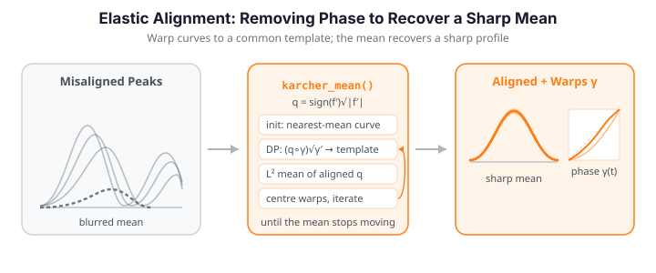

# Elastic Alignment


{ .fdars-diagram }

## The problem: amplitude vs. phase variability

Imagine recording the heartbeat signal of several patients. Every heartbeat has the same features -- a P wave, a QRS complex, a T wave -- but the *timing* of those features differs from patient to patient. Average the raw signals and the peaks blur out, because they do not line up. Two distinct sources of variation are at work whenever curves share a domain:

- **Amplitude variability** -- differences in the *height* of features (peaks, valleys).
- **Phase variability** -- differences in the *timing* of features (shifted or stretched along the domain axis).

Classical statistics -- the cross-sectional mean, ordinary FPCA -- treats *all* variation as amplitude. The result is a blurred mean and artificially inflated variance. Elastic alignment resolves this by finding time-warping functions $\gamma$ that register each curve to a common template, isolating amplitude variation in the aligned curves and phase variation in the warps:

$$
f_{\text{aligned}}(t) = (f \circ \gamma)(t) = f(\gamma(t)).
$$

The panels below show the same set of two-peak curves *before* alignment -- where the peaks land at different times, blurring the cross-sectional mean -- and *after* Karcher-mean alignment, where the peaks snap into register and the mean recovers a sharp two-peak profile.

```python exec="1" html="1"
import numpy as np
from docs_fig import fig, render
from fdars import Fdata
from fdars.alignment import karcher_mean

rng = np.random.default_rng(1)
n, m = 15, 120
t = np.linspace(0, 1, m)

# A two-peak template, warped in time and scaled in amplitude per curve
base = np.exp(-((t - 0.4) ** 2) / 0.01) + 0.7 * np.exp(-((t - 0.75) ** 2) / 0.006)
data = np.zeros((n, m))
for i in range(n):
    amp = 3.0 * rng.uniform(0.6, 1.0)
    warp = t ** rng.uniform(0.7, 1.6)          # random monotone time warp
    warp = (warp - warp.min()) / np.ptp(warp)
    data[i] = amp * np.interp(t, warp, base)

fd = Fdata(data, argvals=t)
res = karcher_mean(fd.data, fd.argvals, lambda_=0.0, max_iter=20, tol=1e-4)
aligned = np.asarray(res["aligned_data"])
mu = np.asarray(res["mean"])

f, (a1, a2) = fig(ncols=2, figsize=(9.5, 4.0))
a1.plot(t, data.T, color="#3f51b5", lw=1, alpha=0.5)
a1.plot(t, data.mean(0), color="#dc3545", lw=2.5, label="cross-sec. mean")
a1.set(title="Misaligned (phase variation)", xlabel="t", ylabel="f(t)")
a1.legend(fontsize=8)

a2.plot(t, aligned.T, color="#198754", lw=1, alpha=0.5)
a2.plot(t, mu, color="#e8710a", lw=2.5, label="Karcher mean")
a2.set(title="Aligned (elastic / Fisher-Rao)", xlabel="t")
a2.legend(fontsize=8)
print(render(f))
```

On the left the peaks arrive at different times, so the red cross-sectional mean is blunted and shifted -- it does not look like any single curve. On the right the Fisher-Rao alignment warps every curve onto the common Karcher mean, and the orange mean now reproduces the true peaked shape. This side-by-side is the canonical illustration of amplitude/phase separation.

!!! info "Fisher-Rao framework"
    All alignment in `fdars` is performed under the **elastic (Fisher-Rao) metric**, the unique Riemannian metric on the function space that is invariant to simultaneous reparameterization. This guarantees the alignment is *proper*: the distance between two functions does not depend on how either is parameterized.

!!! success "Numerical validation"
    Two ground-truth properties of the elastic machinery, asserted below:

    1. **Alignment removes variance.** After Karcher-mean alignment of a phase-varying sample, the mean pointwise variance must drop, so the variance reduction $\text{VR}=1-\overline{\operatorname{Var}}(\tilde f)/\overline{\operatorname{Var}}(f)$ is strictly positive.
    2. **Amplitude = elastic distance.** For the residual after optimal alignment, `amplitude_distance` is *by definition* the elastic distance; the two must agree to machine precision.

    ```python exec="1"
    import numpy as np
    from fdars.alignment import (
        karcher_mean, amplitude_distance, elastic_distance,
    )

    rng = np.random.default_rng(1)
    n, m = 15, 120
    t = np.linspace(0, 1, m)
    base = np.exp(-((t - 0.4) ** 2) / 0.01) + 0.7 * np.exp(-((t - 0.75) ** 2) / 0.006)
    data = np.zeros((n, m))
    for i in range(n):
        warp = t ** rng.uniform(0.7, 1.6)
        warp = (warp - warp.min()) / np.ptp(warp)
        data[i] = 3.0 * rng.uniform(0.6, 1.0) * np.interp(t, warp, base)

    aligned = np.asarray(karcher_mean(data, t, lambda_=0.0, max_iter=20, tol=1e-4)["aligned_data"])
    vr = 1.0 - np.var(aligned, axis=0).mean() / np.var(data, axis=0).mean()
    assert vr > 0.0, vr
    print(f"variance reduction after alignment: {vr:.3f}  (> 0 required)")

    # amplitude_distance IS the elastic distance -> agree to machine precision
    f1 = np.sin(2 * np.pi * t)
    f2 = np.sin(2 * np.pi * (t - 0.1))
    d_amp = amplitude_distance(f1, f2, t)
    d_el = elastic_distance(f1, f2, t)
    assert abs(d_amp - d_el) < 1e-10, (d_amp, d_el)
    print(f"amplitude vs elastic distance: {d_amp:.6f} vs {d_el:.6f}  (|diff| = {abs(d_amp - d_el):.2e})")
    ```

Both assertions pass: the variance reduction is strictly positive (alignment genuinely removed phase spread), and `amplitude_distance` reproduces `elastic_distance` to machine precision -- confirming they are the same quantity by construction, not merely close.

---

## How it works (intuition)

Elastic alignment stretches and compresses the time axis of each curve until corresponding features line up. The key trick is to work in the **Square-Root Slope Function (SRSF)** representation -- a transformed version of the curve that turns the awkward Fisher-Rao geometry into ordinary $L^2$ geometry. In SRSF space, finding the best alignment reduces to a standard dynamic-programming problem that solves in $O(m^2)$ time.

After alignment, variability splits cleanly into two parts:

- **Amplitude variability** -- genuine differences in curve shape (how tall the peaks are, how deep the valleys).
- **Phase variability** -- differences in timing (when the peaks occur), captured entirely by the warping functions.

The **Karcher mean** is the average shape, computed *after* alignment. Unlike the ordinary mean, it preserves sharp features because the peaks are registered before averaging.

---

## Mathematical framework

### The space of warping functions

Let $\mathcal{F}$ be the space of absolutely continuous functions $f:[0,1]\to\mathbb{R}$. The **warping group** is

$$
\Gamma = \{\gamma:[0,1]\to[0,1] \mid \gamma(0)=0,\;\gamma(1)=1,\;\dot\gamma > 0\}.
$$

$\Gamma$ acts on $\mathcal{F}$ by composition: $(f\circ\gamma)(t)=f(\gamma(t))$. This reparameterizes a curve *without changing its shape* -- only the speed at which the curve is traversed changes.

### The Fisher-Rao metric

The Fisher-Rao metric is the unique Riemannian metric (up to scaling) invariant under the action of $\Gamma$. It is hard to compute directly because it involves $f$'s derivative in a denominator. The SRSF transform resolves this by isometrically mapping Fisher-Rao geometry onto a flat $L^2$ space.

### SRSF transform

The **Square-Root Slope Function** of $f$ is

$$
q(t) = \operatorname{sign}\!\big(\dot f(t)\big)\,\sqrt{\lvert \dot f(t)\rvert}.
$$

It has three key properties:

1. **Isometry** -- the Fisher-Rao distance between $f_1,f_2$ equals the $L^2$ distance between their SRSFs after optimal alignment.
2. **Equivariance** -- under $f\mapsto f\circ\gamma$ the SRSF transforms as $q\mapsto(q\circ\gamma)\sqrt{\dot\gamma}$, the standard action of $\Gamma$ on $L^2$.
3. **Invertibility** -- given $q$ and an initial value $f(0)$, the function is recovered by $f(t)=f(0)+\int_0^t q(s)\lvert q(s)\rvert\,ds$.

The SRSF is available directly; the transform loses only the initial offset $f(0)$, which you pass back to `srsf_inverse` to reconstruct the curve exactly.

```python exec="1" html="1" source="above"
import numpy as np
from docs_fig import fig, render
from fdars.alignment import srsf_transform, srsf_inverse

t = np.linspace(0, 1, 100)
f = np.sin(2 * np.pi * t) + 0.4 * np.sin(4 * np.pi * t)

q = srsf_transform(f, t)                    # forward
f_rec = srsf_inverse(q, t, initial_value=f[0])  # inverse (needs f(0))
print(f"Round-trip max error: {np.max(np.abs(f - f_rec)):.2e}")

f2, (a1, a2) = fig(ncols=2, figsize=(9.5, 3.6))
a1.plot(t, f, color="#3f51b5", lw=1.8)
a1.set(title="Original curve $f$", xlabel="t", ylabel="f(t)")
a2.plot(t, np.asarray(q), color="#6f42c1", lw=1.8)
a2.set(title="SRSF representation $q$", xlabel="t", ylabel="q(t)")
print(render(f2))
```

The right panel is the curve's SRSF: it emphasizes the *slopes* of $f$, crossing zero exactly where $f$ has an extremum. The tiny printed round-trip error confirms the transform is losslessly invertible once $f(0)$ is supplied, which is what lets us do all the geometry in SRSF space and map back.

!!! note
    The SRSF drops $f(0)$. Pass `initial_value` to `srsf_inverse` to recover the original function exactly (the round-trip error above is at the level of numerical integration).

### Alignment as optimization

Given $f_1,f_2$ with SRSFs $q_1,q_2$, optimal alignment finds

$$
\gamma^\* = \arg\min_{\gamma\in\Gamma}\;\big\lVert q_1 - (q_2\circ\gamma)\sqrt{\dot\gamma}\,\big\rVert_{L^2},
$$

The aligned function is $f_2\circ\gamma^\*$, and the **elastic distance** is the residual $L^2$ norm. On the continuous problem it is a metric on curves modulo warping and is invariant to simultaneous reparameterization: $d_e(f_1,f_2)=d_e(f_1\circ\gamma, f_2\circ\gamma)$ for any $\gamma\in\Gamma$.

How fdars computes it:

- **The search uses normalised SRSFs.** The warp minimises $\lVert \bar q_1 - (\bar q_2\circ\gamma)\sqrt{\dot\gamma}\rVert^2 + \lambda P(\gamma)$ with $\bar q_j = q_j/\lVert q_j\rVert$, so the choice of warp does not depend on the overall size of the curves. The reported `distance` is then computed from the **un-normalised** SRSFs, by re-differentiating the warped curve $f_2\circ\gamma^\*$, so it is in the units of the data.
- **The optimiser** is a dynamic program over a discretised $\Gamma$ by default (globally optimal among warps with slopes between 1/7 and 7), or a Riemannian quasi-Newton method; both, the penalties $P$ and their weight $\lambda$ are described on [Elastic Optimisers & Penalties](elastic-optimisers.md). Every function on this page has a `*_with_config` twin taking those options.
- **The discretised distance is only approximately symmetric.** `elastic_align_pair(f1, f2)` warps `f2` onto `f1`, and the DP is one-sided. On coarse grids $d(f_1,f_2)$ and $d(f_2,f_1)$ can differ a lot: for a one-bump and a two-bump curve, 0.56 vs 0.94 at $m = 30$, 0.86 vs 0.94 at $m = 101$, 0.92 vs 0.94 at $m = 301$. The gap closes as the grid is refined. The distance-matrix functions compute the upper triangle and mirror it, so their output is symmetric by construction. On coarse grids, use $\tfrac12(d_{12} + d_{21})$ or refine the grid.

### Amplitude-phase decomposition and variance reduction

For a sample $f_1,\dots,f_n$ with aligned versions $\tilde f_i=f_i\circ\gamma_i^\*$:

- **Amplitude variability** is the residual variance in $\tilde f_1,\dots,\tilde f_n$ -- genuine shape differences.
- **Phase variability** is the variability in the warps $\gamma_1^\*,\dots,\gamma_n^\*$ themselves -- timing differences.

The **variance reduction (VR)** quantifies how much of the total variance was phase,

$$
\text{VR} = 1 - \frac{\overline{\operatorname{Var}}(\tilde f_1,\dots,\tilde f_n)}{\overline{\operatorname{Var}}(f_1,\dots,f_n)},
$$

where $\overline{\operatorname{Var}}$ is the mean pointwise variance. VR near 1 means the variation was almost all phase (and has been removed); VR near 0 means it was almost all amplitude.

### Karcher mean

The **Karcher mean** (Frechet mean under the elastic metric) minimizes the sum of squared elastic distances,

$$
\mu^\* = \arg\min_{\mu\in\mathcal{F}}\;\sum_{i=1}^n d_e(\mu, f_i)^2.
$$

Because $d_e$ accounts for reparameterization, $\mu^\*$ is a *shape-preserving* average. `karcher_mean` computes it in SRSF space as follows:

1. **Template.** Start from the observed curve whose SRSF is nearest the pointwise mean SRSF.
2. **Pre-centring.** Align all curves to it, and move the template by the inverse of the mean warp (`SqrtMeanInverse`: the Karcher mean of the $\psi_i=\sqrt{\dot\gamma_i}$ on the sphere, inverted), so that the starting template sits in the "average" time frame.
3. **Iterate.** Align every curve to the current mean SRSF $\mu_q$ and set $\mu_q \leftarrow \frac1n\sum_i (q_i\circ\gamma_i)\sqrt{\dot\gamma_i}$, the $L^2$ mean of the aligned SRSFs. Stop when the relative change of $\mu_q$ is below `tol`. When $m > 50$ and `max_iter` $\ge 10$, the first half of the iterations runs on a grid four times coarser (coarse-to-fine), which is much cheaper.
4. **Post-centring.** Compose the mean and all warps with the inverse of the mean warp, so that the warps average to the identity and the mean is not drifted early or late.
5. **Back to a curve.** The mean curve is `srsf_inverse` of $\mu_q$, anchored at the cross-sectional mean value at the first grid point.

`converged=False` is reported, not raised: check it and raise `max_iter` if needed. The result depends (weakly) on the starting template; there is no restart.

---

## Pairwise alignment

Align a single curve to a reference. The optimizer returns the aligned curve, the warp $\gamma^\*$, and the elastic distance.

```python
from fdars.alignment import elastic_align_pair

t = np.linspace(0, 1, 101)
f1 = np.sin(2 * np.pi * t)
f2 = np.sin(2 * np.pi * (t - 0.1))  # phase-shifted

result = elastic_align_pair(f1, f2, t, lambda_=0.0)

f2_aligned = result["f_aligned"]   # f2 warped to match f1, shape (101,)
gamma      = result["gamma"]       # warping function, shape (101,)
distance   = result["distance"]    # elastic distance (scalar)

print(f"Elastic distance: {distance:.4f}")
print(f"Max alignment residual: {np.max(np.abs(f1 - f2_aligned)):.6f}")
```

| Key | Type | Description |
|-----|------|-------------|
| `f_aligned` | `ndarray (m,)` | Second curve warped to match the first |
| `gamma` | `ndarray (m,)` | Optimal warping function $\gamma^\*$ |
| `distance` | `float` | Elastic distance after alignment |

!!! tip "Regularization"
    Increase `lambda_` to penalize complex warping functions and obtain smoother alignments. `0.0` allows unconstrained warping; around `0.01` the warps become much smoother, and by `1.0` they are often close to the identity. The right value depends on the data: see [Elastic Optimisers & Penalties](elastic-optimisers.md#warp-penalties) for the four penalty forms, the RBFGS optimiser and the scale of $\lambda$.

---

## Group alignment: Karcher mean

The **Karcher mean** simultaneously aligns all curves and computes their elastic average, iterating between aligning every curve to the current mean and recomputing the mean from the aligned curves.

```python
from fdars import Fdata
from fdars.alignment import karcher_mean

# 30 curves with random phase shifts
np.random.seed(0)
n, m = 30, 101
t = np.linspace(0, 1, m)
shifts = np.random.uniform(-0.15, 0.15, n)
fd = Fdata(np.array([np.sin(2 * np.pi * (t - s)) for s in shifts]), argvals=t)

result = karcher_mean(fd.data, t, lambda_=0.0, max_iter=20, tol=1e-4)

mu        = result["mean"]          # Karcher mean, shape (m,)
mu_srsf   = result["mean_srsf"]     # mean in SRSF space, shape (m,)
aligned   = result["aligned_data"]  # aligned curves, shape (n, m)
gammas    = result["gammas"]        # warping functions, shape (n, m)
n_iter    = result["n_iter"]        # iterations used
converged = result["converged"]     # bool

print(f"Converged in {n_iter} iterations: {converged}")
```

| Key | Type | Description |
|-----|------|-------------|
| `mean` | `ndarray (m,)` | Karcher mean function |
| `mean_srsf` | `ndarray (m,)` | Mean in SRSF representation |
| `aligned_data` | `ndarray (n, m)` | All curves aligned to the mean |
| `gammas` | `ndarray (n, m)` | Warping functions for each curve |
| `n_iter` | `int` | Number of iterations performed |
| `converged` | `bool` | Whether the algorithm converged |

The figure below contrasts the two averages directly: the cross-sectional mean is attenuated by the phase shifts, while the Karcher mean recovers the true amplitude.

```python exec="1" html="1" source="above"
import numpy as np
from docs_fig import fig, render
from fdars.alignment import karcher_mean

rng = np.random.default_rng(42)
n, m = 20, 100
t = np.linspace(0, 1, m)
# shifted bumps
data = np.array([np.exp(-25 * (t - 0.5 - rng.uniform(-0.1, 0.1)) ** 2)
                 for _ in range(n)])

km = karcher_mean(data, t, max_iter=30, tol=1e-4)
mu = np.asarray(km["mean"])

f, ax = fig()
ax.plot(t, data.T, color="#6c757d", lw=0.8, alpha=0.3)
ax.plot(t, data.mean(0), color="#3f51b5", lw=2.4, label="cross-sectional mean")
ax.plot(t, mu, color="#dc3545", lw=2.4, label="Karcher mean")
ax.set(title="Cross-sectional vs. Karcher mean (shifted bumps)",
       xlabel="t", ylabel="f(t)")
ax.legend(fontsize=9)
print(render(f))
```

The blue cross-sectional mean is shorter and wider than any real bump -- averaging shifted peaks pointwise smears them out. The red Karcher mean instead keeps the true peak height and width, because it averages *shapes* after warping rather than heights at fixed times. This height loss is the single clearest symptom of ignoring phase.

### Robust centres: Karcher median and trimmed mean

The Karcher mean minimises a sum of *squared* distances, so a few gross outliers can pull it away from the bulk of the sample. Two robust alternatives:

- **`karcher_median`** approximately minimises $\sum_i d_e(\mu, f_i)$ (unsquared) by a Weiszfeld iteration: start from a one-iteration Karcher mean, weight each curve by $w_i \propto 1/d_i$, update the estimate as the weighted mean of the **aligned curves** (not of the SRSFs), re-align, and repeat until the SRSF of the estimate stops changing. Each iteration costs about $2n$ alignments.
- **`robust_karcher_mean`** computes a Karcher mean, drops the `ceil(n * trim_fraction)` farthest curves (keeping at least two), and recomputes the mean from the rest; all curves are then re-aligned to it. `weights` are 1 for kept and 0 for trimmed curves.

```python exec="1" html="1" source="above"
import numpy as np
from docs_fig import fig, render
from fdars.alignment import karcher_mean, karcher_median, robust_karcher_mean

rng = np.random.default_rng(42)
n, m = 30, 101
t = np.linspace(0, 1, m)
bump = lambda c: np.exp(-((t - c) ** 2) / (2 * 0.12 ** 2))
data = np.array([rng.normal(3.0, 0.3) * bump(rng.normal(0.5, 0.08)) for _ in range(n)])
data[0] += 2.0 * np.exp(-((t - 0.2) ** 2) / 0.002)   # spurious early spike
data[1] *= -0.6                                        # flipped, depressed

mean = np.asarray(karcher_mean(data, t, max_iter=15)["mean"])
med = karcher_median(data, t, max_iter=15)
trim = robust_karcher_mean(data, t, trim_fraction=0.1, max_iter=15)

f, ax = fig()
ax.plot(t, data.T, color="#adb5bd", lw=0.7, alpha=0.4)
ax.plot(t, mean, color="#dc3545", lw=2.2, label="Karcher mean")
ax.plot(t, np.asarray(med["mean"]), color="#3f51b5", lw=2.2, label="Karcher median")
ax.plot(t, np.asarray(trim["mean"]), color="#198754", lw=2.2, ls="--", label="trimmed mean (10%)")
ax.set(title="Robust vs. standard elastic central shape", xlabel="t", ylabel="f(t)")
ax.legend(fontsize=9)
print(render(f))
w = np.asarray(med["weights"])
print(f"<p>median weights of the two outliers: {w[0]:.3f}, {w[1]:.3f} (median of all weights {np.median(w):.3f}); "
      f"curves trimmed: {list(np.flatnonzero(np.asarray(trim['weights']) == 0))}</p>")
```

The spike and the flipped curve pull the plain Karcher mean; the median down-weights them and the trimmed mean drops them. Both return the keys of `karcher_mean` plus `weights`; `karcher_median_with_config` and `robust_karcher_mean_with_config` take the optimiser options. Setting `trim_fraction` too high removes legitimate variation: start at 0.05–0.10.

---

## Interpreting warping functions

A warping function $\gamma:[0,1]\to[0,1]$ is a monotonically increasing diffeomorphism. Its position relative to the diagonal and its slope encode local timing:

| Condition | Interpretation |
|-----------|----------------|
| $\gamma(t) > t$ (above diagonal) | Feature occurs **later** in the original curve; alignment looks forward |
| $\gamma(t) < t$ (below diagonal) | Feature occurs **earlier**; alignment looks backward |
| $\dot\gamma(t) > 1$ | Region is **stretched** -- features spread over more reference time |
| $\dot\gamma(t) < 1$ | Region is **compressed** -- features happen faster |
| $\dot\gamma(t) = 1$ | No timing distortion at $t$ |

Plotted together, the warps fan out around the identity diagonal: a $\gamma$ bowing above the diagonal pulls features earlier, one bowing below pushes them later. Their spread *is* the phase variability that alignment separated out of the amplitude.

```python exec="1" html="1"
import numpy as np
from docs_fig import fig, render
from fdars import Fdata
from fdars.alignment import karcher_mean

rng = np.random.default_rng(2)
n, m = 15, 120
t = np.linspace(0, 1, m)
base = np.exp(-((t - 0.4) ** 2) / 0.01) + 0.7 * np.exp(-((t - 0.75) ** 2) / 0.006)
data = np.zeros((n, m))
for i in range(n):
    warp = t ** rng.uniform(0.6, 1.7)
    warp = (warp - warp.min()) / np.ptp(warp)
    data[i] = rng.uniform(0.6, 1.0) * np.interp(t, warp, base)

fd = Fdata(data, argvals=t)
res = karcher_mean(fd.data, fd.argvals, lambda_=0.0, max_iter=20, tol=1e-4)
gammas = np.asarray(res["gammas"])

f, ax = fig()
ax.plot(t, gammas.T, color="#6f42c1", lw=1.1, alpha=0.6)
ax.plot([0, 1], [0, 1], color="#6c757d", lw=1.5, ls="--", label="identity")
ax.set(title="Estimated warping functions $\\gamma_i$",
       xlabel="t", ylabel="$\\gamma(t)$", aspect="equal")
ax.legend()
print(render(f))
```

Differentiating $\gamma$ gives its **local warping speed** $\dot\gamma$, which makes the stretch/compress reading concrete.

```python
# Inspect warping speed for the first curve
gamma_0 = gammas[0]
speed = np.gradient(gamma_0, t)

compressed = t[speed > 1.2]        # sped up
stretched  = t[speed < 0.8]        # slowed down
print(f"Compressed near t in {compressed[[0, -1]] if compressed.size else '(none)'}")
```

---

## Elastic distance and its decomposition

Compute the elastic (Fisher-Rao) distance between two curves without returning the warp explicitly, and the two quantities that describe what the alignment did:

- the **amplitude distance** is the elastic distance itself, the residual after optimal warping: `amplitude_distance(f1, f2) == elastic_distance(f1, f2)`;
- the **phase distance** measures the optimal warp, $d_{\text{phase}} = \arccos\bigl(\int_0^1 \sqrt{\dot\gamma^\*}\bigr)$, the Fisher–Rao distance of $\gamma^\*$ from the identity.

They are two separate summaries (one of the residual, one of the warp), not an orthogonal split of a total distance.

```python
from fdars.alignment import elastic_distance, amplitude_distance, phase_distance

d_amp   = amplitude_distance(f1, f2, t)
d_phase = phase_distance(f1, f2, t)
d_total = elastic_distance(f1, f2, t)

print(f"Amplitude distance: {d_amp:.4f}")
print(f"Phase distance:     {d_phase:.4f}")
print(f"Total (elastic):    {d_total:.4f}")
```

For two phase-shifted sines both are non-zero: the warp cannot move a periodic feature across the fixed end points $\gamma(0)=0$, $\gamma(1)=1$, so some of the shift remains as amplitude. Use the closed-curve aligner (below) for periodic signals.

The single-pair version, `elastic_decomposition`, returns the aligned curve *and* both distances in one call:

```python
from fdars.alignment import elastic_decomposition

dec = elastic_decomposition(f1, f2, t, lambda_=0.0)
print(f"Amplitude: {dec['d_amplitude']:.4f}, Phase: {dec['d_phase']:.4f}")
f2_aligned = dec["f_aligned"]   # f2 aligned onto f1
```

---

## Distance matrices

Compute pairwise elastic distances for an entire dataset. These matrices feed nonparametric regression, clustering, or classification, and can be visualized with multidimensional scaling.

```python exec="1" html="1" source="above"
import numpy as np
from docs_fig import fig, render
from fdars.alignment import elastic_self_distance_matrix

rng = np.random.default_rng(5)
n, m = 15, 100
t = np.linspace(0, 1, m)
data = np.array([np.sin(2 * np.pi * (t - rng.uniform(-0.1, 0.1))) for _ in range(n)])

D = np.asarray(elastic_self_distance_matrix(data, t, lambda_=0.0))
print("Symmetric:    ", bool(np.max(np.abs(D - D.T)) < 1e-8), "(upper triangle mirrored)")
print("Zero diagonal:", bool(np.max(np.abs(np.diag(D))) < 1e-8))

# Classical MDS embedding of the elastic distances
n_ = D.shape[0]
J = np.eye(n_) - np.ones((n_, n_)) / n_
B = -0.5 * J @ (D ** 2) @ J
w, V = np.linalg.eigh(B)
emb = V[:, [-1, -2]] * np.sqrt(np.clip(w[[-1, -2]], 0, None))

f, ax = fig()
ax.scatter(emb[:, 0], emb[:, 1], color="#3f51b5", s=45)
ax.set(title="MDS of elastic distances", xlabel="MDS 1", ylabel="MDS 2")
print(render(f))
```

Cross-distances between two datasets (e.g. train vs. test) come from `elastic_cross_distance_matrix`:

```python
from fdars.alignment import elastic_cross_distance_matrix

fd_train, fd_test = fd[:20], fd[20:]
D_cross = elastic_cross_distance_matrix(fd_train.data, fd_test.data, fd.argvals, lambda_=0.0)
print("Cross-distance shape:", np.asarray(D_cross).shape)  # (20, 10)
```

---

## Alignment quality diagnostics

`alignment_quality` runs the elastic alignment internally and reports a suite of diagnostics -- how much variance is removed, and how the total splits into amplitude and phase.

```python exec="1" html="1" source="above"
import numpy as np
from docs_fig import fig, render
from fdars.alignment import karcher_mean, alignment_quality

rng = np.random.default_rng(42)
n, m = 20, 100
t = np.linspace(0, 1, m)
data = np.array([np.sin(2 * np.pi * (t - rng.uniform(-0.1, 0.1))) for _ in range(n)])

km = karcher_mean(data, t, max_iter=20, tol=1e-4)
aligned = np.asarray(km["aligned_data"])
q = alignment_quality(data, t, lambda_=0.0, max_iter=20)

# Pointwise variance before vs after -- where did alignment help?
var_before = np.var(data, axis=0)
var_after = np.var(aligned, axis=0)

f, ax = fig()
ax.fill_between(t, var_after, var_before, color="#3f51b5", alpha=0.18,
                label="variance removed")
ax.plot(t, var_before, color="#6c757d", ls="--", lw=1.6, label="before")
ax.plot(t, var_after, color="#3f51b5", lw=1.8, label="after")
ax.set(title="Pointwise variance: before vs. after alignment",
       xlabel="t", ylabel="variance")
ax.legend(fontsize=9)
print(render(f))

print()
print(f"mean variance reduction : {float(q['mean_variance_reduction']):.4f}")
print(f"phase / amplitude ratio : {float(q['phase_amplitude_ratio']):.4f}")
print(f"mean warp complexity    : {float(q['mean_warp_complexity']):.4f}")
```

The shaded gap between the dashed (before) and solid (after) curves is the variance alignment removed, and it is largest exactly where the curves were most out of phase. The printed variance-reduction and phase/amplitude numbers put a single figure on that gap -- a compact summary of how much of the spread was timing.

| `alignment_quality` key | Meaning |
|-------------------------|---------|
| `mean_variance_reduction` | Fraction of pointwise variance removed by alignment (the VR metric) |
| `total_variance` | Total variance before decomposition |
| `amplitude_variance` / `phase_variance` | Variance attributable to amplitude / to phase |
| `phase_amplitude_ratio` | Phase share of total variance -- high means phase-dominated |
| `mean_warp_complexity` | Average geodesic distance of warps from the identity |
| `mean_warp_smoothness` | Average bending energy of the warps |
| `pointwise_variance_ratio` | Per-point post/pre variance ratio, shape `(m,)` |

A `phase_amplitude_ratio` near 1 confirms the variation is mostly timing -- precisely where alignment helps most.

### Per-curve health checks

`diagnose_alignment` flags individual curves whose warps are over-complex, under-improving, or too rough, and returns a global health score.

```python
from fdars.alignment import diagnose_alignment

diag = diagnose_alignment(data, t, max_iter=15)
print(f"Health score : {float(diag['health_score']):.3f}")
print(f"Flagged      : {int(diag['n_flagged'])} of {len(data)} curves")
print(f"Flagged idx  : {list(np.asarray(diag['flagged_indices']))}")
```

| Key | Description |
|-----|-------------|
| `health_score` | Overall alignment health in $[0,1]$ (1 = all curves healthy) |
| `flagged_indices` / `n_flagged` | Curves failing a diagnostic threshold |
| `flagged` | Per-curve flags |
| `warp_complexity` / `warp_smoothness` | Per-curve warp metrics |
| `residuals` | Per-curve post-alignment residual |

The thresholds are `over_alignment_threshold` (warp complexity), `max_bending_energy` (warp smoothness), `min_improvement_ratio` and `under_alignment_threshold`. Note that the last one is applied as a minimum *distance* (curves whose post-alignment residual is below it count as suspiciously perfect), not as the ratio its name suggests.

`pairwise_consistency` complements this by checking whether alignment is internally coherent across triplets of curves; a low value can signal subgroups with genuinely different shapes.

```python
from fdars.alignment import pairwise_consistency
pc = pairwise_consistency(data, t, max_triplets=100)
print(f"Pairwise consistency: {pc:.4f}")
```

---

## When elastic alignment works -- and when it does not

Elastic alignment is not a cure-all. It shines when variability is genuinely *timing*, and it can do harm (or nothing) otherwise. The table below is a compact version of the `fdars` scenario gallery; each row was measured with the code that follows.

| Scenario | Typical VR | Verdict |
|----------|-----------:|---------|
| Shifted peaks / bumps | 95--100% | Best case -- localized features with timing shifts |
| Multi-peak (ECG-like), spectral peaks | 95--100% | Excellent when peaks shift coherently |
| Phase-shifted smooth curves (sine, sigmoid) | 90--100% | Works well |
| **Mixed** amplitude + phase | 40--65% | Partial -- residual is *real* amplitude variation |
| Pure amplitude differences | ~0% | Identity warps -- no harm, no help |
| Genuinely different shapes | low / negative | Misuse -- forced warping; use depth/distance instead |
| Very noisy raw data | 0--30% | Smooth first -- SRSF amplifies derivative noise |

```python exec="1" html="1" source="above"
import numpy as np
from docs_fig import fig, render
from fdars.alignment import karcher_mean

def vr(data, t):
    aligned = np.asarray(karcher_mean(data, t, max_iter=20, tol=1e-4)["aligned_data"])
    return 1.0 - np.var(aligned, axis=0).mean() / np.var(data, axis=0).mean()

t = np.linspace(0, 1, 120)
scen = {}

# Shifted bumps -- best case
rng = np.random.default_rng(42)
scen["bumps"] = np.array([np.exp(-200 * (t - 0.5 - rng.uniform(-0.1, 0.1)) ** 2)
                          for _ in range(20)])
# Mixed amplitude + phase
rng = np.random.default_rng(42)
scen["mixed"] = np.array([rng.uniform(0.5, 1.5) * np.sin(2 * np.pi * (t - rng.uniform(-0.1, 0.1)))
                          for _ in range(20)])
# Pure amplitude
rng = np.random.default_rng(42)
scen["pure amp"] = np.array([rng.uniform(0.5, 2.0) * np.sin(2 * np.pi * t) for _ in range(20)])
# Different shapes
rng = np.random.default_rng(42)
shapes = [np.sin(2 * np.pi * t), np.cos(6 * np.pi * t), t ** 3,
          np.exp(-((t - 0.5) ** 2) / 0.002)]
scen["diff shapes"] = np.array([shapes[i % 4] for i in range(20)])

vrs = {k: 100 * vr(v, t) for k, v in scen.items()}

f, ax = fig()
names = list(vrs.keys())
ax.bar(names, [vrs[k] for k in names],
       color=["#198754", "#e8710a", "#6c757d", "#dc3545"])
ax.axhline(0, color="#333", lw=0.8)
ax.set(title="Variance reduction by scenario", ylabel="VR (%)")
for i, k in enumerate(names):
    ax.text(i, vrs[k], f"{vrs[k]:.0f}%", ha="center",
            va="bottom" if vrs[k] >= 0 else "top", fontsize=9)
print(render(f))
```

The read is intuitive: shifted bumps align almost perfectly; the mixed case leaves *real* amplitude variance behind (not a failure); pure-amplitude data yields identity warps (VR $\approx 0$); and forcing unrelated shapes into register produces little or even negative VR -- a signal to use [depth](../represent/depth-functions.md) or distance methods instead.

!!! warning "Smooth noisy data first"
    The SRSF transform differentiates the curve, so measurement noise gets amplified and drives spurious warping. Pre-smooth noisy curves before aligning: with `srsf_presmooth` (next section), a [B-spline basis](../represent/basis-representation.md) or a [kernel smoother](../learn/smoothing.md). The aligners do **not** smooth for you. A minimum of 50--100 grid points is also recommended -- coarse grids limit the dynamic-programming resolution and make the distance asymmetric.

### Pre-smoothing for SRSFs

`srsf_presmooth(data, argvals, smoothing=..., passes=...)` returns smoothed curves, and `srsf_transform_smoothed` their SRSFs, with the two smoothers of fdasrvf:

- `smoothing="box", passes=k`: $k$ passes of a three-point moving average (fdasrvf `smooth.data`; 25 passes is its default);
- `smoothing="spline"`: a smoothing spline (fdasrvf `f_to_srvf(smooth=TRUE)`);
- `smoothing="none"` (default): unchanged.

Smooth, align the smoothed curves, then apply the warps to whatever version of the curves you need. Below, 20 curves with known smooth warps get white noise; the warps estimated from raw and from pre-smoothed data are applied to the *clean* curves, so the remaining variance measures how well the phase was recovered:

```python exec="1" source="above" result="text"
import numpy as np
from fdars import alignment as A

rng = np.random.default_rng(0)
m = 101
t = np.linspace(0, 1, m)
mu = lambda s: np.exp(-(s - 0.35) ** 2 / 0.01) + 0.7 * np.exp(-(s - 0.7) ** 2 / 0.006)
clean = np.array([mu(t + rng.uniform(-0.4, 0.4) * t * (1 - t)) for _ in range(20)])
noisy = clean + 0.05 * rng.standard_normal(clean.shape)

for label, X in [("raw", noisy),
                 ("box filter, 25 passes", A.srsf_presmooth(noisy, t, smoothing="box", passes=25)),
                 ("smoothing spline", A.srsf_presmooth(noisy, t, smoothing="spline"))]:
    gammas = np.asarray(A.karcher_mean(X, t)["gammas"])
    reg = np.array([A.reparameterize_curve(c, t, g) for c, g in zip(clean, gammas)])
    print(f"{label:22s} variance of the warped clean curves / before: {np.var(reg, 0).mean() / np.var(clean, 0).mean():.4f}")
print("FDARS_FENCE_OK")
```

Warps estimated from the raw noisy curves leave five to six times more phase variance in the signal than warps estimated after either smoother.

---

## Multi-bump scaling: a fundamental limit

A single **monotone** warp cannot independently retime many closely spaced features: stretching one inter-peak interval forces compression of another. Alignment therefore degrades gracefully as the number of independently shifting bumps grows.

```python exec="1" html="1" source="above"
import numpy as np
from docs_fig import fig, render
from fdars.alignment import karcher_mean

def vr(data, t):
    aligned = np.asarray(karcher_mean(data, t, max_iter=20, tol=1e-4)["aligned_data"])
    return 100 * (1.0 - np.var(aligned, axis=0).mean() / np.var(data, axis=0).mean())

m = 200
t = np.linspace(0, 1, m)
n = 16
bump_counts = [2, 4, 6, 8]
scores = []
for nb in bump_counts:
    rng = np.random.default_rng(42)
    positions = np.linspace(0.12, 0.88, nb)
    data = np.zeros((n, m))
    for i in range(n):
        for p0 in positions:
            p = p0 + rng.uniform(-0.03, 0.03)
            data[i] += np.exp(-500 * (t - p) ** 2)
    scores.append(vr(data, t))

f, ax = fig()
ax.plot(bump_counts, scores, "o-", color="#3f51b5", lw=2, ms=8)
ax.set(title="Alignment degrades with more independently shifting bumps",
       xlabel="number of bumps", ylabel="VR (%)", ylim=(0, 105))
for x, y in zip(bump_counts, scores):
    ax.text(x, y - 6, f"{y:.0f}%", ha="center", fontsize=9)
print(render(f))
```

With a handful of bumps alignment captures nearly all the phase spread; with many tightly packed bumps the monotonicity constraint bites. This is a property of the model, not a numerical artifact -- when features must move *independently*, a single warp cannot fully separate them.

---

## Elastic vs. DTW distance

Dynamic time warping (DTW) is a familiar alternative. Both are $O(m^2)$ per pair, but DTW allows repeated indices (it can collapse a region to a point), so it is **not** a proper metric and can absorb amplitude differences into its warping. The elastic distance penalizes such "pinching" -- as $\dot\gamma\to0$ the SRSF contribution $(q\circ\gamma)\sqrt{\dot\gamma}$ vanishes rather than concentrating -- so it stays a proper metric and keeps amplitude and phase cleanly separated.

```python exec="1" html="1" source="above"
import numpy as np
from docs_fig import fig, render
from fdars.alignment import elastic_self_distance_matrix
from fdars.metric import dtw_self_1d

rng = np.random.default_rng(42)
n, m = 15, 120
t = np.linspace(0, 1, m)
data = np.zeros((n, m))
for i in range(n):
    p1 = 0.3 + rng.uniform(-0.06, 0.06)
    p2 = 0.7 + rng.uniform(-0.06, 0.06)
    data[i] = np.exp(-300 * (t - p1) ** 2) + np.exp(-300 * (t - p2) ** 2)

D_el = np.asarray(elastic_self_distance_matrix(data, t, lambda_=0.0))
D_dtw = np.asarray(dtw_self_1d(data))
iu = np.triu_indices(n, k=1)
corr = np.corrcoef(D_el[iu], D_dtw[iu])[0, 1]

f, ax = fig()
ax.scatter(D_el[iu], D_dtw[iu], color="#3f51b5", s=22, alpha=0.7)
ax.set(title=f"Elastic vs. DTW pairwise distances (corr = {corr:.2f})",
       xlabel="elastic distance", ylabel="DTW distance")
print(render(f))
```

The two distances correlate strongly on clean phase-shifted data. When amplitude variation is added, DTW partially absorbs it and the correlation weakens -- which is exactly why the elastic distance is preferable for downstream clustering or MDS when amplitude and phase carry distinct meaning.

!!! info "Choosing a method"
    Use **elastic alignment** for localized features with independent timing shifts and when you need a principled mean (`karcher_mean` -- DTW has no equivalent). A plain **DTW distance** is fine for clustering when the metric property is not required, and is more robust on very noisy signals without pre-smoothing.

!!! note "Periodic / circular data"
    `karcher_mean` and `elastic_align_pair` keep the end points fixed, $\gamma(0)=0$, $\gamma(1)=1$, so they cannot move a feature of a periodic signal across the boundary. For one period of a cyclic signal use `elastic_align_pair_closed` / `karcher_mean_closed`, which also search over the starting point; see [Advanced Elastic Alignment](advanced-alignment.md#2-closed-and-periodic-curves).

---

## Warp statistics and phase boxplots

The warps *are* the phase. `warp_statistics` summarizes them -- a mean warp with a confidence band -- and `phase_boxplot` builds a functional boxplot of the warps that flags phase outliers.

```python exec="1" html="1" source="above"
import numpy as np
from docs_fig import fig, render
from fdars.alignment import karcher_mean, warp_statistics, phase_boxplot

rng = np.random.default_rng(11)
n, m = 30, 100
t = np.linspace(0, 1, m)
data = np.array([np.sin(2 * np.pi * (t + rng.uniform(-0.1, 0.1))) for _ in range(n)])

km = karcher_mean(data, t, max_iter=15)
gammas = np.asarray(km["gammas"])

ws = warp_statistics(gammas, t, confidence_level=0.95)
pb = phase_boxplot(gammas, t, factor=1.5)

f, (a1, a2) = fig(ncols=2, figsize=(9.5, 4.0))
a1.plot(t, gammas.T, color="#adb5bd", lw=0.8, alpha=0.5)
a1.fill_between(t, np.asarray(ws["lower_band"]), np.asarray(ws["upper_band"]),
                color="#3f51b5", alpha=0.18, label="95% band")
a1.plot(t, np.asarray(ws["mean"]), color="#3f51b5", lw=2.2, label="mean warp")
a1.plot([0, 1], [0, 1], color="#6c757d", ls="--", lw=1.2)
a1.set(title="warp_statistics", xlabel="t", ylabel="$\\gamma(t)$", aspect="equal")
a1.legend(fontsize=8)

a2.fill_between(t, np.asarray(pb["central_lower"]), np.asarray(pb["central_upper"]),
                color="#e8710a", alpha=0.25, label="central 50%")
a2.plot(t, np.asarray(pb["median"]), color="#e8710a", lw=2.2, label="median warp")
a2.plot([0, 1], [0, 1], color="#6c757d", ls="--", lw=1.2)
a2.set(title=f"phase_boxplot ({len(np.asarray(pb['outlier_indices']))} outliers)",
       xlabel="t", aspect="equal")
a2.legend(fontsize=8)
print(render(f))

print(f"mean geodesic distance of warps from identity: "
      f"{np.asarray(ws['geodesic_distances']).mean():.4f}")
```

Both panels summarize the *warps themselves* -- the phase variation -- against the diagonal identity. The left band shows the spread of individual $\gamma_i$ around their mean, while the right phase boxplot flags warps whose timing deviates enough to count as outliers. Warps that hug the diagonal barely reparameterize their curve; those that bow away carry large phase shifts, and the printed mean geodesic distance measures that on average.

| `warp_statistics` key | Description |
|-----------------------|-------------|
| `mean` | Mean warp |
| `variance` / `std_dev` | Pointwise spread of the warps |
| `lower_band` / `upper_band` | Confidence band around the mean warp |
| `karcher_mean_warp` | Karcher-mean warp under the warp geometry |
| `geodesic_distances` | Each warp's distance from the identity, shape `(n,)` |

| `phase_boxplot` key | Description |
|---------------------|-------------|
| `median` / `median_index` | Central (deepest) warp and its index |
| `central_lower` / `central_upper` | Central-50% envelope |
| `whisker_lower` / `whisker_upper` | Whisker envelope |
| `outlier_indices` | Warps flagged as phase outliers |

Warps far from the identity indicate strong phase variation at those domain locations; curves outside the whiskers are phase outliers.

---

## Full example: aligning time-warped growth-like curves

Pulling the pieces together on one dataset -- align, inspect the warps, quantify the variance reduction, and decompose distances.

```python
import numpy as np
from fdars import Fdata
from fdars.alignment import (
    karcher_mean,
    elastic_self_distance_matrix,
    amplitude_distance,
    phase_distance,
    warp_complexity,
    alignment_quality,
)

# --- Simulate: a double-peak template with amplitude + phase perturbations ---
np.random.seed(42)
n, m = 50, 201
t = np.linspace(0, 1, m)
base = 3 * np.exp(-((t - 0.3) ** 2) / 0.01) + 2 * np.exp(-((t - 0.7) ** 2) / 0.02)

data = np.zeros((n, m))
for i in range(n):
    amp = 1.0 + 0.2 * np.random.randn()
    shift = 0.05 * np.random.randn()
    t_warped = np.clip(t + shift * np.sin(2 * np.pi * t), 0, 1)
    data[i] = amp * np.interp(t, t_warped, base) + 0.1 * np.random.randn(m)

fd = Fdata(data, argvals=t)

# --- Align ---
result = karcher_mean(fd.data, fd.argvals, lambda_=0.1, max_iter=30, tol=1e-5)
print(f"Karcher mean converged: {result['converged']} ({result['n_iter']} iters)")
gammas = np.asarray(result["gammas"])

# --- Warp complexity ---
complexities = np.array([warp_complexity(gammas[i], fd.argvals) for i in range(n)])
print(f"Mean / max warp complexity: {complexities.mean():.4f} / {complexities.max():.4f}")

# --- Variance reduction ---
q = alignment_quality(fd.data, fd.argvals, lambda_=0.1, max_iter=20)
print(f"Variance reduction: {100 * float(q['mean_variance_reduction']):.1f}%")
print(f"Phase / amplitude ratio: {float(q['phase_amplitude_ratio']):.3f}")

# --- Distance decomposition for a pair ---
d_a = amplitude_distance(fd.data[0], fd.data[1], fd.argvals)
d_p = phase_distance(fd.data[0], fd.data[1], fd.argvals)
D = np.asarray(elastic_self_distance_matrix(fd.data, fd.argvals))
print(f"Curves 0 vs 1  amplitude {d_a:.4f}  phase {d_p:.4f}  elastic {D[0, 1]:.4f}")
```

---

See [Elastic Optimisers & Penalties](elastic-optimisers.md) for DP, RBFGS, penalties and the band; [Advanced Alignment](advanced-alignment.md) for closed, partial, multiresolution and generative tools and the choice of $\lambda$; [Choosing an Alignment Method](choosing-a-method.md) for when another warp class fits better; [Landmark Registration](landmark-registration.md) for the classical feature-based approach; [TSRVF](tsrvf.md) for linearized statistics on aligned curves; and [Shape Analysis](shape-analysis.md) for elastic FPCA and depth.

## References

- Srivastava, A., Klassen, E., Joshi, S.H., Jermyn, I.H. (2011). *Shape analysis of elastic curves in Euclidean spaces.* IEEE TPAMI 33(7):1415-1428.
- Tucker, J.D., Wu, W., Srivastava, A. (2013). *Generative models for functional data using phase and amplitude separation.* Computational Statistics & Data Analysis 61:50-66.
- Srivastava, A., Klassen, E. (2016). *Functional and Shape Data Analysis.* Springer.
