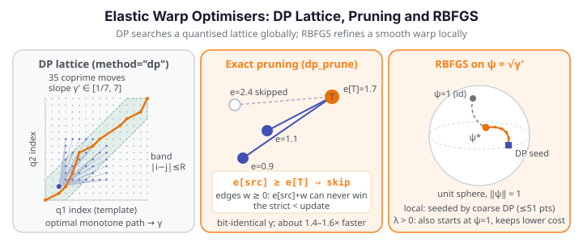
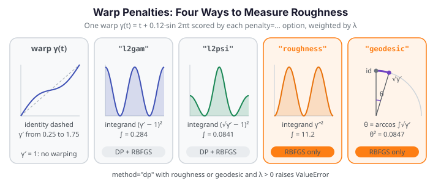

# Elastic Optimisers & Penalties

Every elastic aligner in fdars solves the same problem: find the warp $\gamma$ that minimises the distance between one curve's SRSF and the warped SRSF of another, plus an optional penalty on $\gamma$. *How* it is solved is configurable. The `*_with_config` functions (`elastic_align_pair_with_config`, `elastic_distance_with_config`, the distance-matrix and Karcher variants, the closed, $\mathbb{R}^d$, robust and landmark-constrained versions, and `align_to_target_with_config`) all take the same optimiser keywords:

```python
method="dp", lambda_=0.0, penalty="l2gam", optim_max_iter=30, scl=3,
nbhd_dim=7, dp_scl=1, dp_cost="piecewise_constant", dp_prune=True,
band_frac=0.0, lambda_scale="native"
```

With the defaults they reproduce the classic functions (`elastic_align_pair`, `karcher_mean`, …) bit for bit. This page explains each knob: the dynamic program and its accuracy limits, the Riemannian optimiser, the four warp penalties, the scale of $\lambda$, and the Sakoe–Chiba band.

{ .fdars-diagram }

Left: the dynamic program searches monotone paths on the grid made of coprime moves (35 moves for `nbhd_dim=7`, slopes from 1/7 to 7), optionally inside a band. Middle: exact pruning skips a predecessor whose accumulated cost already reaches the target cell's best. Right: RBFGS optimises $\psi = \sqrt{\dot\gamma}$ on the unit sphere, starting from a coarse DP warp.

---

## The objective

With SRSFs $q_j = \operatorname{sign}(\dot f_j)\sqrt{|\dot f_j|}$, the optimisers minimise

$$
E(\gamma) = \bigl\lVert \bar q_1 - (\bar q_2\circ\gamma)\sqrt{\dot\gamma}\bigr\rVert^2 + \lambda\,P(\gamma),
$$

where $\bar q_j = q_j/\lVert q_j\rVert$ are the **unit-normalised** SRSFs. Normalising makes the alignment independent of the overall size of the curves. The reported `distance`, however, is computed *after* the search from the un-normalised SRSFs, by re-differentiating the warped curve $f_2\circ\gamma$; it is the elastic distance in the units of the data.

---

## Dynamic programming (`method="dp"`)

The DP discretises $\gamma$ as a monotone path through the $m\times m$ grid of index pairs and finds the globally optimal path among those it can represent.

**Moves.** From each cell the path may step by $(\Delta r, \Delta c)$ with $1 \le \Delta r, \Delta c \le$ `nbhd_dim` and $\gcd(\Delta r, \Delta c) = 1$. The default `nbhd_dim=7` gives the classic 35 moves; the slope of the warp on each edge is $\Delta r/\Delta c$, so slopes lie between 1/7 and 7. A larger neighbourhood contains the smaller one, so the optimum of its own objective can only decrease; the cost grows roughly with the number of moves, $\approx 0.61\cdot$`nbhd_dim`$^2$.

**Edge costs.** The integral of $(\bar q_1 - \sqrt{\dot\gamma}\,\bar q_2\circ\gamma)^2$ along each edge is computed with

- `dp_cost="piecewise_constant"` (default): SRSFs constant on each grid interval;
- `dp_cost="piecewise_linear"`: SRSFs linear between samples, integrated exactly. With `nbhd_dim=10` this is fdasrsf's **DP2**;
- `dp_scl=k`: resample the SRSFs $k$ times finer for the edge integrals while the path stays on the input grid (no effect with the piecewise-linear cost).

**Exact pruning** (`dp_prune=True`, default). When filling cell $T$, a predecessor $s$ whose accumulated cost $e[s]$ already reaches the best value found for $T$ cannot win: every edge cost is non-negative, so $e[s] + w \ge e[T]$. Skipping it without evaluating the edge changes nothing, so the warps are **bit-identical** to the unpruned fill, at about 1.4–1.6 times the speed. The engine only prunes when the edge costs are guaranteed non-negative ($\lambda \ge 0$, strictly increasing `argvals`).

**The residual floor.** Because the slopes are quantised, the DP cannot represent a smooth warp exactly, and even an exactly warped copy of a curve keeps a non-zero distance. The floor shrinks with a finer neighbourhood, a better edge cost and a finer grid, and RBFGS removes most of it:

```python exec="1" source="above" result="text"
import time
import numpy as np
from fdars import alignment as A

mu = lambda s: np.exp(-(s - 0.35) ** 2 / 0.01) + 0.7 * np.exp(-(s - 0.7) ** 2 / 0.006)
configs = {
    "DP  (nbhd_dim=7)":        dict(),
    "DP2 (nbhd_dim=10, pw-lin)": dict(nbhd_dim=10, dp_cost="piecewise_linear"),
    "RBFGS":                   dict(method="rbfgs"),
}
for m in (101, 201):
    t = np.linspace(0, 1, m)
    f, g = mu(t), mu(t + 0.3 * t * (1 - t))           # g is an exactly warped copy of f
    for name, cfg in configs.items():
        t0 = time.perf_counter()
        d = A.elastic_distance_with_config(f, g, t, **cfg)
        print(f"m={m}  {name:27s} distance {d:.4f}   {1e3 * (time.perf_counter() - t0):5.1f} ms")

t = np.linspace(0, 1, 101)
a = A.elastic_align_pair_with_config(mu(t), mu(t + 0.3 * t * (1 - t)), t, dp_prune=True)
b = A.elastic_align_pair_with_config(mu(t), mu(t + 0.3 * t * (1 - t)), t, dp_prune=False)
print(f"pruning on vs off: identical warps = {np.array_equal(a['gamma'], b['gamma'])}")
print("FDARS_FENCE_OK")
```

The true distance is 0. On these sharp two-bump curves DP2 cuts the default DP's floor by 40–50 %, and RBFGS by about 65 %, while being the fastest of the three on a single pair. Doubling the grid roughly halves every floor. On smoother curves all floors are lower.

---

## RBFGS (`method="rbfgs"`) {#rbfgs-a-smooth-local-optimiser}

RBFGS is a Riemannian limited-memory BFGS (a port of fdasrsf's `optimum_reparam(method="RBFGS")`, after Huang, Gallivan, Srivastava & Absil). It represents the warp by $\psi = \sqrt{\dot\gamma}$, which lies on the unit sphere of $L^2[0,1]$ because $\int\psi^2 = \gamma(1) - \gamma(0) = 1$, and optimises directly over smooth warps:

1. **Seed.** A DP warp on a coarse grid (at most 51 points) gives the starting point; with a band, the banded DP on the full grid does.
2. **Refine.** The SRSFs are resampled `scl` times finer (default 3) and L-BFGS steps along the sphere run for at most `optim_max_iter` iterations (default 30).
3. **Restart.** When penalised ($\lambda > 0$), it is also started from the identity ($\psi = 1$) and the lower-cost result is kept.

It is a **local** optimiser: it usually reaches a lower cost than the DP and returns smooth warps, but it can settle in a different local minimum than the globally optimal DP path. Use it

- when DP warps look jagged or have long flat (pinched) stretches,
- to get below the DP residual floor,
- for the `"roughness"` and `"geodesic"` penalties, which only RBFGS supports,
- in landmark-constrained alignment, where it refines each segment between landmarks.

---

## Warp penalties {#warp-penalties}

{ .fdars-diagram }

`penalty` chooses $P(\gamma)$, weighted by `lambda_`:

| `penalty` | $P(\gamma)$ | DP | RBFGS | Penalises |
|---|---|---|---|---|
| `"l2gam"` (default) | $\int(\dot\gamma - 1)^2$ | yes | yes | departure of the speed from 1 (the classic fdars penalty) |
| `"l2psi"` | $\int(\sqrt{\dot\gamma} - 1)^2$ | yes | yes | the same on the $\psi$ scale (fdasrsf's default) |
| `"roughness"` | $\int\ddot\gamma^2$ | — | yes | curvature of the warp: allows a constant change of speed, forbids wiggles |
| `"geodesic"` | $\arccos\bigl(\int\sqrt{\dot\gamma}\bigr)^2$ | — | yes | squared Fisher–Rao distance of $\gamma$ from the identity |

A DP can only add penalties that are sums of a function of the slope over its edges, which is why `"roughness"` (concentrated at the corners of the piecewise-linear path) and `"geodesic"` (a non-linear function of a global integral) need RBFGS; `method="dp"` with either of them and $\lambda > 0$ raises `ValueError`.

!!! note "`elastic_align_pair_penalized` is deprecated"
    Its `penalty_type="second_order"` and `"combined"` options smooth the DP warp *after* the search instead of penalising the objective. Use `elastic_align_pair_with_config(method="rbfgs", penalty="roughness", lambda_=...)`.

The effect of $\lambda$ on a noisy pair of curves, for the default penalty under both optimisers and for the roughness penalty. `warp_smoothness` is the bending energy $\int\ddot\gamma^2$ of the warp and `warp_complexity` its geodesic distance from the identity:

```python exec="1" source="above" result="text"
import numpy as np
from fdars import alignment as A

mu = lambda s: np.exp(-(s - 0.35) ** 2 / 0.01) + 0.7 * np.exp(-(s - 0.7) ** 2 / 0.006)
m = 101
t = np.linspace(0, 1, m)
rng = np.random.default_rng(0)
f = mu(t) + 0.03 * rng.standard_normal(m)
g = mu(t + 0.3 * t * (1 - t)) + 0.03 * rng.standard_normal(m)

def row(label, **cfg):
    r = A.elastic_align_pair_with_config(f, g, t, **cfg)
    print(f"{label:30s} bending {A.warp_smoothness(r['gamma'], t):8.1f}   "
          f"complexity {A.warp_complexity(r['gamma'], t):.3f}   distance {r['distance']:.3f}")

for lam in (0.0, 0.01, 0.1, 1.0):
    row(f"l2gam  dp    lambda={lam:g}", lambda_=lam)
    row(f"l2gam  rbfgs lambda={lam:g}", method="rbfgs", lambda_=lam)
for lam in (1e-4, 1e-2):
    row(f"roughness rbfgs lambda={lam:g}", method="rbfgs", penalty="roughness", lambda_=lam)
print("FDARS_FENCE_OK")
```

Reading it (the true warp has complexity 0.087 and bending energy 0.56):

- At $\lambda = 0$ both optimisers chase the noise: complexity 0.32–0.34, four times the truth, with huge bending energy (the DP's twice the RBFGS's).
- `l2gam` with $\lambda = 0.01$ cuts the bending by more than an order of magnitude but the warp is still too large (0.13–0.15); at $\lambda = 0.1$ it is too small, and at $\lambda = 1$ it collapses to the identity. The penalty shrinks the *size* and the *roughness* of the warp together.
- The roughness penalty only targets the wiggles: at $\lambda = 10^{-4}$ it returns a warp with the true complexity (0.093) and bending energy (1.4). It lives on a different scale, an absolute $\int\ddot\gamma^2$: at $10^{-2}$ it already flattens the warp, and on narrow features values like 0.1 give an essentially identity warp.
- The reported distance is not monotone in $\lambda$: it is the post-hoc un-normalised elastic distance, not the penalised objective.

---

## The scale of $\lambda$ {#the-scale-of-lambda}

The two optimisers read $\lambda$ in slightly different conventions. The DP penalises in the fdars convention: edge costs on unit-norm SRSFs, integrated in `argvals` units. RBFGS follows fdasrsf: SRSFs resampled `scl` times finer, with fdasrsf's `lamScale` weighting. The objectives coincide when $\lambda_{\text{rbfgs}} = \varphi\,\lambda_{\text{dp}}$, with a data-dependent factor $\varphi$:

- for 1-D curves $\varphi = 1 + O(1/m)$: the conventions nearly coincide;
- for $\mathbb{R}^d$ curve shapes (raw, un-normalised SRVFs) $\varphi \approx 1/(m\,\lVert q_1\rVert\,\lVert q_2\rVert)$: the same number means a very different strength.

`lambda_scale` removes the ambiguity: `"native"` (default) lets each optimiser read $\lambda$ in its own convention; `"dp"` declares $\lambda$ to be in the DP convention (RBFGS uses $\varphi\lambda$); `"fdasrsf"` declares it in the fdasrsf convention (DP uses $\lambda/\varphi$). Use `"dp"` or `"fdasrsf"` when you tune $\lambda$ under one optimiser and switch to the other, or when you reproduce fdasrsf results. `"roughness"` and `"geodesic"` exist only under RBFGS and are never converted.

Even with a fixed convention, $\lambda$ is not transferable between datasets: the data term is the distance between *normalised* SRSFs, whose size depends on how different the curves are. Choose it per dataset:

- `lambda_cv(data, argvals, lambdas)` scores candidates by cross-validation. It is **biased toward small $\lambda$** and often returns the smallest candidate; treat its answer as a lower bound.
- `peak_persistence(data, argvals, lambdas)` picks the $\lambda$ at which the number of peaks of the Karcher mean is stable, useful when the number of features is what matters.
- Look at the warps: bending energy, complexity, and whether long flat stretches (pinching) remain.

Both selectors are demonstrated on [Advanced Elastic Alignment](advanced-alignment.md).

---

## The Sakoe–Chiba band (`band_frac`) {#the-band}

`band_frac > 0` restricts the warp to a corridor around the identity: the index radius is $R = \lceil \texttt{band\_frac}\cdot m\rceil$, so $|\gamma(t) - t| \le R\,h$ on a uniform grid of spacing $h$.

- **DP** confines the path to $|r - c| \le R$: it is exact *within* the band and costs about $O(m R)$ instead of $O(m^2)$.
- **RBFGS** starts from the banded DP, runs unconstrained, then clamps the warp pointwise into the band (a clamp between two increasing bounds keeps it monotone) and returns the better of the clamped RBFGS warp and the DP seed. The result satisfies the band and is never worse than the banded DP; the band mainly speeds up the seed.
- The landmark-constrained and curve-shape functions reject `band_frac > 0`.

The band is a constraint on the *model*, not only a speed-up: if the true displacement exceeds it, the warps are clipped and the alignment degrades.

```python exec="1" source="above" result="text"
import time
import numpy as np
from fdars import alignment as A

mu = lambda s: np.exp(-(s - 0.35) ** 2 / 0.01) + 0.7 * np.exp(-(s - 0.7) ** 2 / 0.006)
m = 201
t = np.linspace(0, 1, m)
rng = np.random.default_rng(1)
X = np.array([mu(t + rng.uniform(-0.4, 0.4) * t * (1 - t)) for _ in range(20)])   # |gamma - t| up to 0.1

ref = None
for bf in (0.0, 0.3, 0.1, 0.05, 0.02):
    t0 = time.perf_counter()
    r = A.karcher_mean_with_config(X, t, band_frac=bf, max_iter=10)
    dt = time.perf_counter() - t0
    ref = r if ref is None else ref
    ratio = np.var(r["aligned_data"], 0).mean() / np.var(X, 0).mean()
    print(f"band_frac={bf:<4}  {dt:5.2f} s   variance after/before {ratio:.4f}   "
          f"max |mean - unbanded mean| {np.abs(r['mean'] - ref['mean']).max():.4f}")
print("FDARS_FENCE_OK")
```

While the band contains the true displacement (about 0.1 here), the banded Karcher mean is **identical** to the unbanded one and up to four times faster. At `band_frac=0.05` the warps are clipped, 8 % of the variance stays, and the mean changes; at 0.02 the alignment mostly fails. Choose `band_frac` above the largest plausible displacement, or pre-align large shifts with a [shift model](shift-registration.md). [Banded Elastic Alignment](banded-alignment.md) has more on the band and the older `*_with_band` functions.

---

## Which optimiser?

| Situation | Setting |
|---|---|
| Default; reference results; global optimum among quantised warps | `method="dp"` |
| fdasrsf parity, lower residual floor at DP's guarantees | `nbhd_dim=10, dp_cost="piecewise_linear"` (DP2) |
| Smooth warps, lowest cost, exact constrained segments | `method="rbfgs"` |
| Noisy curves | $\lambda > 0$ with `"l2gam"` (DP or RBFGS) or `"roughness"` (RBFGS), after pre-smoothing |
| Long curves with small phase | `band_frac` above the largest displacement |
| Tuning $\lambda$ under one optimiser, running under another | `lambda_scale="dp"` or `"fdasrsf"` |

RBFGS is not only more accurate: for group alignment it can also be faster than DP, because its coarse DP seed is cheap. In the band example above, `karcher_mean_with_config(X, t, method="rbfgs")` takes about a third of the unbanded DP's time.

## See also

- [Elastic Alignment](elastic-alignment.md) — the SRSF framework, Karcher mean and diagnostics.
- [Banded Elastic Alignment](banded-alignment.md) — the band in more detail.
- [Landmark Registration](landmark-registration.md#landmarks-elastic-between-them) — constrained DP vs RBFGS.
- [Choosing an Alignment Method](choosing-a-method.md).

## References

- Srivastava, A., Klassen, E. (2016). *Functional and Shape Data Analysis.* Springer. (Dynamic programming for elastic registration.)
- Huang, W., Gallivan, K.A., Srivastava, A., Absil, P.-A. (2016). Riemannian optimization for registration of curves in elastic shape analysis. *Journal of Mathematical Imaging and Vision* 54(3):320–343.
- Sakoe, H., Chiba, S. (1978). Dynamic programming algorithm optimization for spoken word recognition. *IEEE Transactions on Acoustics, Speech, and Signal Processing* 26(1):43–49.
