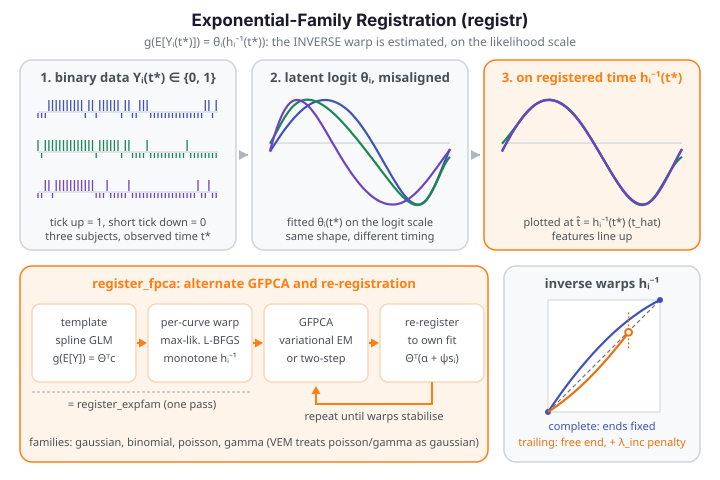

# Non-Gaussian Registration

Accelerometers record whether a person is active minute by minute (0/1). Neurons fire counts per time bin. Disease registries record yes/no states per visit. These are functional data with **binary, count or positive-skewed values**, and they have phase variability like any other: people get up at different times, trials start with different latencies. Aligning them with SRSF or least-squares methods does not work well: the raw values are discrete, derivatives are meaningless, and smoothing them first to "proportions" or $\log$ counts throws information away and distorts the timing near 0 and 1.

`register_fpca` registers such curves **on the likelihood scale**. It is a port of the R package `registr` (Wrobel et al. 2019; Wrobel & Bauer 2021): each curve's time axis is warped so that its observations are most likely under an exponential-family model whose mean is a smooth template, and the template itself is a generalised functional principal component (GFPCA) model estimated jointly. It also handles **irregular grids** and **curves cut off at the start or the end**.

{ .fdars-diagram }

Binary curves registered on the logit scale by estimating inverse warps $h_i^{-1}$.

---

## The model

For curve $i$ observed at times $t^*_{ij}$,

$$
g\bigl(\mathbb{E}[Y_i(t^*)]\bigr) = \theta_i\bigl(h_i^{-1}(t^*)\bigr), \qquad
\theta_i(t) = \Theta(t)^\top(\alpha + \psi\, s_i),
$$

with

- $g$ the canonical link of the chosen `family`: `"gaussian"` (identity), `"binomial"` (logit; values in $[0, 1]$), `"poisson"` (log; values $\ge 0$), `"gamma"` (log; values $> 0$, per-curve scale);
- $\Theta$ a cubic B-spline basis of size `kt` (default 8), $\alpha$ the population mean coefficients, $\psi$ the FPC coefficients and $s_i \sim N(0, I)$ the subject scores (`npc` components, default 1);
- $h_i^{-1}$ the **inverse** warp: it maps the observed ("chronological") time $t^*$ to the registered ("template") time. It is a monotone cubic B-spline with `kh` coefficients (default 4) on the curve's own observed range, with inner knots at quantiles of its time points.

!!! info "This method estimates the inverse warp"
    Most aligners return a warp $h_i$ with registered curve $x_i(h_i(t))$. `register_fpca` returns $\hat t_{ij} = h_i^{-1}(t^*_{ij})$ (`registration["t_hat"]`, one array per curve): the registered time at which each observation sits. To plot registered data, plot $Y_{ij}$ against $\hat t_{ij}$ (or use `registered_argvals` / `registered_values`). `evaluate_inverse_warp(hinv_beta[i], hinv_inner_knots[i], t_lo, t_hi, t)` evaluates $h_i^{-1}$ anywhere on the curve's range.

---

## The algorithm

`register_fpca` alternates registration and GFPCA:

1. **Template.** A spline GLM $g(\mathbb{E}[Y]) = \Theta^\top c$ is fitted to all observations pooled (iteratively reweighted least squares). The time range of `template` (default: the data) must equal the data's.
2. **Registration** (`register_expfam` is this step alone). For every curve, the coefficients of $h_i^{-1}$ maximise the curve's log-likelihood under the template. registr does this with a log-barrier `constrOptim`; fdars reparametrises the coefficients through a softmax of increments (so every candidate is strictly monotone) and uses L-BFGS with analytic gradients for all four families. Losses are therefore at most R's, and warps are strictly monotone.
3. **GFPCA** of the registered data (see below).
4. **Re-registration.** Every curve is re-registered to its **own** fitted curve $\Theta^\top(\alpha + \psi\,\hat s_i)$, warm-started from the previous warp. This separates amplitude (the score $s_i$) from phase: a curve that is simply more active is not warped to look like the mean.
5. Repeat 3–4 until the mean squared change of $\hat t / t_{\max}$ is at most $10^{-4}$, or for `max_iterations` (default 10), then run a final GFPCA.

### Two GFPCA engines

| `fpca_type` | Method | Families | Cost |
|---|---|---|---|
| `"variational_em"` (default) | registr `bfpca` / `fpca_gauss`: EM with the Jaakkola–Jordan variational bound for binary data (one variational parameter per observation), exact EM for Gaussian data | likelihood-based for **gaussian and binomial only**; poisson and gamma data are treated as **gaussian on the data scale**, as in R | fast |
| `"two_step"` | registr `gfpca_twoStep` (Gertheiss et al. 2017): (1) smooth covariance on the latent scale (Hall, Müller & Yao 2008: P-spline GLM mean, tensor-spline smooth of the off-diagonal cross-products, delta-method transform, near-PD projection); (2) eigen-decomposition; (3) scores and mean from a GLMM fitted natively (REML for gaussian, Laplace otherwise) | family-specific for **all four** families | much slower |

Prefer `"two_step"` for Poisson and gamma data when the GFPCA itself matters; for registration alone the variational EM is usually enough (see the example below). `npc_var_explained` (and `npc_min_component_share`) choose the number of components by explained variance, registr's `npc_criterion`.

---

## Registering binary and count curves

Thirty curves are generated from a common latent template $\theta$ evaluated at a known inverse warp, $Y_i(t^*) \sim \text{Bernoulli}\bigl(\operatorname{logit}^{-1}\theta(h_i^{-1}(t^*))\bigr)$, and likewise with Poisson counts and a log link. The table compares the recovered inverse warps with the truth (mean absolute error after removing the common part, $\times 10^{-3}$), for `register_fpca` and for the usual workaround: smooth each curve, transform it to the logit or log scale, and align with the elastic Karcher mean.

```python exec="1" source="above" result="text"
import numpy as np
from fdars import alignment as A

def simulate(family, m, rng, n=30):
    t = np.linspace(0, 1, m)
    theta = (lambda s: 3 * np.sin(2 * np.pi * s) - 0.5) if family == "binomial" else \
            (lambda s: 1.5 * np.sin(2 * np.pi * s) + 0.5)
    Y, Hinv = [], []
    for _ in range(n):
        hinv = t + rng.uniform(-0.6, 0.6) * t * (1 - t)        # true inverse warp
        eta = theta(hinv)
        Y.append(rng.binomial(1, 1 / (1 + np.exp(-eta))) if family == "binomial" else rng.poisson(np.exp(eta)))
        Hinv.append(hinv)
    return t, np.array(Y, float), np.array(Hinv)

rng = np.random.default_rng(0)
print("family     m    register_fpca   smooth + elastic   no registration")
for family in ("binomial", "poisson"):
    for m in (100, 200):
        t, Y, Hinv = simulate(family, m, rng)
        err = lambda T: 1000 * np.abs((T - T.mean(0)) - (Hinv - Hinv.mean(0))).mean()

        r = A.register_fpca_regular(Y, t, family=family)
        T = np.array([np.asarray(x) for x in r["registration"]["t_hat"]])

        K = np.exp(-0.5 * ((t[:, None] - t[None, :]) / 0.06) ** 2)   # Gaussian kernel smoother
        S = Y @ (K / K.sum(1, keepdims=True)).T
        S = np.log((S + 0.02) / (1.02 - S)) if family == "binomial" else np.log(S + 0.5)
        G = np.asarray(A.karcher_mean(S, t)["gammas"])
        Te = np.array([np.interp(t, g, t) for g in G])               # elastic warp -> inverse warp

        print(f"{family:9s} {m:4d}   {err(T):13.1f}   {err(Te):16.1f}   {err(np.tile(t, (len(Y), 1))):15.1f}")
print("FDARS_FENCE_OK")
```

`register_fpca` recovers the warps best in every setting, with 20–40 % lower error than the smoothing workaround. With more observations per curve both approaches improve. (The elastic warp $\gamma_i$ registers $x_i(\gamma_i(t))$, so its inverse is the comparable quantity.)

---

## Variational EM or two-step?

Count curves whose level also varies between subjects (a random intercept on the log scale, recovered as the first GFPCA score):

```python exec="1" source="above" result="text"
import time
import numpy as np
from docs_fig import fast
from fdars import alignment as A

rng = np.random.default_rng(5)
n, m = 30, 100
t = np.linspace(0, 1, m)
Y, Hinv, level = [], [], []
for _ in range(n):
    hinv = t + rng.uniform(-0.6, 0.6) * t * (1 - t)
    s = rng.normal(0, 0.5)                                   # subject-level amplitude
    Y.append(rng.poisson(np.exp(1.5 * np.sin(2 * np.pi * hinv) + 0.5 + s)))
    Hinv.append(hinv)
    level.append(s)
Y, Hinv, level = np.array(Y, float), np.array(Hinv), np.array(level)

for fpca_type in fast(("variational_em", "two_step"), ("variational_em",)):
    t0 = time.perf_counter()
    r = A.register_fpca_regular(Y, t, family="poisson", fpca_type=fpca_type, npc=1)
    T = np.array([np.asarray(x) for x in r["registration"]["t_hat"]])
    err = 1000 * np.abs((T - T.mean(0)) - (Hinv - Hinv.mean(0))).mean()
    score = np.asarray(r["fpca"]["scores"])[:, 0]
    print(f"{fpca_type:15s} GFPCA family {r['fpca']['em_family']:8s} warp error {err:5.1f}"
          f"  |corr(score, level)| {abs(np.corrcoef(score, level)[0, 1]):.3f}"
          f"  ({time.perf_counter() - t0:.1f} s)")
print("FDARS_FENCE_OK")
```

Both engines recover the subject levels (correlation above 0.95) and similar warps. The variational EM reports `em_family = "gaussian"`: it modelled the counts as Gaussian on the data scale. The two-step fit is Poisson-specific and slightly more accurate here, at more than a hundred times the run time. (In local `DOCS_FAST` builds only the variational EM runs.)

---

## Incomplete curves

A curve can stop before the process it records has finished (a recording that ends early), or start late. With `incompleteness="trailing"`, `"leading"` or `"full"` the corresponding end(s) of $h_i^{-1}$ are **free**: the curve's last observation does not have to map to the end of the template. Free ends are weakly identified, so the negative log-likelihood is penalised by $n_i \cdot \lambda_{\text{inc}} \cdot \text{pen}$, where pen is the squared offset of the free end from the diagonal (or the squared difference in span for `"full"`), as in registr's `loss_h`. Incompleteness is not available with `warping="piecewise_linear2"`.

```python exec="1" source="above" result="text"
import numpy as np
from fdars import alignment as A
from fdars.pace_fpca import irreg_fdata_from_lists

rng = np.random.default_rng(0)
n, m = 30, 150
t = np.linspace(0, 1, m)
times, values, true_hinv = [], [], []
for _ in range(n):
    hinv = t + rng.uniform(-0.5, 0.5) * t * (1 - t)
    y = rng.poisson(np.exp(1.5 * np.sin(2 * np.pi * hinv) + 0.5)).astype(float)
    end = rng.integers(int(0.6 * m), m)                 # recording stops between 60% and 100%
    times.append(t[:end]); values.append(y[:end]); true_hinv.append(hinv[:end])
data = irreg_fdata_from_lists(times, values)

print("incompleteness  lambda_inc   warp error   end-point error   (x 1e-3)")
for inc, lam in [(None, 0.0), ("trailing", 0.0), ("trailing", 1.0), ("trailing", 10.0)]:
    r = A.register_fpca(data, family="poisson", incompleteness=inc, lambda_inc=lam)
    T = [np.asarray(x) for x in r["registration"]["t_hat"]]
    warp = 1000 * np.mean([np.abs(a - h).mean() for a, h in zip(T, true_hinv)])
    end = 1000 * np.mean([abs(a[-1] - h[-1]) for a, h in zip(T, true_hinv)])
    print(f"{str(inc):14s} {lam:10.1f}   {warp:10.1f}   {end:15.1f}")
print("FDARS_FENCE_OK")
```

Two lessons:

- **A free end needs a penalty.** With $\lambda_{\text{inc}} = 0$ the free end chases noise and the warps get *worse* than pretending the curves were complete.
- **With a moderate penalty** ($\lambda_{\text{inc}} \approx 1$) the end points are estimated better than under the complete-curve assumption, while the overall warp error stays the same. The gain is modest here because the true inverse warps do not move the end far from the diagonal; it grows when curves stop at very different stages of the process.

Treat $\lambda_{\text{inc}}$ as a tuning parameter: try a few values on a log scale and inspect where the free ends land.

---

## Piecewise-linear warps with priors

`warping="piecewise_linear2"` replaces the B-spline by registr's two-knot polygon $(0,0) \to (x_1,y_1) \to (x_2,y_2) \to (1,1)$ on each curve's range scaled to $[0,1]$, with $x_1 \ge 0.1$, $x_2 - x_1 \ge 0.1$, $x_2 \le 0.9$ (and the same for $y$). The binary likelihood is multimodal in these four numbers, so the optimiser adds a coarse grid start and a Nelder–Mead polish. For binomial data, `prior_sd` puts normal priors on the knots (means 0.25, 0.25, 0.75, 0.75). With this warping, `t_hat` is on the scaled domain. Use it when you want an interpretable, low-dimensional warp ("the morning came 40 minutes later").

---

## Parameters

| Parameter | Default | Effect |
|---|---|---|
| `family` | `"gaussian"` | `"binomial"`, `"poisson"`, `"gamma"` |
| `kh` | 4 | B-spline size of the inverse warp (≥ 4); more = more flexible warps |
| `warping` | `"nonparametric"` | or `"piecewise_linear2"` |
| `prior_sd` | `None` | knot prior (binomial + piecewise_linear2 only) |
| `incompleteness`, `lambda_inc` | `None`, 0 | free ends and their penalty |
| `max_iterations` | 10 | registration ⇄ GFPCA rounds |
| `warp_max_iter`, `warp_tol`, `gamma_scale_init` | 500, 1e-12, 1.5 | per-curve optimiser |
| `fpca_type` | `"variational_em"` | or `"two_step"` |
| `npc`, `kt` | 1, 8 | GFPCA components and spline size (`kt` is also the template size) |
| `npc_var_explained`, `npc_min_component_share` | `None` | choose `npc` by explained variance |
| `fpca_max_iter`, `error_thresh`, `seed` | 50, 1e-4, 1988 | EM controls; `psi_init`, `xi_init` fix the random start |
| `periodic` | `False` | periodic B-spline bases |

Entry points:

- `register_fpca(data, template=None, ...)` for an irregular data object from `fdars.pace_fpca.irreg_fdata_from_lists(times, values)`; `register_fpca_regular(data, argvals, ...)` for a dense $(n, m)$ matrix.
- `register_expfam(data, ...)`: one registration pass to the population template, without GFPCA.
- `gfpca_variational(data, family, ...)`, `gfpca_two_step(data, family, ...)`: GFPCA alone, without registration.

Results: `registration` (`t_hat`, `hinv_beta`, `hinv_inner_knots`, `curve_loss`, `loss`, `template_knots`, `template_coefs`, per-curve `converged`), `fpca` (`mean`, `efunctions`, `evalues`, `scores`, `fitted`, `em_family`, ...), `registered_data` (an irregular data object), `registered_argvals`, `registered_values`, `iterations`, `converged`, `registration_loss`.

!!! note "Reproducing R"
    The random initialisation of the EM uses a different generator from R, so results agree with registr only up to the EM tolerance; pass `psi_init` / `xi_init` to fix the start. registr's subsampling of more than $10^7$ rows is not ported.

## When to use it

- **Use it** for binary, count or positive-skewed curves with phase variability; for irregular grids; for curves that stop early or start late; when you want the GFPCA of the registered data in the same step.
- **Prefer elastic or continuous registration** for dense, roughly Gaussian curves: with `family="gaussian"` this model works, but the elastic and Ramsay–Li methods give metrics, amplitude/phase decompositions and smoother warp classes.
- **Check the warps.** With few observations per curve or a nearly flat template, the likelihood carries little information about timing; inspect `t_hat` against the observed times.

## See also

- [Sparse & Irregular Curves](sparse-elastic.md) — elastic analysis of irregularly sampled real-valued curves and trajectories.
- [PACE FPCA](../represent/pace-fpca.md) — FPCA of sparse Gaussian curves.
- [Functional GLM](../regression/functional-glm.md) — binary and count responses with functional predictors.
- [Choosing an Alignment Method](choosing-a-method.md).

## References

- Wrobel, J., Zipunnikov, V., Schrack, J., Goldsmith, J. (2019). Registration for exponential family functional data. *Biometrics* 75(1), 48–57.
- Wrobel, J., Bauer, A. (2021). registr 2.0: Incomplete curve registration for exponential family functional data. *Journal of Open Source Software* 6(61), 2964.
- Gertheiss, J., Goldsmith, J., Staicu, A.-M. (2017). A note on modeling sparse exponential-family functional response curves. *Computational Statistics & Data Analysis* 105, 46–52.
- Hall, P., Müller, H.-G., Yao, F. (2008). Modelling sparse generalized longitudinal observations with latent Gaussian processes. *Journal of the Royal Statistical Society, Series B* 70(4), 703–723.
- Jaakkola, T. S., Jordan, M. I. (1997). A variational approach to Bayesian logistic regression models and their extensions. *Proceedings of the Sixth International Workshop on Artificial Intelligence and Statistics*, PMLR R1, 283–294.
