# Align

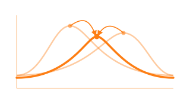

**Register and align curves to separate amplitude from phase variability.**

Functional observations vary in two ways: *amplitude* (how tall or deep the features are) and *phase* (when those features occur). Methods that ignore phase blur the mean and inflate the variance. The Align module estimates a warping function per curve, so that the registered curves $x_i(h_i(t))$ carry the amplitude and the warps $h_i$ carry the phase. It covers rigid shifts, affine and landmark warps, smooth Ramsay–Li registration, elastic (Fisher–Rao / SRSF) alignment with several optimisers, shape spaces of curves, likelihood-based registration of non-Gaussian curves, Bayesian alignment and template-free synchronisation.

**Not sure where to start?** Read [Choosing an Alignment Method](choosing-a-method.md): it matches the kind of phase variability in your data to a method, and shows on simulated data why the smallest matching warp class wins.

## Start here

<a class="fdars-gallery-item" href="choosing-a-method/">
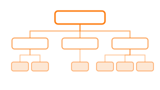

Choosing a Method

Decision tree, comparison table, recommendations and pitfalls for every aligner.

</a>
<a class="fdars-gallery-item" href="alignment-comparison/">
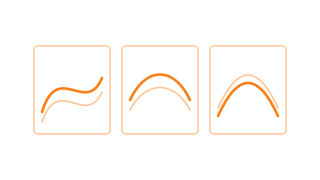

Comparing Methods

No alignment vs elastic vs landmark, side by side.

</a>

## Rigid &amp; parametric warps

<a class="fdars-gallery-item" href="shift-registration/">
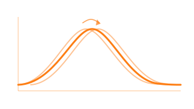

Shift Registration

One time delay per curve: least-squares, iterative Newton and landmark shifts.

</a>
<a class="fdars-gallery-item" href="affine-registration/">
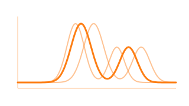

Affine Registration

Shift plus dilation of time, h(t) = a·t + b, with three criteria.

</a>
<a class="fdars-gallery-item" href="landmark-registration/">
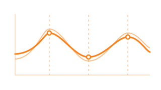

Landmark Registration

Pin detected features with monotone cubic warps, or elastically between them.

</a>
<a class="fdars-gallery-item" href="continuous-registration/">
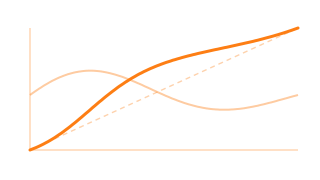

Continuous Registration

Ramsay–Li smooth monotone warps with a scale-free criterion.

</a>

## Elastic (Fisher–Rao)

<a class="fdars-gallery-item" href="elastic-alignment/">
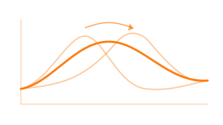

Elastic Alignment

SRSF registration, Karcher mean, and amplitude/phase separation.

</a>
<a class="fdars-gallery-item" href="elastic-optimisers/">

Elastic Optimisers &amp; Penalties

DP, DP2 and RBFGS, warp penalties, the λ scale and the band.

</a>
<a class="fdars-gallery-item" href="banded-alignment/">
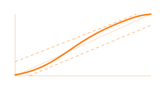

Banded Elastic Alignment

A Sakoe–Chiba corridor around the diagonal for long curves.

</a>
<a class="fdars-gallery-item" href="advanced-alignment/">
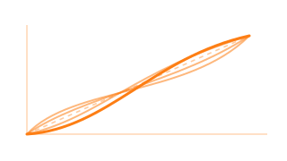

Advanced Elastic Alignment

Closed curves, partial matching, multiresolution, geodesics, generative models.

</a>
<a class="fdars-gallery-item" href="tsrvf/">
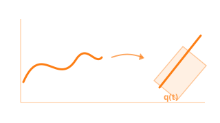

TSRVF

Linearised elastic analysis in the tangent space at the mean.

</a>
<a class="fdars-gallery-item" href="shape-analysis/">
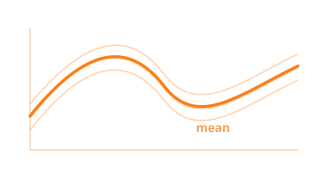

Shape Analysis (1-D)

Shape quotients, shape means and elastic FPCA for real-valued curves.

</a>

## Shapes

<a class="fdars-gallery-item" href="curve-shapes/">
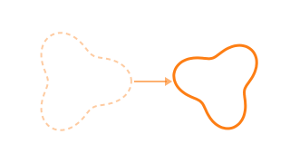

Shapes of Curves in R^d

Outlines and trajectories modulo translation, scale, rotation, speed and start point.

</a>

## Special data

<a class="fdars-gallery-item" href="sparse-elastic/">
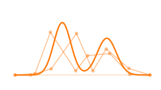

Sparse &amp; Irregular Curves

Elastic distances and spline means from a few irregular points per curve.

</a>
<a class="fdars-gallery-item" href="expfam-registration/">
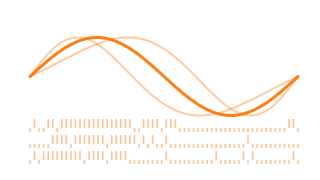

Non-Gaussian Registration

Binary and count curves registered on the likelihood scale, with GFPCA.

</a>

## Template-free &amp; probabilistic

<a class="fdars-gallery-item" href="pairwise-synchronization/">
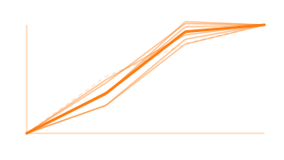

Pairwise Synchronisation

Tang–Müller: each warp is the inverted average of pairwise warps.

</a>
<a class="fdars-gallery-item" href="bayesian-alignment/">
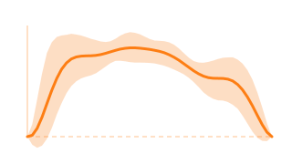

Bayesian Alignment

Posterior warps and template by pCN or infHMC, with R̂, ESS and tempering.

</a>

!!! info "Scope"

    - **Real-valued curves on one shared grid** (`argvals`) are supported by every family on these pages.
    - **Irregular or incomplete grids** are handled by `register_fpca` (curves observed on their own grids, optionally cut off at the start or end) and by the sparse elastic functions `sparse_elastic_align_pair` / `sparse_elastic_mean`. `elastic_partial_match` matches a short curve to a sub-interval of a longer one.
    - **Curves in $\mathbb{R}^d$**: the shape-space functions `curve_shape_*` quotient out translation, scale, rotation, reparametrisation and (for closed curves) the starting point; `karcher_mean_nd_with_config` and the other `*_nd_with_config` functions share one warp across coordinates without rotation or scale invariance.
    - **Non-Gaussian values** (binary, counts, positive-skewed): `register_fpca(family=...)`.
    - **Time series of different lengths** for search and classification: the DTW family in `fdars.metric`.
    - **Still unsupported:** manifold-valued trajectories other than the shape space (sphere-, SPD- or rotation-valued curves) and density-valued curves. Transform them to an unconstrained space first.
