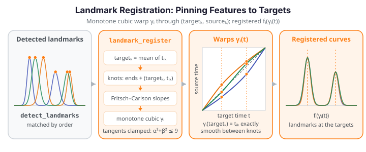

# Landmark Registration

Landmark registration is the oldest and most transparent way to remove phase variation: identify a handful of *landmarks* on each curve (a peak, a valley, a zero crossing, an inflection) and warp every curve so that its landmarks land at common target times. You *dictate* the correspondence rather than search for it. That makes the result fast and interpretable ("this child's growth spurt happened 1.3 years after the average"), at the cost of needing features that can be detected reliably.

It is the natural choice for curves with meaningful, identifiable features: the peak of the pubertal growth spurt, the P/QRS/T waves of an ECG, the peak force of a gait cycle. Where [elastic alignment](elastic-alignment.md) optimises the whole curve, landmark registration anchors the warp at a few feature times and fills in between with a smooth monotone curve. A hybrid, [landmark-constrained elastic alignment](#landmarks-elastic-between-them), pins the landmarks and optimises the elastic criterion between them.

{ .fdars-diagram }

From left to right: peaks found by `detect_landmarks` and matched by order; the steps of `landmark_register`; the resulting warps $\gamma_i$, which pass exactly through the knots $(\tau_k^\*, t_{ik})$ and are smooth monotone cubics between them; and the registered curves $x_i(\gamma_i(t))$ with every landmark on its target.

---

## The functions

| Function | Does |
|---|---|
| `detect_landmarks(curve, argvals, kind="peak", min_prominence=0.0)` | Finds features in one curve: `kind` is `"peak"`, `"valley"`, `"zero_crossing"`, `"inflection"` or `"custom"`. Returns a list of dicts with `position`, `kind`, `value`, `prominence`, in time order. |
| `landmark_register(data, argvals, landmarks, target=None)` | Warps each curve so that its landmarks (one list per curve) map to `target` (default: per-landmark mean). Returns `registered`, `gammas`, `landmarks`, `target_landmarks`. |
| `landmark_detect_and_register(data, argvals, kind="peak", min_prominence=0.0, expected_count=...)` | Detection plus registration in one call, using the **first** `expected_count` features of each curve. |
| `elastic_align_pair_constrained_with_config(f1, f2, argvals, landmark_targets, landmark_sources, ...)` | Elastic (SRSF) alignment of `f2` to `f1` whose warp passes through given landmark pairs. |

---

## Mathematical framework

### The warp

Given landmark times $t_{i1} < \dots < t_{iK}$ on curve $i$ and targets $\tau_1^\* < \dots < \tau_K^\*$, the warp $\gamma_i$ maps **target time to source time** and must satisfy

$$
\gamma_i(\tau_k^\*) = t_{ik}, \qquad \gamma_i(a) = a, \qquad \gamma_i(b) = b,
$$

so that the registered curve $\tilde x_i(t) = x_i(\gamma_i(t))$ shows landmark $k$ at $\tau_k^\*$. fdars builds $\gamma_i$ as a **monotone piecewise-cubic Hermite interpolant** (Fritsch–Carlson) through the knots $(a, a), (\tau_1^\*, t_{i1}), \dots, (\tau_K^\*, t_{iK}), (b, b)$:

1. Start from tangent slopes $d_j$ at the knots.
2. On each interval with secant slope $\Delta_j$, set $\alpha = d_j/\Delta_j$ and $\beta = d_{j+1}/\Delta_j$. If $\alpha^2 + \beta^2 > 9$, scale both tangents by $3/\sqrt{\alpha^2+\beta^2}$. This is the Fritsch–Carlson condition that guarantees the cubic on that interval is monotone.
3. Evaluate the Hermite cubic on every interval.

Unlike the piecewise-linear warp of the classical textbook recipe, the result has a continuous first derivative, so the registered curves have no kinks at the landmarks. Like it, the warp interpolates the landmarks exactly: there is no optimisation and no residual.

### The targets

By default $\tau_k^\* = \frac1n\sum_i t_{ik}$, the per-landmark mean, which keeps the registered sample near the "average" timing. Any fixed `target` works, for example the landmarks of a reference curve or round numbers.

### Prominence

A peak at $t_0$ has **prominence** $x(t_0) - \max\bigl(\min_{[t_L, t_0]} x, \min_{[t_0, t_R]} x\bigr)$, where $t_L, t_R$ are the nearest higher peaks (or the domain ends). A bump on the flank of a big peak has low prominence; an isolated peak has high prominence. `min_prominence` discards features below a threshold; valleys are peaks of $-x$.

---

## Example: the pubertal growth spurt

The Berkeley growth data contain the heights of 93 children at 31 ages. The velocity (first derivative) has a peak, the pubertal growth spurt, whose timing varies by years between children. We take 15 boys and 15 girls, compute velocities on ages 8–18 from a cubic spline, pick each child's **most prominent** velocity peak, and register on it.

```python exec="1" html="1" source="above"
import numpy as np
from scipy.interpolate import CubicSpline
from docs_data import load_growth
from docs_fig import fig, render
from fdars import alignment as A

age, X, meta = load_growth()
idx = np.r_[0:15, 39:54]                       # 15 boys, 15 girls
t = np.linspace(8, 18, 101)
V = np.array([CubicSpline(age, x)(t, 1) for x in X[idx]])   # velocity, cm/year

# one landmark per child: the most prominent velocity peak (the spurt)
peaks = [A.detect_landmarks(v, t, kind="peak", min_prominence=1.0) for v in V]
L = [[max(p, key=lambda d: d["prominence"])["position"]] for p in peaks]

res = A.landmark_register(V, t, L)
R, G = np.asarray(res["registered"]), np.asarray(res["gammas"])
tau = res["target_landmarks"][0]

f, (a1, a2, a3) = fig(ncols=3, figsize=(11, 3.6))
a1.plot(t, V.T, color="#3f51b5", lw=0.8, alpha=0.5)
a1.plot(t, V.mean(0), color="#dc3545", lw=2.2, label="mean")
a1.set(title="Velocity (spurts drift)", xlabel="age", ylabel="cm / year")
a1.legend(fontsize=8)
a2.plot(t, R.T, color="#198754", lw=0.8, alpha=0.5)
a2.plot(t, R.mean(0), color="#e8710a", lw=2.2, label="mean")
a2.axvline(tau, color="#6c757d", ls=":", lw=1)
a2.set(title="Registered on the spurt", xlabel="registered age")
a2.legend(fontsize=8)
a3.plot(t, G.T, color="#6f42c1", lw=0.9, alpha=0.6)
a3.plot(t, t, color="#6c757d", ls="--", lw=1.2)
a3.set(title="Warps $\\gamma_i$", xlabel="registered age", ylabel="original age", aspect="equal")
print(render(f))

hit = max(abs(np.interp(tau, t, g) - l[0]) for g, l in zip(G, L))
print(f"<p>target spurt age {tau:.2f}; max |gamma_i(target) - landmark_i| = {hit:.1e}; "
      f"variance after/before = {np.var(R, 0).mean() / np.var(V, 0).mean():.2f}; "
      f"height of the mean peak {V.mean(0).max():.1f} -> {R.mean(0).max():.1f} cm/year "
      f"(average individual peak {np.mean(V.max(1)):.1f})</p>")
```

The unregistered mean (left) is a low, broad hump: it averages spurts that happen between ages 11 and 15. After registration the mean spurt reaches almost the average individual peak height, and the warps (right) show who matured early (below the diagonal near the target) or late (above). The sampled warps pass through their knots to better than $10^{-3}$ years (the warp is exact at the knot; the residual is linear interpolation between grid points). About half of the variance remains: the spurts differ in size and duration, which a single landmark cannot and should not remove.

---

## Automatic detection: check what was matched

`landmark_detect_and_register` is convenient, but it pairs features **by order**: it keeps the *first* `expected_count` detected features of each curve, in time order, and registers them. Two consequences:

- A spurious early feature (a pre-pubertal bump) becomes "landmark 1" for that curve, and every later pairing shifts.
- Every curve must have at least `expected_count` detected features (default 1). If one has fewer, the call raises `ValueError` rather than registering on mismatched landmarks; `expected_count=0` is rejected too.

```python exec="1" source="above" result="text"
import numpy as np
from scipy.interpolate import CubicSpline
from docs_data import load_growth
from fdars import alignment as A

age, X, meta = load_growth()
t = np.linspace(8, 18, 101)
V = np.array([CubicSpline(age, x)(t, 1) for x in X[np.r_[0:15, 39:54]]])
ratio = lambda R: np.var(np.asarray(R), 0).mean() / np.var(V, 0).mean()

counts = [len(A.detect_landmarks(v, t, kind="peak", min_prominence=1.0)) for v in V]
print(f"peaks detected per curve: {counts}")
r = A.landmark_detect_and_register(V, t, kind="peak", min_prominence=1.0, expected_count=1)
print(f"expected_count=1: target {np.round(r['target_landmarks'], 2)}, variance after/before {ratio(r['registered']):.2f}")
try:
    A.landmark_detect_and_register(V, t, kind="peak", min_prominence=1.0, expected_count=2)
except ValueError as e:
    print(f"expected_count=2: ValueError: {e}")
print("FDARS_FENCE_OK")
```

Between one and four velocity peaks are detected per child. With `expected_count=1` the *first* peak (often a small bump before the spurt) is registered, so the target lands at 11.5 years and the variance barely moves (0.95). Choosing the most prominent peak, as in the previous example, targets 12.8 years and halves it. Inspect the detections, choose the landmarks yourself when the features are ambiguous, and pass them to `landmark_register`.

!!! warning "Invalid input returns zero warps"
    `landmark_register` does not raise on inconsistent input (for example, fewer landmark lists than curves): it returns `gammas` filled with **zeros**, not identity warps, and leaves the curves unregistered. Check that `len(landmarks) == data.shape[0]` and that every curve has the same number of landmarks, or test `gammas[:, -1]` against `argvals[-1]`.
    Tracked upstream as [sipemu/fdars#78](https://github.com/sipemu/fdars/issues/78).

Other properties to keep in mind:

- **Targets must be increasing** within the domain; landmarks at or beyond the end points are dropped from the knots.
- **A zero secant** (two equal consecutive source landmarks) gives a flat segment of the warp; the warp is then non-decreasing rather than strictly increasing.
- **Grid resolution.** `detect_landmarks` reports grid points; refine the grid (as above, by evaluating a spline on 101 ages) or interpolate the feature when sub-grid accuracy matters.

---

## Landmarks + elastic between them

Sometimes the landmarks are trustworthy but the timing *between* them is not a smooth interpolation: the curve has further features that should be aligned too. `elastic_align_pair_constrained_with_config` solves the elastic problem

$$
\min_{\gamma\in\Gamma}\;\bigl\lVert q_1 - (q_2\circ\gamma)\sqrt{\dot\gamma}\bigr\rVert^2 + \lambda P(\gamma)
\quad\text{subject to}\quad \gamma(\tau_k) = s_k ,
$$

where `landmark_targets` $\tau_k$ are times on `f1` and `landmark_sources` $s_k$ the corresponding times on `f2`. The landmark pairs are first snapped to the grid (the pairs actually enforced are returned as `enforced_landmarks`); pairs that would cross are dropped. Then:

- **`method="dp"`** runs the dynamic program separately on each segment between consecutive waypoints.
- **`method="rbfgs"`** uses the segmented DP as a seed and refines each segment with the Riemannian optimiser, which reaches a lower cost and a smoother warp.

Both pass exactly through the enforced waypoints. The Sakoe–Chiba band is not supported (`band_frac` must be 0), and the `"geodesic"` penalty cannot be combined with $\lambda > 0$ here.

```python exec="1" source="above" result="text"
import numpy as np
from fdars import alignment as A

t = np.linspace(0, 1, 101)
mu = lambda s: np.exp(-(s - 0.3) ** 2 / 0.004) + 0.8 * np.exp(-(s - 0.7) ** 2 / 0.004)
w = t + 0.4 * t * (1 - t) * (t - 0.2)            # true warp
f1 = mu(t)
f2 = mu(np.interp(t, w, t))                       # f2(w(t)) = f1(t): peaks moved to w(0.3), w(0.7)
targets = np.array([0.3, 0.7])
sources = np.interp(targets, t, w)

free = A.elastic_align_pair(f1, f2, t)
print(f"unconstrained DP:  distance {free['distance']:.3f}, "
      f"|gamma(tau) - s| = {np.abs(np.interp(targets, t, free['gamma']) - sources).round(4)}")
for method in ("dp", "rbfgs"):
    r = A.elastic_align_pair_constrained_with_config(f1, f2, t, targets, sources, method=method)
    enf = np.asarray(r["enforced_landmarks"])
    hit = np.abs(np.interp(enf[:, 0], t, r["gamma"]) - enf[:, 1]).max()
    print(f"constrained {method:5s}: distance {r['distance']:.3f}, enforced pairs {enf.round(2).tolist()}, "
          f"max |gamma(tau) - s| at enforced pairs {hit:.1e}")
print("FDARS_FENCE_OK")
```

Here the unconstrained DP already lands within 0.002 of the true landmarks; the constraint guarantees it. Both constrained solvers hit the (grid-snapped) landmark pairs exactly; snapping moves a pair by up to half a grid step from the requested source (0.742 becomes 0.74). Within the constraint the DP warp is the same as the free one, while RBFGS, which is not limited to quantised slopes, lowers the elastic distance by about 30 %. The older `elastic_align_pair_constrained(f1, f2, t, targets, sources, lambda_=0.0)` is the DP version without the optimiser options. The landmark arrays must be NumPy arrays, not lists.

---

## Landmark, shift, or elastic?

| | Landmark (`landmark_register`) | [Landmark shift](shift-registration.md#landmark-shift-registration) | Constrained elastic | [Elastic](elastic-alignment.md) (`karcher_mean`) |
|---|---|---|---|---|
| Correspondence | you specify it | you specify one point | you specify it, the rest is optimised | found automatically |
| Warp | monotone cubic through the knots | a translation | elastic, through the knots | elastic ($\Gamma$) |
| Template | none | none | pairwise (`f1`) | Karcher mean |
| Cost | trivial | trivial | one DP (+ RBFGS) per pair | iterative DP |
| Best when | features are the phase | one marker, rigid phase | features fixed, more to align between | no reliable features |

Landmark registration is ideal when the features to align are unambiguous (a clear systolic peak, a known stimulus onset). When features are noisy, hard to detect or absent, prefer elastic alignment, which uses the whole curve. See [Choosing an Alignment Method](choosing-a-method.md) for the full decision tree.

## See also

- [Shift Registration](shift-registration.md) — including the landmark shift.
- [Continuous Registration](continuous-registration.md) — smooth warps without landmarks.
- [Growth curve alignment](../examples/growth-alignment.md) — the same data aligned elastically.
- [Comparing Methods](alignment-comparison.md).

## References

- Kneip, A., Gasser, T. (1992). Statistical tools to analyze data representing a sample of curves. *Annals of Statistics* 20(3):1266–1305.
- Gasser, T., Kneip, A. (1995). Searching for structure in curve samples. *Journal of the American Statistical Association* 90(432):1179–1188.
- Fritsch, F.N., Carlson, R.E. (1980). Monotone piecewise cubic interpolation. *SIAM Journal on Numerical Analysis* 17(2):238–246.
- Ramsay, J.O., Silverman, B.W. (2005). *Functional Data Analysis*, 2nd ed., ch. 7. Springer.
