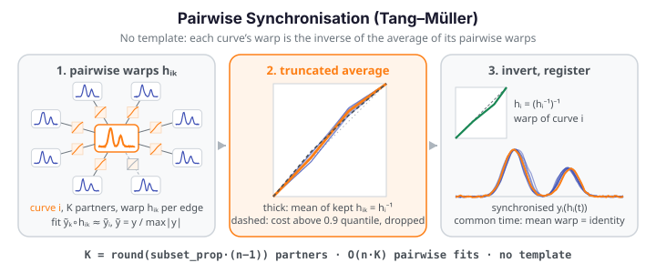

# Pairwise Synchronisation

Every other group aligner in fdars registers curves **to a template**: the cross-sectional mean, the Karcher mean, a landmark target. When the sample is heterogeneous or noisy, that template can be a poor reference, and errors in it propagate to every warp. Tang & Müller (2008) proposed a template-free alternative: estimate a warp between **pairs** of curves, which only requires the two curves to be comparable with each other, and obtain each curve's warp to the common time scale by **averaging its pairwise warps**.

`pairwise_synchronization` implements this method (R `fdapace::WFDA`).

{ .fdars-diagram }

Each curve's warp inverts the truncated mean of its pairwise warps; no template is needed.

---

## How it works

For each curve $i$:

1. **Partners.** Draw $K = \operatorname{round}(\text{subset\_prop}\cdot(n-1))$ partner curves at random (seeded with `seed + i`).
2. **Pairwise warps.** For each partner $k$, fit a monotone piecewise-linear warp $h_{ik}$ with `nknots` equally spaced interior knots such that $\tilde y_k \circ h_{ik} \approx \tilde y_i$:

    $$
    \min_{h_{ik}} \sum_j \bigl(\tilde y_k(h_{ik}(w_j)) - \tilde y_i(w_j)\bigr)^2 + \lambda \sum_j \bigl(h_{ik}(w_j) - w_j\bigr)^2 ,
    $$

    where $\tilde y = y / \max\lvert y\rvert$ is the curve normalised by its maximum absolute value and $w$ is the grid mapped to $[0, 1]$. The second term keeps pairwise warps near the identity; with `lambda_=None`, $\lambda$ is fdapace's data-driven value $10^{-4}\sqrt{\sum_i\int(\tilde y_i - \bar{\tilde y})^2/(n-1)}$. The knot heights are optimised by box-constrained Nelder–Mead with restarts (fdapace uses BOBYQA).
3. **Average.** The average of the pairwise warps estimates $h_i^{-1}$: with `choice="truncated"` (default) partners whose fit cost exceeds the `truncation_quantile` (0.9) of the costs are dropped and the rest averaged; with `choice="weighted"` all partners are averaged with weights inversely proportional to their costs.
4. **Invert.** $h_i$ is the inverse of that average, and the synchronised curve is $y_i \circ h_i$.

Why does averaging work? If curve $i$ runs on its own clock $h_i$, the pairwise warp to partner $k$ is roughly $h_k \circ h_i^{-1}$. Averaging over many partners averages out the partners' clocks, and the common time scale is defined as the one in which **the average warp is the identity**. No template is ever estimated.

The result holds `warps` $h_i$ (registered curve $y_i(h_i(t))$, same convention as the other aligners), `inverse_warps`, the synchronised curves `aligned`, the per-curve `costs`, the `lambda` used, and the raw `partners`, `pairwise_warps` and `pairwise_costs`. All warps are on the `argvals` scale.

---

## Example: robustness to noise

Twenty curves are two-bump functions, each warped by a random piecewise-linear warp through two knots, plus white noise of increasing size. The table reports the error of the estimated registering warps (mean absolute, $\times 10^{-3}$, after removing the common part, averaged over three samples) for pairwise synchronisation and for the elastic Karcher mean on raw curves, on pre-smoothed curves, and on pre-smoothed curves with a warp penalty:

```python exec="1" source="above" result="text"
import numpy as np
from fdars import alignment as A

def simulate(seed, noise, n=20, m=101):
    rng = np.random.default_rng(seed)
    t = np.linspace(0, 1, m)
    mu = lambda s: np.exp(-(s - 0.33) ** 2 / 0.006) + 0.6 * np.exp(-(s - 0.67) ** 2 / 0.006)
    X, H = [], []
    for _ in range(n):
        knots = np.sort(rng.uniform(0.2, 0.8, 2))
        heights = np.sort(np.clip(knots + rng.uniform(-0.08, 0.08, 2), 0.05, 0.95))
        w = np.interp(t, [0, *knots, 1], [0, *heights, 1])        # piecewise-linear data warp
        X.append(mu(w) + noise * rng.standard_normal(m))
        H.append(np.interp(t, w, t))                              # true registering warp
    return t, np.array(X), np.array(H)

print("noise sd   pairwise   Karcher   Karcher (smoothed)   Karcher (smoothed, lambda=0.05)")
for noise in (0.02, 0.1, 0.2):
    errs = []
    for seed in range(3):
        t, X, H = simulate(seed, noise)
        inner = (t > 0.1) & (t < 0.9)
        err = lambda W: 1000 * np.abs(((W - W.mean(0)) - (H - H.mean(0)))[:, inner]).mean()
        Xs = np.asarray(A.srsf_presmooth(X, t, smoothing="box", passes=25))
        errs.append([err(np.asarray(A.pairwise_synchronization(X, t)["warps"])),
                     err(np.asarray(A.karcher_mean(X, t)["gammas"])),
                     err(np.asarray(A.karcher_mean(Xs, t)["gammas"])),
                     err(np.asarray(A.karcher_mean(Xs, t, lambda_=0.05)["gammas"]))])
    e = np.mean(errs, axis=0)
    print(f"{noise:8.2f}   {e[0]:8.1f}   {e[1]:7.1f}   {e[2]:18.1f}   {e[3]:31.1f}")
print("FDARS_FENCE_OK")
```

On clean data the elastic Karcher mean is slightly better: its warp class is richer and its template sharp. As noise grows, the elastic alignment of raw curves degrades fast, because the SRSF differentiates the noise. Pairwise synchronisation hardly changes: it compares function **values**, not derivatives, uses a four-parameter warp, and its penalty keeps pairwise warps near the identity. Elastic alignment catches up with it, and slightly overtakes it, only after pre-smoothing **and** a warp penalty, both of which need tuning.

---

## Choosing the settings

```python exec="1" source="above" result="text"
import time
import numpy as np
from fdars import alignment as A

rng = np.random.default_rng(0)
mu = lambda s: np.exp(-(s - 0.33) ** 2 / 0.006) + 0.6 * np.exp(-(s - 0.67) ** 2 / 0.006)
m = 101
t = np.linspace(0, 1, m)
for n in (10, 20, 40):
    X, H = [], []
    for _ in range(n):
        knots = np.sort(rng.uniform(0.2, 0.8, 2))
        w = np.interp(t, [0, *knots, 1], [0, *np.sort(np.clip(knots + rng.uniform(-0.08, 0.08, 2), 0.05, 0.95)), 1])
        X.append(mu(w) + 0.05 * rng.standard_normal(m))
        H.append(np.interp(t, w, t))
    X, H = np.array(X), np.array(H)
    inner = (t > 0.1) & (t < 0.9)
    err = lambda W: 1000 * np.abs(((W - W.mean(0)) - (H - H.mean(0)))[:, inner]).mean()
    for kw in ({}, {"choice": "weighted"}, {"subset_prop": 1.0}, {"nknots": 4}):
        t0 = time.perf_counter()
        r = A.pairwise_synchronization(X, t, **kw)
        print(f"n={n:2d}  {str(kw):24s} K={len(r['partners'][0]):2d}  warp error {err(np.asarray(r['warps'])):5.1f}"
              f"  ({time.perf_counter() - t0:.2f} s)")
print("FDARS_FENCE_OK")
```

- **Cost grows as $n^2$.** Each curve fits $K \approx (n-1)/2$ pairwise warps by default, so the number of pairwise fits quadruples when $n$ doubles (the timings of these small runs are dominated by overheads and parallel scheduling). Lower `subset_prop` for large samples; a few dozen partners per curve are usually enough.
- **Few curves: use every partner.** With $n = 10$ the default gives only $K = 4$ partners per curve, and the average of four warps is noisy; `subset_prop=1.0` cuts the error substantially. With larger $n$ the gain is small.
- **Truncated vs weighted averaging** matter little on clean samples. Truncation protects against a few partners that cannot be matched at all (different shapes, outliers); weighting uses every partner.
- **More knots** (`nknots`, up to 7) allow more complex warps but cost more and need more data per segment. The method targets smooth, low-complexity phase; for warps with many local features use [elastic alignment](elastic-alignment.md).
- **`is_pwl=False`** replaces knot optimisation by a random search over $K^2$ sorted-uniform candidate warps (fdapace's alternative); it is rarely better.

---

## Pitfalls

- **Vertical offsets distort the fit.** Curves are normalised by $\max\lvert y\rvert$, not centred, so curves that differ by a baseline shift are compared at different relative levels. Subtract a baseline first if offsets are nuisance.
- **Identically zero curves are rejected** (the normalisation fails). At least 2 curves and 3 points are required.
- **Boundaries are fixed.** Warps map $[t_0, T]$ onto itself; a phase that runs off the end of the window is distorted.
- **fdapace parity.** fdapace 0.6.0 computes the pairwise cost from a single matrix element (an R indexing bug). The default `cost_measure="pairwise_fit"` uses the intended data-fit cost; `cost_measure="fdapace_legacy"` reproduces fdapace. The random partner draws use a different generator from R; with `subset_prop=1.0` the result does not depend on the generator.

---

## Parameters

| Parameter | Default | Effect |
|---|---|---|
| `choice` | `"truncated"` | `"truncated"` or `"weighted"` averaging |
| `subset_prop` | 0.5 | fraction of the other curves used as partners, in $(0, 1]$ |
| `nknots` | 2 | interior knots of the pairwise warps (1–7) |
| `is_pwl` | `True` | knot optimisation (`False`: random search) |
| `lambda_` | `None` | warp penalty; `None` = fdapace's data-driven value |
| `truncation_quantile` | 0.9 | cost quantile above which partners are dropped |
| `cost_measure` | `"pairwise_fit"` | or `"fdapace_legacy"` |
| `max_evals`, `optim_tol` | 4000, 1e-12 | optimiser budget per pairwise warp |
| `seed` | 666 | partner draws (fdapace default) |

## When to use it

- **Use it** when the sample is noisy, when no curve or mean is a credible template, when you want simple, low-dimensional warps without tuning an SRSF pre-smoother, or for parity with fdapace.
- **Prefer elastic alignment** when you need a metric, an amplitude/phase decomposition, elastic FPCA or inference, or warps with many local features; prefer a [shift](shift-registration.md) or [affine](affine-registration.md) model when the phase is that simple.
- The [Comparing Methods](alignment-comparison.md) bake-off shows it against every other aligner on one sample.

## See also

- [Elastic Alignment](elastic-alignment.md), [Continuous Registration](continuous-registration.md).
- [Choosing an Alignment Method](choosing-a-method.md).

## References

- Tang, R., Müller, H.-G. (2008). Pairwise curve synchronization for functional data. *Biometrika* 95(4), 875–889.
