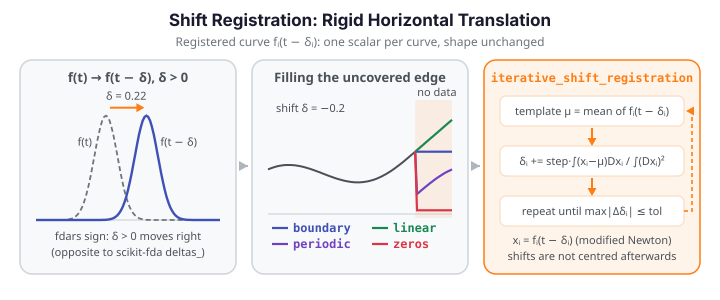

# Shift Registration

Shift registration is the entry-level alignment model: it asks whether the phase variation in a sample can be explained by **one time delay per curve**. If two curves are identical except that one starts three days later, a shift captures that exactly. It is fast, interpretable ("station A's cycle runs 3 days late"), and because it has a single parameter per curve it cannot over-fit amplitude noise as phase, which flexible elastic warps do.

Before reaching for elastic alignment, check whether rigid shifts explain the phase spread. On many real datasets (seasonal lags, reaction delays, onset times) they do; the [method chooser](choosing-a-method.md#same-data-five-methods) shows that a shift model recovers pure-shift warps about three times more accurately than the elastic Karcher mean.

{ .fdars-diagram }

The left panel fixes the sign convention: fdars registers a curve as $x_i(t - \delta_i)$, so $\delta > 0$ moves it to the **right**. The middle panel shows the four ways of filling the edge that a shift uncovers, and the right panel the Newton loop of `iterative_shift_registration`.

---

## Three shift estimators

| Function | Template | Optimiser | Use when |
|---|---|---|---|
| `least_squares_shift_registration` | raw cross-sectional mean, never updated | golden-section search per curve on $[-\Delta, \Delta]$ | a quick baseline, or a seed for the iterative method |
| `iterative_shift_registration` | re-estimated mean (or a fixed array, or a callable) | modified Newton steps, template updated every iteration | the default; latency, onset, seasonal lag |
| `landmark_shift_registration` | none: a target landmark position | closed form, $\delta_i = \tau - t_i$ | one reliable marker per curve (a peak, an onset) |

All three return `shifts` $\delta_i$ with the same meaning, and the registered curves $\tilde x_i(t) = x_i(t-\delta_i)$. `shift_curves(data, argvals, shifts, ...)` applies known shifts.

---

## Mathematical framework

The warp class is the one-parameter family of translations, $h_i(t) = t - \delta_i$, a tiny subset of the warping group used by [elastic alignment](elastic-alignment.md). Shifting a curve uncovers an edge of the domain on which $x_i(t-\delta_i)$ is not observed; the `extrapolation` option fills it:

| `extrapolation` | Value on the uncovered edge |
|---|---|
| `"boundary"` (default) | the nearest observed value: a flat segment |
| `"linear"` | continues the end slope |
| `"periodic"` | wraps around, $x(t \pm L)$; for one period of a cyclic signal |
| `"zeros"` | 0 |

With `restrict_domain=True` the criterion is integrated only over the sub-interval observed by *every* shifted curve, and the registered curves are returned on that shorter grid (`registered_argvals`).

### Least-squares shift (fixed template)

`least_squares_shift_registration` aligns each curve to the raw cross-sectional mean $\bar x$:

$$
\hat\delta_i = \arg\min_{|\delta| \le \Delta} \int \bigl(x_i(t-\delta) - \bar x(t)\bigr)^2\,dt ,
$$

by golden-section search, which assumes the criterion is unimodal in $\delta$. The template is never re-estimated, so it stays as blurred as the unregistered mean: one pass, no sharpening.

### Iterative shift (Newton on REGSSE)

`iterative_shift_registration` minimises the registration error sum of squares

$$
\mathrm{REGSSE} = \sum_{i=1}^n \int \bigl(x_i(t-\delta_i) - \mu(t)\bigr)^2\,dt
$$

alternately over the shifts and the template $\mu$. With $\tilde x_i = x_i(\cdot-\delta_i)$, each iteration takes one modified Newton step per curve,

$$
\delta_i \leftarrow \delta_i + \text{step\_size}\cdot\frac{\int (\tilde x_i - \mu)\,D\tilde x_i\,dt}{\int (D\tilde x_i)^2\,dt},
$$

then recomputes $\mu$ as the mean of the shifted curves (unless a fixed `template` array is given; a callable `template(curves) -> (m,)` is applied to the shifted curves each iteration). It stops when $\max_i |\Delta\delta_i| \le$ `tol` or after `max_iter` iterations. This is scikit-fda's `LeastSquaresShiftRegistration`; the fdars results match its reference values to $10^{-10}$, with the **opposite sign** of `deltas_`.

Two consequences:

- **The shifts are not centred.** The template can drift, so the whole registered sample may sit early or late. Subtract `shifts.mean()` if you want shifts relative to the average curve.
- **Newton is local.** For misalignments comparable to the feature width, seed it with the least-squares shifts: `initial=least_squares_shift_registration(...)["shifts"]`.

---

## Simulated shifts: which estimator recovers them?

Twenty-five noisy two-bump curves are shifted by known, centred $\delta_i \in [-0.08, 0.08]$ on $[0, 1]$. The block compares the recovered (centred, sign-corrected) shifts with the truth.

```python exec="1" source="above" result="text"
import numpy as np
from fdars import alignment as A

rng = np.random.default_rng(1)
n, m = 25, 101
t = np.linspace(0, 1, m)
mu = lambda s: np.exp(-(s - 0.4) ** 2 / 0.01) + 0.6 * np.exp(-(s - 0.65) ** 2 / 0.006)
delta = rng.uniform(-0.08, 0.08, n)
delta -= delta.mean()
X = np.array([mu(t - d) + 0.02 * rng.standard_normal(m) for d in delta])   # x_i(t) = mu(t - delta_i)

# registering x_i(t - s_i) undoes the shift when s_i = -delta_i (up to a common constant)
err = lambda s: np.abs((-(s - s.mean())) - delta).max()

ls = A.least_squares_shift_registration(X, t, 0.2)
it_default = A.iterative_shift_registration(X, t)                       # max_iter=5, tol=1e-2
it_tight = A.iterative_shift_registration(X, t, max_iter=20, tol=1e-4)
print(f"least squares (raw-mean template):     max error {err(ls['shifts']):.4f}")
print(f"iterative, defaults (tol=1e-2):         max error {err(it_default['shifts']):.4f}"
      f"  ({it_default['n_iter']} iterations)")
print(f"iterative, tol=1e-4:                    max error {err(it_tight['shifts']):.4f}"
      f"  ({it_tight['n_iter']} iterations)")
print("FDARS_FENCE_OK")
```

With the scikit-fda defaults the iterative method stops after a few iterations: `tol` is in the **units of `argvals`**, and 0.01 is 1 % of this domain, so it stops before the shifts settle. With `tol` matched to the scale of the domain it refines its template and beats the one-pass least-squares estimate. On a domain measured in days (below), `tol=1e-2` is already very strict.

---

## Periodic data: the Canadian temperature cycle

Each Canadian weather station records one annual temperature cycle (35 stations × 365 days). A shift that moves the cycle uncovers a few days at one end; with the default `"boundary"` fill those days become a flat plateau, while `"periodic"` wraps the cycle around and keeps it continuous.

```python exec="1" source="above" result="text"
import numpy as np
import pandas as pd
from docs_data import load_canadian_weather
from fdars import alignment as A

day, T, meta = load_canadian_weather("temperature")

for mode in ("boundary", "periodic"):
    r = A.iterative_shift_registration(T, day, extrapolation=mode, max_iter=50, tol=0.5)
    R, s = np.asarray(r["registered_data"]), np.asarray(r["shifts"])
    i = int(np.argmax(np.abs(s)))
    flat = int(np.sum(np.isclose(np.diff(R[i]), 0.0)))
    print(f"{mode:9s}: station {meta['station'].iloc[i]!r} shift {s[i]:+.1f} days, "
          f"{flat} flat days in its registered curve, Dec 31 -> Jan 1 jump {abs(R[i, -1] - R[i, 0]):.2f} C")

centred = s - s.mean()
print("\nmean centred shift by region (days; negative = cycle runs late):")
print(pd.Series(centred).groupby(meta["region"].to_numpy()).mean().round(1).to_string())
print("FDARS_FENCE_OK")
```

The boundary fill turns the last three weeks of the most-shifted station into a constant, which then enters every later average; the periodic fill keeps the year closed (no jump between 31 December and 1 January). Use `"periodic"` whenever each curve is exactly one period of a cyclic signal. The centred regional means show the Atlantic stations' cycle running about three days later than average, the Pacific stations' about four days earlier.

---

## Landmark shift registration

When every curve has one reliable feature (a peak, an onset, a zero crossing), the shift is not estimated at all: $\delta_i = \tau - t_i$ moves landmark $t_i$ onto a common target $\tau$. There is no template and no optimisation, so it is exact, instant and immune to the shape of the rest of the curve, and exactly as good as the landmark detection.

`location` chooses $\tau$:

| `location` | Target $\tau$ |
|---|---|
| `None` / `"mean"` (default) | mean landmark position |
| `"midrange"` | $(\min_i t_i + \max_i t_i)/2$ |
| a float | that fixed time |
| a callable `f(landmarks) -> float` | e.g. `np.median` |

With several landmarks per curve, `landmark_shift_deltas_multi(landmarks (n, K), targets=None)` returns the least-squares common shift, $\delta_i = \tfrac1K\sum_k (\tau_k - t_{ik})$. `landmark_shift_deltas` returns the shifts without registering.

```python exec="1" source="above" result="text"
import numpy as np
from fdars import alignment as A

rng = np.random.default_rng(1)
n, m = 25, 101
t = np.linspace(0, 1, m)
mu = lambda s: np.exp(-(s - 0.4) ** 2 / 0.01) + 0.6 * np.exp(-(s - 0.65) ** 2 / 0.006)
delta = rng.uniform(-0.08, 0.08, n)
delta -= delta.mean()
X = np.array([mu(t - d) + 0.02 * rng.standard_normal(m) for d in delta])

peak = t[np.argmax(X, axis=1)]                       # landmark: time of the tallest peak
r = A.landmark_shift_registration(X, t, peak, location="mean", extrapolation="linear")
s = np.asarray(r["shifts"])
print(f"target tau = {float(r['target']):.3f}  (true peak at 0.400)")
print(f"max shift error {np.abs(-(s - s.mean()) - delta).max():.4f}  (grid step {t[1] - t[0]:.2f})")
print(f"np.median target: {A.landmark_shift_deltas(peak, np.median)[:4].round(3)} ...")
print("FDARS_FENCE_OK")
```

The error is one to two grid steps: `argmax` can only report grid points, and noise moves the sampled maximum. Interpolate the landmark (e.g. a parabola through the three points around the maximum) when sub-grid accuracy matters.

---

## API reference

```python
from fdars import alignment as A

A.least_squares_shift_registration(data, argvals, max_shift)
A.iterative_shift_registration(data, argvals, template=None, max_iter=5, tol=1e-2,
                               step_size=1.0, restrict_domain=False,
                               extrapolation="boundary", initial=None)
A.landmark_shift_registration(data, argvals, landmarks, location=None,
                              extrapolation="boundary", restrict_domain=False)
A.landmark_shift_deltas(landmarks, location=None)
A.landmark_shift_deltas_multi(landmarks, targets=None)
A.shift_curves(data, argvals, shifts, extrapolation="boundary", restrict_domain=False)
```

| Function | Returns |
|---|---|
| `least_squares_shift_registration` | `registered_data (n, m)`, `shifts (n,)` |
| `iterative_shift_registration` | `registered_data (n, m')`, `registered_argvals (m',)`, `shifts (n,)`, `template (m,)`, `n_iter`, `converged` |
| `landmark_shift_registration` | `registered_data (n, m')`, `registered_argvals (m',)`, `shifts (n,)`, `target` |
| `shift_curves` | `data (n, m')`, `argvals (m',)` |

`m' < m` only with `restrict_domain=True`. The `Fdata.shift_register(max_shift)` method wraps `least_squares_shift_registration`. A reasonable `max_shift` is a quarter of the domain length.

---

## Registration quality scores

Three scalar scores summarise how well any set of registered curves is aligned; they also let you compare shift registration with elastic alignment on the same data.

| Function | Formula (sketch) | Better when |
|----------|------------------|-------------|
| `least_squares_score(reg, t)` | $(1/n)\sum_i \int (\tilde x_i - \bar{\tilde x})^2\,dt$ | **lower** |
| `pairwise_correlation_score(reg, t)` | mean centred $L^2$ cosine over all pairs | **higher** |
| `sobolev_least_squares_score(reg, t, lambda_)` | LS score + $\lambda\,\times$ a derivative term (uniform grid needed when $\lambda>0$) | **lower** |

The least-squares scores are absolute (they scale with the data), unlike scikit-fda's ratio versions; compare them before and after registration, or between methods. As a rough guide, a pairwise correlation above about 0.9 after shifting means the phase variation is essentially rigid; well below that, non-rigid phase remains and an [affine](affine-registration.md), [continuous](continuous-registration.md) or [elastic](elastic-alignment.md) model is worth trying.

---

## When shift registration works, and when it fails

**Works** when the phase variability is a constant offset across the whole domain: seasonal lags, reaction delays, an age offset, the onset of an event.

**Fails** when different parts of the domain move by different amounts (a rise that starts early but a fall that ends late), when the tempo varies (use [affine registration](affine-registration.md)), or when the curves have no shared shape to slide into register.

Pitfalls:

- **Edges.** The default `"boundary"` fill creates flat edges that enter the criterion and every later average; use `"periodic"` for cycles and consider `restrict_domain=True` otherwise.
- **Tolerance units.** `tol` and `max_shift` are in `argvals` units.
- **Sign.** fdars' $\delta$ has the opposite sign of scikit-fda's `deltas_`.
- **Centring.** Iterative shifts are not centred.
- **Unimodality.** The golden-section search of the least-squares method can stop in a local minimum when the curve is periodic within the search range; keep `max_shift` below half the dominant period.

See [Choosing an Alignment Method](choosing-a-method.md) for where shifts sit among the other warp classes, and [Landmark Registration](landmark-registration.md) for landmark warps that do more than shift.

---

## See also

- [Affine Registration](affine-registration.md) — shift plus a uniform change of speed.
- [Landmark Registration](landmark-registration.md) — monotone warps through several landmarks.
- [Elastic Alignment](elastic-alignment.md) — arbitrary monotone warps under the Fisher–Rao metric.
- [Comparing Methods](alignment-comparison.md) — methods side by side.

## References

- Ramsay, J.O., Silverman, B.W. (2005). *Functional Data Analysis*, 2nd ed., ch. 7. Springer. (Shift registration and the REGSSE criterion.)
- Ramos-Carreño, C., Torrecilla, J.L., Carbajo-Berrocal, M., Marcos, P., Suárez, A. (2024). scikit-fda: a Python package for functional data analysis. *Journal of Statistical Software* 109(2). (Reference implementation of least-squares and landmark shift registration.)
