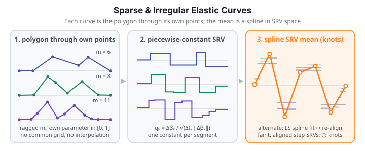

# Sparse & Irregular Curves

Many curves are not observed on a dense common grid. A growth record has a handful of visits at irregular ages; a GPS track has fixes at uneven times; a digitised outline has a few landmarks clicked by hand. The usual elastic tools need every curve on the same dense grid, which forces you to interpolate first and then align curves whose values between the observations were invented by the interpolation.

The sparse elastic functions avoid that step. They treat each curve as the **polygon through its own observed points**, align polygons with an exact coordinate-wise optimiser, and estimate a smooth mean directly from the ragged data. They port the R package `elasdics` (Steyer, Stöcker & Greven 2023) and agree with it to about $10^{-8}$ on its reference cases.

{ .fdars-diagram }

Sparse curves as polygons through their own points; the mean is a spline in SRV space.

---

## The polygon SRV

Let curve $i$ be observed at points $\beta_{i,0}, \dots, \beta_{i,m_i}$ in $\mathbb{R}^d$ (any $d \ge 1$; for a real-valued function, $d = 1$ and the points are the values) with parameter values $0 = t_0 < t_1 < \dots < t_{m_i} = 1$. The polygon through the points has a piecewise-constant square-root velocity function

$$
q_k = \frac{\Delta\beta_k}{\sqrt{\Delta t_k\,\lVert\Delta\beta_k\rVert}}, \qquad \Delta\beta_k = \beta_{i,k} - \beta_{i,k-1},\; \Delta t_k = t_k - t_{k-1},
$$

on each segment. Nothing is assumed between the points beyond the straight line. The parametrisation is yours (`param1`, `params`) or, by default, arc length; consecutive duplicate points are dropped (`removed_duplicates`).

The elastic distance between two polygons is invariant to **re-parametrisation and translation, but not to rotation or scale**. If those matter, normalise the curves first, or, for dense planar or spatial curves, use the [shape-space functions](curve-shapes.md).

---

## Aligning two sparse curves

`sparse_elastic_align_pair(points1, points2, param1=None, param2=None, closed=False, eps=0.01)` finds the re-parametrisation of curve 2 that best matches curve 1. The warp is evaluated only at curve 2's own points, and each of those values is optimised **analytically** in turn (coordinate-wise), sweeping until no warp point moves by more than `eps` / number of points. Because the optimum lies in the *closure* of the warping group, warps may be flat on stretches, meaning that a whole segment of one polygon is matched to a single point of the other. For closed curves every segment start is tried first.

The result holds the optimal parametrisation `param_optim` of curve 2 (wrapped into $[0, 1]$ for closed curves) and the `distance`.

```python exec="1" source="above" result="text"
import numpy as np
from fdars import alignment as A

rng = np.random.default_rng(1)
u = np.linspace(0, 1, 401)
mu = lambda s: np.exp(-(s - 0.35) ** 2 / 0.008) + 0.7 * np.exp(-(s - 0.68) ** 2 / 0.01)
f1 = mu(u)                                         # template, densely known
f2 = mu(u + 0.4 * u * (1 - u))                     # a warped copy: elastic distance 0

def sample(f, k):                                  # k random points incl. both ends
    p = np.sort(np.concatenate([[0, 1], rng.uniform(0, 1, k - 2)]))
    return np.interp(p, u, f)[None, :], p

for k in (8, 15, 30, 60):
    d = []
    for _ in range(20):                            # 20 random samplings per k
        (x1, p1), (x2, p2) = sample(f1, k), sample(f2, k)
        d.append(A.sparse_elastic_align_pair(x1, x2, param1=p1, param2=p2, eps=1e-3)["distance"])
    print(f"{k:3d} random points per curve: median sparse distance {np.median(d):.3f}")
print("dense elastic distance:", round(A.elastic_distance(f1, f2, u), 3))
print("FDARS_FENCE_OK")
```

The two underlying functions are the same shape, so the dense distance is (up to the DP residual) zero. The sparse distance measures the two **polygons**, which differ because each misses different parts of the peaks; it falls towards zero as the sampling becomes denser. Read sparse distances relative to this sampling floor: two curves observed at 8 points each cannot look closer than their polygons allow.

!!! note "Lower `eps` for densely sampled curves"
    The sweeps stop when no warp point moves by more than `eps` divided by the number of points. With the default `eps=0.01` and tens of points per curve the sweeps can stop early: in this example, at 60 points the median distance is about three times larger with the default than with `eps=1e-3`. Points that differ by less than $\max\lvert x\rvert\cdot\varepsilon$ from their predecessor are also dropped as duplicates (`removed_duplicates`), which on flat stretches of densely sampled curves removes real observations.

---

## The elastic mean of sparse curves

`sparse_elastic_mean(curves, params=None, knots=None, mean_type="smooth")` estimates the mean shape as a **spline in SRV space** on the given `knots` (default $[0, 0.25, 0.5, 0.75, 1]$):

- `mean_type="smooth"` (default): the mean SRV is a linear spline, so the mean curve is differentiable;
- `mean_type="polygon"`: the mean SRV is piecewise constant, so the mean is a polygon with corners at the knots.

The algorithm alternates two steps until the relative change of the spline coefficients falls below `eps`: (1) fit the spline to the SRVs of all curves, each under its current warp, by least squares (all observations together, in long format); (2) re-align every curve to the current mean (in parallel). In iteration $i$ the aligner's tolerance is $100\,\varepsilon / i$.

The returned `model` evaluates the result: `model.srv_eval(t)` gives the mean SRV, `model.mean_curve(t_grid, centering=True)` integrates it to the mean curve (starting at the origin, optionally centred, as elasdics `get_evals`), and `model.closure_residual()` reports how far a closed mean is from closing. The mean is identified only up to re-parametrisation and translation.

### Example: how many knots?

Thirty curves are smooth warps of a two-bump template. Each is observed at 8–15 random points (plus both ends). The table reports the elastic distance between the estimated mean and the true template for several knot sets, against two dense-grid workarounds (interpolate every curve linearly onto 201 points, then take the elastic Karcher mean or the cross-sectional mean):

```python exec="1" source="above" result="text"
import numpy as np
from fdars import alignment as A

rng = np.random.default_rng(1)
u = np.linspace(0, 1, 201)
mu = lambda s: np.exp(-(s - 0.35) ** 2 / 0.008) + 0.7 * np.exp(-(s - 0.68) ** 2 / 0.01)
curves, params = [], []
for _ in range(30):
    w = u + rng.uniform(-0.5, 0.5) * u * (1 - u)
    k = rng.integers(8, 16)
    p = np.sort(np.concatenate([[0, 1], rng.uniform(0, 1, k - 2)]))
    curves.append(np.interp(np.interp(p, u, w), u, mu(u))[None, :])   # (1, m_i) observed values
    params.append(p)

truth = mu(u)
print("knots  mean_type   d(mean, truth)")
for n_knots in (5, 9, 13):
    for mean_type in ("smooth", "polygon"):
        r = A.sparse_elastic_mean(curves, params=params, knots=np.linspace(0, 1, n_knots), mean_type=mean_type)
        mean = np.asarray(r["model"].mean_curve(u, centering=False))[0]
        print(f"{n_knots:5d}  {mean_type:8s}   {A.elastic_distance(truth, mean, u):.3f}")

dense = np.array([np.interp(u, p, c[0]) for c, p in zip(curves, params)])
print("interpolate + Karcher mean:     ", round(A.elastic_distance(truth, np.asarray(A.karcher_mean(dense, u)["mean"]), u), 3))
print("interpolate + pointwise mean:   ", round(A.elastic_distance(truth, dense.mean(0), u), 3))
print("FDARS_FENCE_OK")
```

How to read it:

- **Knots set the resolution of the mean.** Five knots cannot represent two narrow peaks; thirteen can. More knots need enough observations per knot interval across the sample, otherwise the least-squares fit becomes unstable.
- **`"smooth"` beats `"polygon"`** for smooth underlying curves; use `"polygon"` when the curves really are polygons (digitised outlines with corners).
- **The pointwise mean of interpolated curves is the worst**: it averages misaligned peaks. Interpolating and then aligning is competitive here, but it aligns values the interpolation invented, and it requires a common grid and $d = 1$ or a shared warp; the sparse mean works directly on the ragged points in any dimension.

---

## Closed curves

With `closed=True` the mean is a **closed** curve: every curve is first pre-aligned over all starting points against the reference curve with the smallest sum of squared distances, the SRV spline is periodic, and each iteration takes a line search on the least-squares loss plus a closedness penalty $\lvert\int p\,\lvert p\rvert\,\rvert^2$ (weight $1/(\text{pen\_factor}\cdot i)$ in iteration $i$). On convergence `closure_steps` closing steps follow; the default 1 matches elasdics and leaves a small gap, values above 1 close the mean to round-off. Closed means need at least 3 knots and work in any dimension (elasdics: planar only).

```python exec="1" source="above" result="text"
import numpy as np
from fdars import alignment as A

rng = np.random.default_rng(0)
curves = []
for _ in range(15):                               # 15 ovals, each seen at 7-12 random angles
    th = np.sort(rng.uniform(0, 2 * np.pi, rng.integers(7, 13)))
    r = 1 + 0.3 * rng.uniform(0.8, 1.2) * np.cos(2 * th)
    curves.append(np.stack([r * np.cos(th), r * np.sin(th)]))

for steps in (1, 5):
    res = A.sparse_elastic_mean(curves, closed=True, knots=np.linspace(0, 1, 9), closure_steps=steps)
    gap = np.linalg.norm(res["model"].closure_residual())
    print(f"closure_steps={steps}: closure residual {gap:.2e}, iterations {res['n_iter']}")
print("FDARS_FENCE_OK")
```

---

## From irregular functional data

`sparse_curves_from_irreg(data)` converts an irregular functional data object (`fdars.pace_fpca.irreg_fdata_from_lists`) into a list of `{"points": (1, m_i), "param": (m_i,)}` dicts, one per curve, ready for `sparse_elastic_mean(curves=[c["points"] ...], params=[c["param"] ...])`.

!!! warning "Each curve's own interval is stretched to $[0, 1]$"
    The parametrisation is $(t - t_{i,0}) / (t_{i,\text{last}} - t_{i,0})$: every curve's **own** observed range is mapped to $[0, 1]$. A child seen from age 2 to 10 and a child seen from age 2 to 18 are then treated as covering the same developmental span. If curves are observed on different sub-intervals of a common domain, either build the parametrisation yourself on the common domain (the parameter must still start at 0 and, for open curves, end at 1), or use a method that models incomplete curves, such as `register_fpca(incompleteness=...)` ([Non-Gaussian Registration](expfam-registration.md)) or [partial-curve conformal prediction](../regression/partial-conformal.md).

---

## Deviations from elasdics

The implementation documents five deliberate differences from `elasdics` 1.1.3:

1. The closed-curve distance is evaluated before the warp is wrapped around (elasdics overestimates it, for example 2.339 instead of 1.369 in one reference case).
2. The smooth mean integrates exactly and uses a bracketed one-dimensional search, where elasdics uses `integrate(rel.tol = 0.1)` and `constrOptim`; results agree to the optimiser tolerance.
3. The returned `distances` refer to the returned mean (elasdics: the previous iteration's).
4. Duplicate points are detected relative to the data scale ($\max\lvert x\rvert\cdot\varepsilon$).
5. Closed means work in any dimension, with an analytic gradient of the closure penalty and optional extra closing steps.

---

## Parameters

| Function | Parameter | Default | Effect |
|---|---|---|---|
| `sparse_elastic_align_pair` | `param1`, `param2` | arc length | parametrisation of each curve's points |
| | `closed` | `False` | closed curves (first point appended if needed) |
| | `eps` | 0.01 | sweep tolerance |
| `sparse_elastic_mean` | `params` | arc length | one entry per curve, `None` or an array |
| | `knots` | `[0, .25, .5, .75, 1]` | spline knots of the mean SRV |
| | `mean_type` | `"smooth"` | `"smooth"` (linear SRV spline) or `"polygon"` |
| | `eps`, `max_iter` | 0.01, 50 | relative coefficient change, iteration cap |
| | `closed`, `pen_factor`, `closure_steps` | `False`, 100, 1 | closed means |

`sparse_elastic_mean` returns `coefs`, `knots`, `curves`, `params`, `params_optim` (each curve's optimal parametrisation), `distances` (to the mean), `n_iter`, `converged`, `start_indices` (closed curves) and `model`.

## When to use it

- **Use it** when curves are observed at a few, irregular points each and you want an elastic mean or distances without inventing values between the observations; for trajectories and outlines in any dimension; when the parametrisation is meaningful (pass it) or irrelevant (arc length).
- **Do not use it** when rotation or scale must be quotiented out (normalise first, or use [`curve_shape_*`](curve-shapes.md) on resampled curves), or when the data are dense: on a common dense grid the [Karcher mean](elastic-alignment.md) is the standard tool.
- **Mind the sampling floor:** sparse distances reflect the polygons, so they are inflated for sparsely sampled curves and are comparable only between curves with similar sampling.

## See also

- [Shapes of Curves in R^d](curve-shapes.md) — dense curves with rotation and scale quotients.
- [Non-Gaussian Registration](expfam-registration.md) — irregular grids and incomplete curves with a likelihood model.
- [PACE FPCA](../represent/pace-fpca.md) — FPCA for sparse, irregular functional data.
- [Irregular Sampling](../learn/irregular-sampling.md).

## References

- Steyer, L., Stöcker, A., Greven, S. (2023). Elastic analysis of irregularly or sparsely sampled curves. *Biometrics* 79(3), 2103–2115.
- Srivastava, A., Klassen, E. (2016). *Functional and Shape Data Analysis.* Springer.
