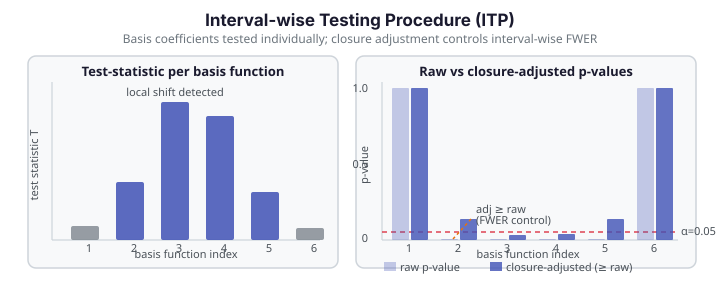

# Interval-wise Testing Procedure (ITP)

The **Interval-wise Testing Procedure** (ITP) tests *where along the domain* two functional populations differ — or where a single functional population deviates from a reference curve — with rigorous interval-wise family-wise error rate (FWER) control. Rather than producing a single p-value for the whole domain, ITP returns a **vector of p-values**, one per basis function, identifying which basis coefficients drive the difference; for a B-spline basis these can be mapped back to the domain to give the intervals where the null is rejected. The `fdars.inference` module exposes:

| Function | Question answered |
|---|---|
| `itp_one_pop` | Does the functional mean equal a reference curve $\mu_0$? |
| `itp_two_pop` | Do two functional populations share the same mean curve? |
| `itp_flm` | Is the functional predictor significant in a scalar-on-function regression? |
| `itp_pointwise_pvalues` | Map the per-component adjusted p-values of a B-spline ITP to the grid |
| `itp_two_pop_regions` | Where (which intervals of $t$) do two mean functions differ, and in which direction? |
| `scb_two_sample_band` | The same question answered with a simultaneous confidence band for the mean difference |

---

## Diagram

{ .fdars-diagram }

---

## Theory

### Basis expansion and projection

Each observed curve $X_i(t)$ is projected onto a set of $K$ basis functions $\{\phi_1, \dots, \phi_K\}$ (B-spline or Fourier), giving scalar coefficients $c_{ik} = \langle X_i, \phi_k \rangle$. Testing proceeds **separately** on each coefficient:

$$
H_0^{(k)} : \mathbb{E}[c_{ik}] = c_k^{(0)}, \quad k = 1, \dots, K.
$$

For each coefficient $k$, a permutation null distribution is built by randomly relabelling the pooled curves of both groups (`itp_two_pop`, as in `fdatest`), by sign-flipping the centred curves (`itp_one_pop`), or by permuting the response (`itp_flm`), and recomputing the test statistic; for `itp_two_pop` the statistic is $\lvert \bar c_{A,k} - \bar c_{B,k}\rvert$. The raw p-value for basis $k$ is

$$
p_k^{\mathrm{raw}} = \frac{\#\{T_k^* \ge T_k^{\mathrm{obs}}\} + 1}{n_{\mathrm{perm}} + 1}.
$$

### Closure adjustment and FWER control

Because $K$ hypotheses are tested simultaneously, ITP applies the **closure principle** to control the interval-wise FWER. The closure adjustment takes cumulative min-p values across nested subsets of basis indices, then re-applies the marginal distribution, producing adjusted p-values $p_k^{\mathrm{adj}}$ that satisfy

$$
P\!\Bigl(\exists\, k \in S : p_k^{\mathrm{adj}} \le \alpha \;\Big|\; H_0^{(k)} \text{ true for all } k \in S\Bigr) \le \alpha
$$

for every subset $S \subseteq \{1, \dots, K\}$ simultaneously.

!!! note "Closure increases individual p-values"
    The adjusted p-values are **at or above** the raw p-values: $p_k^{\mathrm{adj}} \ge p_k^{\mathrm{raw}}$. This is the expected behaviour of a multiple-testing correction — the price paid for simultaneous FWER control is that individual coefficients need a stronger signal to be declared significant after adjustment. A coefficient whose raw p-value is 0.005 may have an adjusted p-value of 0.14 if its neighbours are not also significant.

---

## Parameters

### `itp_one_pop`

Tests whether the mean of a single functional sample equals a reference curve.

| Parameter | Type | Default | Description |
|---|---|---|---|
| `data` | `ndarray (n, m)` | — | Functional data matrix; $n \ge 2$ |
| `argvals` | `ndarray (m,)` | — | Evaluation grid |
| `mu0` | `ndarray (m,) \| None` | `None` | Reference mean curve; `None` → zero function |
| `basis_type` | `str` | `"bspline"` | Projection basis: `"bspline"` or `"fourier"` |
| `nbasis` | `int` | `5` | Requested number of basis functions (see clamping note below) |
| `n_perm` | `int` | `999` | Permutation count |
| `seed` | `int \| None` | `None` | RNG seed; `None` resolves to `0` — two calls with identical inputs and `seed=None` are byte-identical |

### `itp_two_pop`

Tests whether two independent functional samples share the same mean curve.

| Parameter | Type | Default | Description |
|---|---|---|---|
| `data_a` | `ndarray (n_a, m)` | — | First sample; $n_a \ge 2$ |
| `data_b` | `ndarray (n_b, m)` | — | Second sample; $n_b \ge 2$; must match column count |
| `argvals` | `ndarray (m,)` | — | Evaluation grid |
| `basis_type` | `str` | `"bspline"` | `"bspline"` or `"fourier"` |
| `nbasis` | `int` | `5` | Requested basis count |
| `n_perm` | `int` | `999` | Permutation count |
| `seed` | `int \| None` | `None` | RNG seed |

### `itp_flm`

Tests whether the functional predictor is significant in the scalar-on-function regression $Y_i = \int X_i(t)\beta(t)\,dt + \varepsilon_i$ projected onto the basis.

| Parameter | Type | Default | Description |
|---|---|---|---|
| `data` | `ndarray (n, m)` | — | Functional predictor matrix |
| `response` | `ndarray (n,)` | — | Scalar response |
| `argvals` | `ndarray (m,)` | — | Evaluation grid |
| `basis_type` | `str` | `"bspline"` | `"bspline"` or `"fourier"` |
| `nbasis` | `int` | `5` | Requested basis count |
| `n_perm` | `int` | `999` | Permutation count |
| `seed` | `int \| None` | `None` | RNG seed |

---

## Returns

All three functions return the same five-key dict:

| Key | Type | Description |
|---|---|---|
| `adjusted_pvalues` | `ndarray (n_basis,)` | Closure-adjusted p-values, one per basis function |
| `raw_pvalues` | `ndarray (n_basis,)` | Raw (unadjusted) permutation p-values |
| `basis_type` | `str` | The basis used (`"bspline"` or `"fourier"`) |
| `n_basis` | `int` | **Actual** basis count after clamping (see note) |
| `n_perm` | `int` | Permutations actually run |

!!! note "Components that vanish on the grid"
    fdars's B-spline basis is built on an extended knot sequence and contains two functions (the first and the last) that are zero on the whole grid. Their coefficients are identically zero and carry no information, so their p-values are `1.0`: expect `1.0` at both ends of `raw_pvalues` and `adjusted_pvalues`. `itp_two_pop` also leaves them out of the interval-wise closure, so that they do not dilute the intervals of their neighbours.

!!! warning "n_basis after B-spline clamping (Pitfall 5)"
    For `basis_type="bspline"`, the B-spline library may reduce the actual basis count below the requested `nbasis` if the grid is too coarse to support that many basis functions. Always read `n_basis` from the returned dict to know the true length of `adjusted_pvalues` and `raw_pvalues` — do **not** assume `len(adjusted_pvalues) == nbasis`.

---

## Example

```python exec="1" source="above"
import numpy as np
from docs_fig import fast
import fdars.inference as fi

rng = np.random.default_rng(5)
n, m = 20, 40
t = np.linspace(0, 1, m)
# Curves with a local mean shift in the middle of the domain
X = np.array([np.sin(2 * np.pi * t) + rng.normal(0, 0.3, m) for _ in range(n)])
X[:, 16:28] += 1.0   # local shift in basis coefficients 2–4

n_perm = fast(199, 19)
res = fi.itp_one_pop(X, t, mu0=None, basis_type="bspline", nbasis=5,
                     n_perm=n_perm, seed=0)
adj_p = np.asarray(res["adjusted_pvalues"])
raw_p = np.asarray(res["raw_pvalues"])

print(f"n_basis (actual)={res['n_basis']}  n_perm={res['n_perm']}")
print(f"adjusted_pvalues={adj_p.round(3).tolist()}")
print(f"raw_pvalues     ={raw_p.round(3).tolist()}")
print("FDARS_FENCE_OK")
```

---

## Caveats and interpretation

### Sample-size requirements

Each sample needs at least $n \ge 2$ observations (`itp_one_pop` requires $n \ge 2$; `itp_two_pop` requires $n_a \ge 2$ and $n_b \ge 2$). With small $n$, the permutation null distribution is **coarse**: the smallest achievable p-value is $1 / (n_{\text{perm}} + 1)$, but the permutation null itself can only take at most $\binom{n_a + n_b}{n_a}$ distinct values for `itp_two_pop`. Small samples also mean the closure adjustment acts on a coarse null, making the adjusted p-values discrete. For reliable conclusions, aim for at least $n \approx 10$ per group; with small $n$, treat the adjusted p-values as ordinal indicators rather than calibrated probabilities.

### Basis sensitivity

The choice of `nbasis` sets the spatial resolution of the test, and it matters more than the classical "more components, less power" trade-off suggests; see [Power and resolution of the ITP](#power-and-resolution-of-the-itp) below. For `basis_type="bspline"`, the B-spline library clamps the actual basis count to the largest supported by the evaluation grid; always check `n_basis` in the returned dict (see the [clamping note](#returns) above).

---

## ITP vs a global permutation test

ITP and `fi.t_perm_test` answer **different questions** from the same data:

| Aspect | ITP (`itp_two_pop`) | Global permutation test (`t_perm_test`) |
|--------|--------------------|-----------------------------------------|
| Question | *Where* do the populations differ? | *Whether* the populations differ? |
| Output | Per-basis adjusted p-value vector | Single global p-value |
| Statistic | Absolute difference of the group means of each basis coefficient | Integrated L2 distance between means |
| Localisation | Yes — flags specific basis coefficients | No — integrates over the whole domain |
| Multiple testing | Closure-based FWER control per coefficient | No multiple-testing issue (single test) |
| Sensitivity | Higher for local, interval-specific differences | Higher for global, diffuse differences |

**Use ITP when you need to know which region of the domain drives the difference.** Use `t_perm_test` when you only need a yes/no answer about whether two functional populations share the same mean. The global test is more sensitive to diffuse, whole-domain differences; ITP is more sensitive to localised sub-interval differences after closure adjustment.

### Example — ITP vs permutation test on the same small synthetic dataset

The fence below builds two groups that differ only in a middle sub-interval, then runs both tests on the same data. The global test returns a single p-value; ITP returns one adjusted p-value per basis component.

```python exec="1" source="above"
import numpy as np
from docs_fig import fast
import fdars.inference as fi

rng = np.random.default_rng(11)
n_a, n_b, m = 12, 12, 40
t = np.linspace(0, 1, m)

# Group A: flat + noise; Group B: same but with a local elevation in t ∈ [0.35, 0.65]
grp_a = rng.normal(0, 0.4, (n_a, m))
grp_b = rng.normal(0, 0.4, (n_b, m))
mid = (t >= 0.35) & (t <= 0.65)
grp_b[:, mid] += 1.2   # local mean shift in the middle interval only

n_perm = fast(299, 29)

# --- ITP two-population test ---
res_itp = fi.itp_two_pop(grp_a, grp_b, t,
                         basis_type="bspline", nbasis=7,
                         n_perm=n_perm, seed=3)
adj_p = np.asarray(res_itp["adjusted_pvalues"])

# --- Global permutation t-test ---
res_perm = fi.t_perm_test(grp_a, grp_b, t, n_perm=n_perm, seed=3)

print(f"ITP n_basis (actual)={res_itp['n_basis']}  n_perm={res_itp['n_perm']}")
print(f"ITP adjusted p-values: {adj_p.round(3).tolist()}")
print(f"  (basis coefficients with adj_p <= 0.05: indices "
      f"{[i for i, p in enumerate(adj_p) if p <= 0.05]})")
print()
print(f"Global permutation t-test:")
print(f"  statistic={res_perm['statistic']:.4f}  p_value={res_perm['p_value']:.4f}  "
      f"n_perm={res_perm['n_perm']}")
print()
print("FDARS_FENCE_OK")
```

Both tests reject. With only 7 basis functions, of which the first and last vanish on the grid, each informative component is wide, and ITP flags all five of them, including those centred outside the shifted interval $[0.35, 0.65]$: the localisation is only as fine as the basis. The next section turns the component p-values into intervals of $t$ and shows how to choose `nbasis`.

---

## Where do the means differ: `itp_two_pop_regions`

`itp_two_pop_regions(data_a, data_b, argvals, nbasis=15, n_perm=999, seed=42, alpha=0.05, mapping="dominant")` runs a B-spline `itp_two_pop`, maps the adjusted component p-values to the grid with `itp_pointwise_pvalues`, and returns the contiguous runs of grid points with adjusted $p(t) < \alpha$. Because the ITP controls the interval-wise error rate, $\{t : p(t) < \alpha\}$ is the set of domain points where the null is rejected at level $\alpha$. Each run is split where the sign of the mean difference changes, and gets a `direction`: `"positive"` (A above B) or `"negative"`. The result also holds the `itp` dict, `pointwise_adjusted_pvalues` and `mean_difference` (A − B).

`itp_pointwise_pvalues(result, argvals, mapping=...)` does the mapping for any B-spline `itp_one_pop` / `itp_two_pop` result (a Fourier component is a frequency, not a location, so Fourier results are rejected):

- `mapping="dominant"` (default): $p(t)$ is the adjusted p-value of the component whose basis function is largest at $t$, the nearest-component convention of R's `fdatest`;
- `mapping="support"`: the largest adjusted p-value among all components whose basis function is positive at $t$, which is more conservative and gives narrower regions.

Two groups of 30 curves around $\sin(2\pi t)$ with noise sd 0.15; group A is higher on $(0.25, 0.5)$ and lower on $(0.65, 0.9)$:

```python exec="1" source="above" result="text"
import numpy as np
import fdars.inference as fi

rng = np.random.default_rng(7)
n, m = 30, 101
t = np.linspace(0, 1, m)
bump = lambda a, b: np.where((t > a) & (t < b), np.sin(np.pi * (t - a) / (b - a)), 0.0)
effect = 0.5 * bump(0.25, 0.5) - 0.4 * bump(0.65, 0.9)
A = np.sin(2 * np.pi * t) + effect + rng.normal(0, 0.15, (n, m))
B = np.sin(2 * np.pi * t) + rng.normal(0, 0.15, (n, m))

r = fi.itp_two_pop_regions(A, B, t, nbasis=30)
print(f"n_basis = {r['itp']['n_basis']}")
for g in r["regions"]:
    print(f"  [{g['t_start']:.2f}, {g['t_end']:.2f}]  {g['direction']:8s}  min adjusted p = {g['min_adjusted_pvalue']:.3f}")
for mapping in ("dominant", "support"):
    p = fi.itp_pointwise_pvalues(r["itp"], t, mapping=mapping)
    print(f"mapping={mapping!r:10s}: p(t) < 0.05 on {np.mean(p < 0.05):.0%} of the grid")
print("FDARS_FENCE_OK")
```

The two planted intervals are found with the right directions. The regions are slightly narrower than the true supports, where the difference fades out.

---

## Simultaneous band for the difference: `scb_two_sample_band`

`scb_two_sample_band(data_a, data_b, argvals, bandwidth, nb=200, confidence=0.95, multiplier="gaussian")` builds a simultaneous confidence band for the mean difference (Degras 2011): the difference curves are smoothed with a local-polynomial smoother of the given `bandwidth`, and a multiplier bootstrap gives the critical value of the band $\hat\Delta(t) \pm c\,\hat\sigma(t)/\sqrt{n}$. Where the band excludes zero, the means differ, with coverage `confidence` simultaneously over the whole grid. It returns the band (`estimate`, `lower`, `upper`, `half_width`, `critical_value`), the global decision (`statistic`, `rejected`; identical to `scb_two_sample_test`) and the `regions` where the band excludes zero, in the same format as above (`min_adjusted_pvalue` is always `None`).

!!! note "Paired construction"
    Like `scb_two_sample_test`, the band is computed from the differences of the first $\min(n_a, n_b)$ rows of the two samples, paired by row. For independent groups the row order is arbitrary, so with unequal sizes the extra curves of the larger group are not used. The multiplier bootstrap is liberal for small samples (fdars-core's seeded study rejects about 35 of 200 null data sets at 10 curves per group, 6 of 200 at 30).

```python exec="1" source="above" result="text"
import numpy as np
import fdars.inference as fi

rng = np.random.default_rng(7)
n, m = 30, 101
t = np.linspace(0, 1, m)
bump = lambda a, b: np.where((t > a) & (t < b), np.sin(np.pi * (t - a) / (b - a)), 0.0)
effect = 0.5 * bump(0.25, 0.5) - 0.4 * bump(0.65, 0.9)
A = np.sin(2 * np.pi * t) + effect + rng.normal(0, 0.15, (n, m))
B = np.sin(2 * np.pi * t) + rng.normal(0, 0.15, (n, m))

band = fi.scb_two_sample_band(A, B, t, bandwidth=0.03, nb=999)
print(f"critical value {band['critical_value']:.2f}, rejected: {band['rejected']}")
for g in band["regions"]:
    print(f"  [{g['t_start']:.2f}, {g['t_end']:.2f}]  {g['direction']}")
print(f"max half-width {np.max(band['half_width']):.3f}")
print("FDARS_FENCE_OK")
```

The band finds the same two intervals and directions as the ITP. It needs no basis, but its `bandwidth` plays a similar role: it should be small compared with the width of the effects.

---

## Power and resolution of the ITP

The ITP tests basis coefficients, so its regions are only as good as the basis:

- **A coarse basis smears the effect over the domain.** The coefficients are a least-squares projection, and a cubic B-spline spans four knot intervals, so a strong local difference also shifts the coefficients of components some distance away. With too few components, components far from the effect reject as well, the adjusted p-values are small almost everywhere, and `itp_two_pop_regions` (or `elastic_local_difference_test`) returns most of the domain, chopped into many short "positive" and "negative" regions by the sign of the *noisy* mean difference. Those directions are not evidence of anything.
- **Effects carried by few components can lose all power in the closure.** The adjusted p-value of a component is the largest p-value over *every* interval that contains it, including long intervals made mostly of null components, which dilute the evidence. An effect that shows up in only a few components, because it is weak, narrow, or falls badly on the knots, can therefore have raw p-values at the floor and adjusted p-values well above $\alpha$. How much this happens depends on `nbasis` in a way that is not monotone. This is a property of the procedure, not of the implementation: fdars's closure is validated against R `fdatest`'s `ITP2bspline`.

The fence shows both traps: the data of the two previous examples under different `nbasis` (the default 15 spaces the components roughly 0.07 apart on $[0, 1]$, for effects 0.25 wide), then two single bumps:

```python exec="1" source="above" result="text"
import numpy as np
import fdars.inference as fi

rng = np.random.default_rng(7)
n, m = 30, 101
t = np.linspace(0, 1, m)
bump = lambda a, b: np.where((t > a) & (t < b), np.sin(np.pi * (t - a) / (b - a)), 0.0)
effect = 0.5 * bump(0.25, 0.5) - 0.4 * bump(0.65, 0.9)
A = np.sin(2 * np.pi * t) + effect + rng.normal(0, 0.15, (n, m))
B = np.sin(2 * np.pi * t) + rng.normal(0, 0.15, (n, m))

for nbasis in (15, 25, 40):
    r = fi.itp_two_pop_regions(A, B, t, nbasis=nbasis)
    flagged = np.mean(np.asarray(r["pointwise_adjusted_pvalues"]) < 0.05)
    print(f"nbasis={nbasis}: {len(r['regions']):2d} regions covering {flagged:.0%} of the grid")
print("true effect support: 50% of the grid")

# a moderate bump (height 0.5, width 0.1) on a 50-point grid, noise sd 0.1
rng = np.random.default_rng(0)
t50 = np.linspace(0, 1, 50)
A = rng.normal(0, 0.1, (n, 50)) + 0.5 * np.exp(-(((t50 - 0.7) / 0.1) ** 2))
B = rng.normal(0, 0.1, (n, 50))
# a narrow, weak bump (height 0.15, sd 0.01) on the 101-point grid, noise sd 0.1
rng = np.random.default_rng(0)
A2 = rng.normal(0, 0.1, (n, m))
B2 = rng.normal(0, 0.1, (n, m)) + 0.15 * np.exp(-(t - 0.5) ** 2 / (2 * 0.01 ** 2))
for name, (a, b, grid) in {"moderate bump": (A, B, t50), "narrow bump": (A2, B2, t)}.items():
    for nbasis in (8, 15, 40):
        r = fi.itp_two_pop(a, b, grid, nbasis=nbasis, seed=42)
        print(f"{name}, nbasis={nbasis:2d}: smallest raw p {np.min(r['raw_pvalues']):.3f}, "
              f"smallest adjusted p {np.min(r['adjusted_pvalues']):.3f}")
print("FDARS_FENCE_OK")
```

With 15 components the two strong effects smear into 18 regions covering 85 % of the grid, against 50 % for the true effects; 25 or 40 components recover them. The moderate bump has raw p-values at the floor under every basis, but its adjusted p-value is 0.14 with 15 components and 0.001 with 8 or 40: here the default sits in a dip of the power curve (on three more seeds of the same simulation, 15 components miss the bump at 5 % in two). The narrow, weak bump survives the closure under none of the three bases (adjusted p 0.21–0.37).

Practical rules:

1. There is no safe default for `nbasis`. Too few components smear a strong effect over the domain; a basis that spreads a modest effect over few of many components can lose it in the closure. Run the test for a few values (for example 8, 15, 25, 40, within what the grid supports; read `n_basis` from the result) and trust regions that are stable across them.
2. Distrust a result that flags most of the domain in many short regions of alternating direction, and do not read a non-significant ITP as "no difference" when raw p-values are small.
3. Cross-check the regions with `scb_two_sample_band` (or `test="scb"` in `elastic_local_difference_test`): the band has no basis and fails in different ways.

---

## References

1. Pini, A., and Vantini, S. (2017). "Interval-wise testing for functional data." *Journal of Nonparametric Statistics*, 29(2), 407–424. — the original ITP paper defining the closure-based interval-wise FWER control.
2. Ramsay, J. O., and Silverman, B. W. (2005). *Functional Data Analysis*, 2nd ed. Springer. — Chapter 13 on functional hypothesis testing; B-spline and Fourier basis expansion background.
3. Degras, D. A. (2011). "Simultaneous confidence bands for nonparametric regression with functional data." *Statistica Sinica*, 21(4), 1735–1765. — the multiplier-bootstrap band behind `scb_two_sample_band`.
4. Romano, J. P., and Wolf, M. (2005). "Exact and approximate stepdown methods for multiple hypothesis testing." *Journal of the American Statistical Association*, 100(469), 94–108. — closure principle and stepdown procedures underlying the FWER correction.
