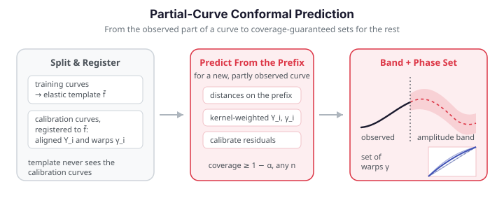

# Partial-Curve Conformal Prediction

Some curves are only partly observed when a decision has to be made: a growth curve up to the current age, a batch profile up to the current hour, a signal with dropouts. **Partial-curve conformal prediction** answers two questions about the unobserved remainder, both with a finite-sample coverage guarantee:

- **Amplitude:** after registration to a common template, where will the complete curve lie? This is a prediction band for the *aligned* curve.
- **Phase:** how will the complete curve be warped relative to the template? This is a prediction set of warping functions.

`fdars.conformal` implements the split-conformal SFCP (amplitude) and SFCPP (phase) procedures of Wang, Kurtek & Zhang (2026). It extends them with simultaneous bands, held-out bandwidth tuning and fragmented or sparse observation patterns. For conformal intervals of a **scalar** response, see [Conformal Prediction](conformal-prediction.md); for bands that should contain whole new curves, see [Tolerance Bands](../analyze/tolerance-bands.md).

{ .fdars-diagram }

## How it works

Fully observed curves $f_1, \dots, f_n$ are available; a new curve $f_{n+1}$ is observed only on part of the domain.

1. **Split.** The curves are split at random (`cal_fraction`, `seed`) into a training part and a calibration part of size $n_2$. The training part is used *only* to estimate the elastic template $\bar f$, a Karcher mean.
2. **Register.** Each calibration curve is registered to the template, $\gamma_i^* = \arg\min_\gamma \lVert \bar q - (q_i \circ \gamma)\sqrt{\dot\gamma}\rVert$ (SRSF dynamic programming, penalty `lambda_`). This gives an amplitude response $Y_i = f_i \circ \gamma_i^*$ (the aligned curve) and a phase response $\gamma_i^*$.
3. **Predict from the observed part.** The new curve's responses are predicted by Nadaraya–Watson smoothing over the calibration curves, with Gaussian kernel weights on the distance between the observed parts (`distance="l2"`, `"srsf"` or `"elastic"`; bandwidth `bandwidth`, by default the median pairwise distance).
4. **Calibrate.** The leave-one-out residuals of the calibration curves, together with a trial value for the new curve (full conformal within the calibration set), give the band. For the amplitude the conformal interval is computed exactly in closed form at every grid point. For the phase, residuals are Fisher–Rao distances $d(\gamma_1, \gamma_2) = \arccos \int \sqrt{\dot\gamma_1 \dot\gamma_2}$ between warps.

Because the template comes from curves that are not used for calibration, the calibration curves and the new curve are exchangeable. That gives, for any sample size,

$$
P\big(Y_{n+1}(t) \in I_t\big) \ge 1 - \alpha \ \text{ for every } t, \qquad P\big(\gamma_{n+1}^* \in I_\gamma\big) \ge 1 - \alpha,
$$

where $Y_{n+1}$ and $\gamma^*_{n+1}$ are the aligned curve and warp of the **complete** new curve, which are unknown at prediction time. The guarantee needs $\alpha \ge 1/(n_2 + 1)$; a smaller `alpha` raises a `ValueError` naming the number of calibration curves required.

## Example: a curve observed up to $t = 0.58$

```python exec="1" html="1" source="above"
import numpy as np
from docs_fig import fig, render
import fdars.conformal as cf
from fdars.alignment import elastic_align_pair

rng = np.random.default_rng(7)
m = 51
t = np.linspace(0, 1, m)
def curve():                     # a main peak and a shoulder, random height and timing
    a, s = rng.uniform(0.8, 1.2), rng.uniform(-0.08, 0.08)
    w = t + s * np.sin(np.pi * t)
    return a * np.exp(-0.5 * ((w - 0.5) / 0.12) ** 2) + 0.3 * a * np.exp(-0.5 * ((w - 0.8) / 0.06) ** 2)

X = np.array([curve() for _ in range(30)])          # fully observed reference curves
new = curve()
k = 30                                              # only the first 30 grid points are observed

model = cf.partial_conformal_fit(X, t, alpha=0.2, seed=1)
pred = cf.partial_conformal_predict(model, new[:k])
truth = elastic_align_pair(model.template, new, t)  # the complete curve, registered (unknown in practice)

f, (a0, a1) = fig(1, 2, figsize=(12, 3.8))
for c in model.calibration_aligned:
    a0.plot(t, c, color="#6c757d", lw=0.8, alpha=0.35)
a0.fill_between(t, pred["amplitude_lower"], pred["amplitude_upper"], color="#dc3545", alpha=0.18,
                label="80% amplitude band")
a0.plot(t, pred["amplitude_center"], color="#dc3545", lw=2.0, label="predicted aligned curve")
a0.plot(t, truth["f_aligned"], color="#1a1a2e", lw=1.8, ls="--", label="complete curve, aligned")
a0.plot(t[:k], new[:k], color="#e8710a", lw=2.4, label="observed prefix (raw)")
a0.axvline(t[k - 1], color="#495057", lw=1.0, ls=":")
a0.set(title="Amplitude: where the aligned curve will lie", xlabel="t")
a0.legend(fontsize=8, loc="upper left")

for g in pred["phase_accepted"][::6]:
    a1.plot(t, g - t, color="#3f51b5", lw=0.7, alpha=0.35)
a1.fill_between(t, pred["phase_lower"] - t, pred["phase_upper"] - t, color="#3f51b5", alpha=0.15,
                label="envelope of accepted warps")
a1.plot(t, pred["phase_center"] - t, color="#3f51b5", lw=2.0, label="predicted warp")
a1.plot(t, truth["gamma"] - t, color="#1a1a2e", lw=1.8, ls="--", label="warp of the complete curve")
a1.axhline(0, color="#495057", lw=1.0)
a1.set(title="Phase: warps, shown as gamma(t) - t", xlabel="t")
a1.legend(fontsize=8)
print(render(f))
inside = np.mean((truth["f_aligned"] >= pred["amplitude_lower"]) & (truth["f_aligned"] <= pred["amplitude_upper"]))
print(f"<p>observed {pred['n_observed']} of {m} points (up to t = {pred['observed_end']:.2f}); "
      f"{len(model.calibration_indices)} calibration curves; bandwidth {pred['bandwidth']:.3f}; "
      f"aligned complete curve inside the band at {inside:.0%} of grid points; "
      f"its warp in the phase set: {pred['prediction'].phase_set_contains(truth['gamma'])}</p>")
print("FDARS_FENCE_OK")
```

The grey curves are the registered calibration curves. The band covers where the *registered* complete curve will lie, including the shoulder at $t \approx 0.8$, which has not been observed yet. The raw prefix (orange) need not lie inside the band, because it has not been aligned. On the right, the phase set is drawn through its accepted members: geodesics on the space of warps from the predicted warp towards each calibration warp, kept when they pass the conformal test. The exact set is available as `pred["prediction"].phase_set_contains(gamma)`. The envelope `phase_lower`/`phase_upper` is a pointwise summary for display, not the set itself. In this draw the warp of the complete curve (dashed) stays inside the envelope but is *not* in the 80% phase set: its Fisher–Rao distance from the predicted warp is too large compared with the calibration residuals. The guarantee allows that about one time in five; the simulation below shows the long-run rate.

### Checking the coverage

The guarantee is about repeated use, so check it by simulation: draw fresh curves, observe the same prefix, and count how often the band contains the registered complete curve.

```python exec="1" source="above" result="text"
import numpy as np
import fdars.conformal as cf
from fdars.alignment import elastic_align_pair

rng = np.random.default_rng(7)
m = 51
t = np.linspace(0, 1, m)
def curve():
    a, s = rng.uniform(0.8, 1.2), rng.uniform(-0.08, 0.08)
    w = t + s * np.sin(np.pi * t)
    return a * np.exp(-0.5 * ((w - 0.5) / 0.12) ** 2) + 0.3 * a * np.exp(-0.5 * ((w - 0.8) / 0.06) ** 2)

X = np.array([curve() for _ in range(30)])
pointwise = cf.partial_conformal_fit(X, t, alpha=0.2, seed=1)
simultaneous = cf.partial_conformal_fit(X, t, alpha=0.2, seed=1, band="simultaneous")

hits_pw, hits_sim, hits_phase, width_pw, width_sim = [], [], [], [], []
for _ in range(60):
    c = curve()
    full = elastic_align_pair(pointwise.template, c, t)
    target = full["f_aligned"]
    p = cf.partial_conformal_predict(pointwise, c[:30])
    hits_phase.append(p["prediction"].phase_set_contains(full["gamma"]))
    s = cf.partial_conformal_predict(simultaneous, c[:30])
    hits_pw.append(np.mean((target >= p["amplitude_lower"]) & (target <= p["amplitude_upper"])))
    hits_sim.append(np.all((target >= s["amplitude_lower"]) & (target <= s["amplitude_upper"])))
    width_pw.append(np.mean(p["amplitude_upper"] - p["amplitude_lower"]))
    width_sim.append(np.mean(s["amplitude_upper"] - s["amplitude_lower"]))
print(f"pointwise band   : average pointwise coverage {np.mean(hits_pw):.2f}   (target >= 0.80), mean width {np.mean(width_pw):.3f}")
print(f"simultaneous band: whole curve inside        {np.mean(hits_sim):.2f}   (target >= 0.80), mean width {np.mean(width_sim):.3f}")
print(f"phase set        : warp inside               {np.mean(hits_phase):.2f}   (target >= 0.80)")
print("FDARS_FENCE_OK")
```

All three sets meet their target. They promise different things: the **pointwise** band covers the curve at each $t$ separately, while the **simultaneous** band covers the whole curve at once and is about 3 times wider here. Both models use the same `seed`, so they share the split and template.

## Band types

| `band=` | Score | Guarantee | Use when |
|---|---|---|---|
| `"pointwise"` (default) | $\lvert Y_i(t) - \hat Y_i(t)\rvert$ at each $t$ | each $t$ covered with probability $\ge 1-\alpha$ | you look at the band one time point at a time |
| `"simultaneous"` | $\sup_t \lvert Y_i(t) - \hat Y_i(t)\rvert / \sigma(t)$ | the whole curve inside with probability $\ge 1-\alpha$ | decisions depend on the entire remaining trajectory |

For the simultaneous band, `band_scale` sets the shape $\sigma(t)$ of the band: `"constant"` (default, equal width), `"training_sd"` (the pointwise SD of the aligned training curves, floored at 5% of its maximum, so wider where curves vary more) or a positive array of length $m$. The result's `amplitude_radius` is the calibrated multiplier $R$, and the band is $\hat c(t) \pm R\,\sigma(t)$.

## Observation patterns

`partial_conformal_predict(model, observed)` handles the common case: the curve is observed on a **prefix** of the grid, `observed = values[:k]`. `partial_conformal_predict_observed` also covers the other patterns:

| `observation=` | Arguments | Meaning |
|---|---|---|
| `"prefix"` | `values`, `n_observed=None` (= `len(values)`) | the first `n_observed` grid points |
| `"fragments"` | `values`, `fragments` `(K, 2)` | inclusive grid-index ranges, increasing and disjoint; `values` concatenated in fragment order |
| `"sparse"` | `values`, `times` | values at increasing times inside the domain, not necessarily on the grid |

For fragments, the distance between observed parts is a length-weighted sum of per-fragment distances; for sparse times it is the Euclidean distance of the values, with calibration curves interpolated linearly at those times. Each fragment is also located in the template by elastic partial matching (`fragment_registrations`), for information only: the registration of the observed part (`registration`) does not enter the conformal sets. The guarantee assumes the observation pattern does not depend on the curve's values.

```python exec="1" source="above" result="text"
import numpy as np
import fdars.conformal as cf

rng = np.random.default_rng(7)
m = 51
t = np.linspace(0, 1, m)
def curve():
    a, s = rng.uniform(0.8, 1.2), rng.uniform(-0.08, 0.08)
    w = t + s * np.sin(np.pi * t)
    return a * np.exp(-0.5 * ((w - 0.5) / 0.12) ** 2) + 0.3 * a * np.exp(-0.5 * ((w - 0.8) / 0.06) ** 2)

X = np.array([curve() for _ in range(30)])
new = curve()
model = cf.partial_conformal_fit(X, t, alpha=0.2, seed=1)

frag = np.array([[0, 9], [30, 39]])                       # two windows of 10 grid points
fr = cf.partial_conformal_predict_observed(model, np.r_[new[0:10], new[30:40]],
                                           observation="fragments", fragments=frag)
times = np.array([0.1, 0.3, 0.45, 0.6])                   # four off-grid measurements
sp = cf.partial_conformal_predict_observed(model, np.interp(times, t, new),
                                           observation="sparse", times=times)
for name, r in [("fragments", fr), ("sparse", sp)]:
    print(f"{name:9s}: mean band width {np.mean(r['amplitude_upper'] - r['amplitude_lower']):.3f}, "
          f"phase radius {r['phase_radius']:.3f}")
print("fragment registrations:", len(fr["fragment_registrations"]))
print("FDARS_FENCE_OK")
```

## Choosing the bandwidth

The kernel bandwidth decides how many calibration curves contribute to the prediction. Choosing it by minimising band width on the calibration curves themselves would break the coverage guarantee. fdars therefore offers a **held-out** selector:

- `partial_conformal_fit(..., tuning_fraction=0.3)` reserves that share of the calibration curves as a tuning set. Each tuning curve is predicted from the others under the observation pattern of the new curve, and the candidate bandwidth with the smallest mean band width is used. The remaining calibration curves are then exchangeable with the new curve, so coverage stays exact; the cost is fewer calibration curves. `bandwidth_candidates` overrides the default candidates (quantiles of the pairwise distances).
- `partial_conformal_select_bandwidth(tuning_model, observation=..., n_observed=...)` runs the same selector on the calibration curves of `tuning_model` and returns `{bandwidth, candidates, mean_width, n_tuning}`. Pass the result as `bandwidth=` to a model fitted on **other** curves.

```python exec="1" source="above" result="text"
import numpy as np
import fdars.conformal as cf

rng = np.random.default_rng(7)
m = 51
t = np.linspace(0, 1, m)
def curve():
    a, s = rng.uniform(0.8, 1.2), rng.uniform(-0.08, 0.08)
    w = t + s * np.sin(np.pi * t)
    return a * np.exp(-0.5 * ((w - 0.5) / 0.12) ** 2) + 0.3 * a * np.exp(-0.5 * ((w - 0.8) / 0.06) ** 2)

X = np.array([curve() for _ in range(30)])
new = curve()
tuned = cf.partial_conformal_fit(X, t, alpha=0.2, seed=1, tuning_fraction=0.4)
p = cf.partial_conformal_predict(tuned, new[:30])
sel = p["bandwidth_selection"]
print(f"tuning curves: {sel['n_tuning']}, calibration curves left: {len(tuned.calibration_indices)}")
print("candidates :", np.round(sel["candidates"], 3))
print("mean width :", np.round(sel["mean_width"], 3))
print(f"chosen bandwidth {sel['bandwidth']:.3f}")
print("FDARS_FENCE_OK")
```

## Using a known template

If a template is available from earlier, independent data, `partial_conformal_fit_with_template(calibration, argvals, template, ...)` skips the split: every curve passed is used for calibration. The template must not be estimated from those calibration curves, otherwise exchangeability, and with it the guarantee, is lost. `band_scale="training_sd"` is unavailable here, since there are no training curves.

## Parameters and results

| Parameter | Default | Meaning |
|---|---|---|
| `alpha` | 0.1 | miscoverage; can be overridden per prediction (`alpha=`) |
| `cal_fraction`, `seed` | 0.5, 42 | calibration share and split seed |
| `distance` | `"l2"` | distance between observed parts: `"l2"`, `"srsf"` (L² between SRSFs, no alignment) or `"elastic"` (elastic amplitude distance) |
| `bandwidth` | `None` | kernel bandwidth; `None` = median pairwise distance (or the tuned value) |
| `lambda_` | 0.0 | registration penalty |
| `karcher_max_iter`, `karcher_tol` | 20, 1e-3 | template estimation |
| `n_phase_radii` | 25 | radii per geodesic direction when listing accepted warps |
| `band`, `band_scale` | `"pointwise"`, `None` | see [Band types](#band-types) |
| `tuning_fraction`, `bandwidth_candidates` | `None` | see [Choosing the bandwidth](#choosing-the-bandwidth) |

The fitted model exposes `template`, `calibration_indices`, `training_indices`, `tuning_indices`, `calibration_data`, `calibration_aligned`, `calibration_gammas` and `training_sd`. A prediction returns `amplitude_center/lower/upper`, `phase_center/lower/upper`, `phase_radius`, `phase_accepted`, `weights` (the kernel weights of the calibration curves), `registration` (partial match of the observed part to the template: `start_index`, `end_index`, `gamma`, `distance`, `domain_fraction`), `full_registration` (only for a fully observed curve), `bandwidth`, `bandwidth_selection` and `prediction` (the handle with `phase_set_contains`).

!!! warning "What the guarantee does not cover"
    Coverage is marginal over new curves drawn like the calibration curves, and it is about the **registered** curve and the warp to *this* template. It does not cover the raw, unaligned curve, and it does not hold if the new curve comes from a different population (drift) or if its observation pattern depends on its values. With few calibration curves the bands are wide and very small `alpha` is not attainable.


## See also

- [Inference after Alignment](../align/alignment-inference.md) — the other tests, box plots and uncertainty tools built on elastic alignment.
- [Elastic Alignment](../align/elastic-alignment.md) — the Karcher template and the registration these sets refer to.

## References

1. Wang, Kurtek & Zhang (2026). Joint registration and conformal prediction for partially observed functional data. *Journal of Computational and Graphical Statistics* (PMC13160368).
2. Lei, J., G'Sell, M., Rinaldo, A., Tibshirani, R. J. & Wasserman, L. (2018). Distribution-free predictive inference for regression. *Journal of the American Statistical Association*, 113(523), 1094–1111.
3. Srivastava, A. & Klassen, E. P. (2016). *Functional and Shape Data Analysis*. Springer.
