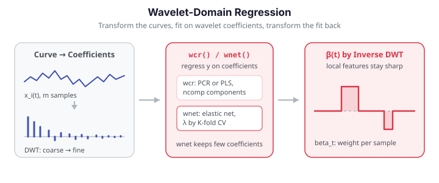

# PEER & Wavelet Regression

[Scalar-on-function regression](scalar-on-function.md) estimates a coefficient function $\beta(t)$ in

$$
y_i = \alpha + \int x_i(t)\,\beta(t)\,dt + \varepsilon_i .
$$

FPC regression and P-splines assume $\beta$ is smooth, or that it lies in the span of the leading principal components. This page covers four estimators in `fdars.scalar_on_function` for when that assumption is wrong or prior knowledge is available:

| Function | Idea | Best when |
|---|---|---|
| `peer` | penalised least squares with a **structured penalty** $\lambda\,\beta^\top Q\beta$, $\lambda$ by GCV or REML | $\beta$ is smooth, or you know a plausible shape for it |
| `lpeer` | `peer` plus a **subject random intercept** for repeated measures | several curves per subject |
| `wcr` | PCR or PLS on the curves' **wavelet coefficients** | $\beta$ is spatially inhomogeneous (jumps, local bursts) |
| `wnet` | **elastic net** on the wavelet coefficients, $\lambda$ by cross-validation | $\beta$ is sparse in a wavelet basis: mostly zero, a few local features |

## PEER: structured penalties

PEER (*partially empirical eigenvectors for regression*, Randolph, Harezlak & Feng 2012) solves the penalised normal equations

$$
(W_c^\top W_c + \lambda Q)\,\beta = W_c^\top y_c ,
$$

where $W_c$ is the centred design with Simpson quadrature weights, so $\beta$ is on the scale of the integral model above, and $Q$ is a positive semi-definite penalty matrix. The penalty decides which directions of $\beta$ are cheap and which are shrunk:

| `penalty=` | $Q$ | Effect |
|---|---|---|
| `"difference"` (default) | $D_2^\top D_2$, second differences | shrinks towards straight lines: a smoothness prior |
| `"ridge"` | $I$ | shrinks every coefficient equally; does not penalise roughness |
| `"decree"` | your `decree_q`, an `(m, m)` symmetric PSD matrix | encodes prior knowledge: directions in the null space of $Q$ are not penalised at all |

`lambda_` is a float (fixed), `"gcv"` (the default; a 40-point log grid on $[10^{-6}, 10^4]$) or `"reml"` (an EM algorithm for the REML criterion). The result holds `beta`, `intercept`, `fitted_values`, `effective_df` (trace of the hat matrix), the chosen `lambda_`, `lambda_method`, `gcv` (when GCV ran) and `model`, whose `predict(new_data, argvals)` scores new curves.

A **decree** penalty is how PEER uses prior information. If you believe $\beta$ resembles a shape $p(t)$, penalise only what $p$ cannot explain. With $P = pp^\top / p^\top p$ the projection onto $p$, the matrix $Q = (I - P)\, D_2^\top D_2\,(I - P)$ leaves any multiple of $p$ unpenalised and asks the remainder to be smooth.

```python exec="1" html="1" source="above"
import numpy as np
from docs_fig import fig, render
import fdars.scalar_on_function as sof

rng = np.random.default_rng(5)
n, m = 30, 65
t = np.linspace(0, 1, m)
k = np.arange(1, 9)
X = (rng.standard_normal((n, 8)) / k) @ np.vstack([np.sin(np.pi * kk * t) for kk in k])
beta = np.sin(2 * np.pi * t) * np.exp(-2 * t)                       # true beta(t)
y = 0.5 + np.trapezoid(X * beta, t, axis=1) + 0.01 * rng.standard_normal(n)

D2 = np.diff(np.eye(m), 2, axis=0)
prior = np.sin(2 * np.pi * t)                                       # prior guess of the shape
P = np.outer(prior, prior) / (prior @ prior)
Q = (np.eye(m) - P) @ D2.T @ D2 @ (np.eye(m) - P)

fits = {
    "difference (default)": sof.peer(X, y, t),
    "ridge": sof.peer(X, y, t, penalty="ridge"),
    "decree: smooth around sin(2 pi t)": sof.peer(X, y, t, penalty="decree", decree_q=Q),
}

f, ax = fig(figsize=(8, 3.6))
ax.plot(t, beta, color="#1a1a2e", lw=2.6, label="true beta(t)")
for (name, r), col in zip(fits.items(), ["#3f51b5", "#e8710a", "#198754"]):
    ax.plot(t, r["beta"], color=col, lw=1.8, label=name)
ax.set(title="PEER estimates under three penalties (lambda by GCV)", xlabel="t")
ax.legend(fontsize=9)
print(render(f))
rows = []
for name, r in fits.items():
    err = np.sqrt(np.trapezoid((r["beta"] - beta) ** 2, t))
    rows.append(f"{name}: edf {r['effective_df']:.1f}, L2 error {err:.3f}")
print("<p>" + "; ".join(rows) + "</p>")
print("FDARS_FENCE_OK")
```

The difference penalty recovers the shape but bends towards a straight line near the ends, where the data carry little information. The decree penalty has no cost for the prior shape and gets the lowest error. The ridge estimate zig-zags: ridge does not penalise roughness, and with Simpson weights (alternating 4, 2, 4, ... across the grid) in the design, the least-norm solution alternates between neighbouring grid points. Use ridge only on a coarse grid or after smoothing.

### Longitudinal PEER

With repeated curves per subject (visits, trials, sessions), responses of the same subject are correlated. `lpeer(data, y, argvals, subject_ids, ...)` (Kundu, Harezlak & Randolph 2016) fits

$$
y_{ij} = \alpha + \int x_{ij}(t)\,\beta(t)\,dt + u_i + \varepsilon_{ij},\qquad u_i \sim N(0, \sigma^2_{u}),\ \varepsilon_{ij} \sim N(0, \sigma^2_{\varepsilon}).
$$

It first estimates the variance components by REML on FPC scores, then re-solves for $\beta$ by penalised generalised least squares with the same PEER penalty. `subject_ids` may be any non-negative integer labels. The result adds `sigma2_subject`, `sigma2_resid` and `n_subjects`; `fitted_values` and `model.predict` are marginal (population-level, without $u_i$).

```python exec="1" source="above" result="text"
import numpy as np
import fdars.scalar_on_function as sof

rng = np.random.default_rng(5)
n, m = 30, 65
t = np.linspace(0, 1, m)
k = np.arange(1, 9)
X = (rng.standard_normal((n, 8)) / k) @ np.vstack([np.sin(np.pi * kk * t) for kk in k])
beta = np.sin(2 * np.pi * t) * np.exp(-2 * t)
subject = np.repeat(np.arange(10), 3)                   # 10 subjects x 3 visits
u = rng.normal(0, 0.5, 10)                              # subject random intercepts
y = 0.5 + np.trapezoid(X * beta, t, axis=1) + u[subject] + 0.01 * rng.standard_normal(n)

lp = sof.lpeer(X, y, t, subject)
pe = sof.peer(X, y, t)
corr = lambda b: np.corrcoef(b, beta)[0, 1]
print(f"subjects: {lp['n_subjects']}, sigma2_subject={lp['sigma2_subject']:.3f}, "
      f"sigma2_resid={lp['sigma2_resid']:.5f}")
print(f"corr(beta_hat, beta): lpeer {corr(lp['beta']):.3f}   peer ignoring subjects {corr(pe['beta']):.3f}")
print("FDARS_FENCE_OK")
```

Ignoring the subject effect treats $u_i$ as noise that happens to be shared by the three visits. `peer` then partly explains it with $\beta$ and gets the shape wrong; `lpeer` assigns it to the random intercept.

## Wavelet-domain regression

{ .fdars-diagram }

Smoothness penalties and FPC bases spread $\beta$ over the whole domain, so a coefficient that is zero almost everywhere with a few sharp features is estimated badly. Wavelets localise in both time and scale: a jump or a short burst needs only a few wavelet coefficients. Wavelet regression (Zhao, Ogden & Reiss 2012) therefore works in coefficient space:

1. each curve is transformed with a discrete wavelet transform (`basis.wavelet_decompose_matrix`; Daubechies `"haar"`/`"db1"` to `"db10"`, `"periodic"` or `"symmetric"` boundaries, `level=None` for the deepest useful level) and its coefficients are concatenated into a row of the design;
2. a regression is fitted on that design: **`wcr`** uses principal-component (`method="pcr"`) or partial-least-squares (`method="pls"`) regression with `ncomp` components, while **`wnet`** fits an elastic net (`alpha` = L1 share, 1 is the lasso) with $\lambda$ chosen by `n_folds`-fold cross-validation (deterministic folds from `seed`);
3. the coefficient weights are mapped back to the time domain as `beta_t`, by the adjoint of the wavelet transform (for the orthogonal periodic transform this is the inverse transform).

Both return `intercept`, `beta_t`, `fitted_values`, `residuals`, `coeff_weights` (in wavelet space), the effective `level`, and `model` with `predict(new_data)`. `wnet` also returns `selected`, the indices of non-zero wavelet coefficients, and the chosen `lambda_`.

!!! note "Coefficient scale: per sample, not per unit time"
    `wcr` and `wnet` take no `argvals`. They model $y_i = \alpha + \sum_j x_i(t_j)\,\beta_j$ on the **sampling index**, without quadrature weights. Their `beta_t` therefore equals $\beta(t_j)\,\Delta t$ in the integral model. Multiply PEER's `beta` by $\Delta t$, or divide `beta_t` by it, before comparing the two.

!!! note "Boundary mode: `periodic` or `symmetric`"
    Both modes give a `beta_t` that is consistent with the fit: `beta_t` is the adjoint of the wavelet analysis operator applied to `coeff_weights`, so `X @ beta_t + intercept` reproduces `fitted_values` to round-off in either mode. They differ in how the transform treats the ends of the curve:

    - `mode="periodic"` (default) wraps the curve around, so the last sample is treated as the neighbour of the first. The transform is orthogonal with $m$ coefficients for a power-of-two $m$. If $x(t_1)$ and $x(t_m)$ differ, the wrap creates an artificial jump that costs fine-scale coefficients near both ends.
    - `mode="symmetric"` mirrors the curve at each end, so there is no artificial jump; the price is a redundant, non-orthogonal transform with more coefficients than samples (448 instead of 64 for the Haar transform of the 64-point curves below).

    Use `periodic` for periodic data and when the features of $\beta$ are away from the ends, `symmetric` when the curves' end values differ and the behaviour of $\beta$ near the boundaries matters. The example below uses `periodic`; with `symmetric`, WNET's estimate is about as good.

The coefficient below is piecewise constant: zero except for a positive block and a narrower negative block. The predictors are rough, Brownian-like curves.

```python exec="1" html="1" source="above"
import numpy as np
from docs_fig import fig, render
import fdars.scalar_on_function as sof

rng = np.random.default_rng(6)
n, m = 30, 64
t = np.arange(m) / m
X = np.cumsum(rng.standard_normal((n, m)), axis=1) / np.sqrt(m)     # rough, Brownian-like curves
beta = np.where((t >= 0.3) & (t < 0.4), 1.0, 0.0) - np.where((t >= 0.7) & (t < 0.75), 1.5, 0.0)
y = 1.0 + X @ beta + 0.05 * rng.standard_normal(n)                   # per-sample coefficients

wn = sof.wnet(X, y, wavelet="haar", alpha=0.9, seed=0)
wc = sof.wcr(X, y, wavelet="haar", ncomp=5, method="pls")
pe = sof.peer(X, y, t)                                               # integral scale

f, ax = fig(figsize=(8, 3.6))
ax.step(t, beta, where="post", color="#1a1a2e", lw=2.6, label="true coefficient")
ax.plot(t, wn["beta_t"], color="#3f51b5", lw=1.8, label=f"WNET (haar, {len(wn['selected'])} coefficients)")
ax.plot(t, wc["beta_t"], color="#e8710a", lw=1.6, label="WCR (haar, PLS, 5 components)")
ax.plot(t, pe["beta"] / m, color="#198754", lw=1.6, ls="--", label="PEER difference, x dt")
ax.set(title="A piecewise-constant coefficient", xlabel="t")
ax.legend(fontsize=8.5)
print(render(f))
corr = lambda b: np.corrcoef(b, beta)[0, 1]
print(f"<p>correlation with the truth: WNET {corr(wn['beta_t']):.2f}, WCR {corr(wc['beta_t']):.2f}, "
      f"PEER {corr(pe['beta']):.2f}; WNET kept {len(wn['selected'])} of {wn['coeff_weights'].size} "
      f"wavelet coefficients (lambda={wn['lambda_']:.3g}); "
      f"X @ beta_t + intercept reproduces the fit: {np.allclose(X @ wn['beta_t'] + wn['intercept'], wn['fitted_values'])}</p>")
print("FDARS_FENCE_OK")
```

WNET keeps 14 of the 64 Haar coefficients and recovers both blocks with sharp edges, slightly shrunk in height. The difference-penalised PEER estimate tracks the blocks too, but its smoothness prior rounds the edges and adds ripples in the flat parts. WCR's five PLS components capture the overall pattern without isolating the blocks: PCR/PLS shrink along directions of the predictors, not towards sparsity.

### Choosing the wavelet and level

- **`wavelet`**: `"haar"` suits piecewise-constant coefficients; smoother Daubechies wavelets (`"db4"`, the default, up to `"db10"`) suit smooth bumps. A longer filter gives a smoother basis but fewer usable levels.
- **`level`**: `None` uses the deepest level the signal length allows, `basis.wavelet_max_level(m, wavelet)` $= \lfloor \log_2(m / (\text{filter length} - 1)) \rfloor$ ($\lfloor\log_2 m\rfloor$ for Haar). Shallower levels leave a larger coarse approximation band.
- **`mode`**: `"periodic"` (default) or `"symmetric"`, see the note on boundary modes above. With periodic boundaries the grid length should ideally be a power of two; odd lengths are extended by one sample internally.

See [Basis Representation](../represent/basis-representation.md#wavelet-decomposition) for the wavelet transform itself, including thresholding-based denoising.

## Choosing an estimator

- Smooth $\beta$, no prior information: `peer` with the default difference penalty, or the P-spline and FPC estimators of [Scalar-on-Function](scalar-on-function.md).
- A plausible shape for $\beta$ from earlier studies or physics: `peer` with a `decree` penalty that leaves that shape unpenalised.
- Repeated curves per subject: `lpeer`.
- $\beta$ with jumps, bursts or isolated features: `wnet` (sparse) or `wcr` (dense, few components).
- Many more grid points than curves and an interest in *where* $\beta$ is non-zero: `wnet` with `alpha` close to 1, then read off `selected`.

## References

1. Randolph, T. W., Harezlak, J. & Feng, Z. (2012). Structured penalties for functional linear models—partially empirical eigenvectors for regression. *Electronic Journal of Statistics*, 6, 323–353.
2. Kundu, M. G., Harezlak, J. & Randolph, T. W. (2016). Longitudinal functional models with structured penalties. *Statistical Modelling*, 16(2), 114–139.
3. Zhao, Y., Ogden, R. T. & Reiss, P. T. (2012). Wavelet-based LASSO in functional linear regression. *Journal of Computational and Graphical Statistics*, 21(3), 600–617.
4. Zou, H. & Hastie, T. (2005). Regularization and variable selection via the elastic net. *Journal of the Royal Statistical Society: Series B*, 67(2), 301–320.
5. Daubechies, I. (1992). *Ten Lectures on Wavelets*. SIAM.
