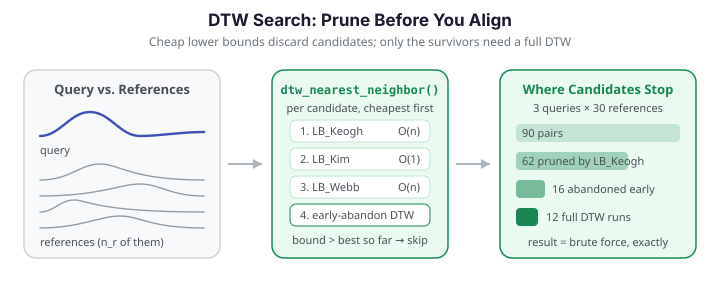

# DTW Search & Averaging

[Distance Metrics](distance-metrics.md) covers the DTW and soft-DTW **distance matrices** (`dtw_self_1d`, `soft_dtw_self_1d`, ...). This page covers the toolkit around a single DTW computation: global windows, the optimal warping path, lower bounds and early abandoning, exact nearest-neighbour search, averaging curves under DTW (DBA and the soft-DTW barycenter), the soft alignment matrix, the triangular Global Alignment Kernel, and multichannel DTW.

All functions live in `fdars.metric`. They work on raw sampled series (no `argvals`): DTW matches *sample indices*, so the curves should share a sampling rate, though their lengths may differ. DTW used to *register* curves (as opposed to measuring distance between them) is covered in the Align section.

{ .fdars-diagram }

!!! note "Cost convention: no square root"
    Every function here reports the accumulated cost $\sum_{(i,j)\in\pi} |x_i - y_j|^p$ along the optimal path $\pi$, **without** taking a $p$-th root. That matches `dtw_self_1d`; tslearn and dtaidistance report the square root of the $p = 2$ cost. Take `np.sqrt` if you compare with them.

## Global windows

A global window restricts which cells $(i, j)$ the warping path may visit. It stops pathological warps (one sample matched to half of the other series) and makes DTW faster. Every windowed function takes the same four keyword arguments:

| `window=` | Extra argument | Admissible cells | Convention |
|---|---|---|---|
| `"none"` (default) | — | all | unconstrained DTW |
| `"sakoe_chiba"` | `radius` (int) | $\lvert i - j\rvert \le$ `radius` (adjusted for unequal lengths) | tslearn |
| `"itakura"` | `max_slope` ($\ge 1$) | parallelogram with slopes `max_slope` and 1/`max_slope` | tslearn |
| `"sakoe_chiba_fraction"` | `window_fraction` in $[0, 1]$ | band half-width as a fraction of the length | aeon `window=` |
| `"itakura_fraction"` | `max_slope` in $(0, 1]$ | aeon's Itakura bounding matrix | aeon `itakura_max_slope=` |

`dtw_window_mask(n, m, ...)` returns the boolean admissibility grid, so you can inspect a window before using it. The path below is the same pair of curves aligned three times; constraining the window can only raise the cost, because it removes candidate paths.

```python exec="1" html="1" source="above"
import numpy as np
from docs_fig import fig, render
from fdars.metric import dtw_path, dtw_window_mask

t = np.linspace(0, 1, 40)
x = np.sin(2 * np.pi * t)
y = np.sin(2 * np.pi * t ** 1.6)          # the same wave, time-warped

C = (x[:, None] - y[None, :]) ** 2          # local cost |x_i - y_j|^2
free = dtw_path(x, y)
band = dtw_path(x, y, window="sakoe_chiba", radius=4)
itak = dtw_path(x, y, window="itakura", max_slope=2.0)

f, axes = fig(1, 3, figsize=(12, 3.9))
for ax, (title, res, mask) in zip(axes, [
    ("no window", free, None),
    ("Sakoe-Chiba, radius=4", band, dtw_window_mask(40, 40, window="sakoe_chiba", radius=4)),
    ("Itakura, max_slope=2", itak, dtw_window_mask(40, 40, window="itakura", max_slope=2.0)),
]):
    ax.imshow(C, cmap="Greys", origin="lower")
    if mask is not None:
        ax.contour(mask.astype(float), levels=[0.5], colors="#e8710a", linewidths=1.2)
    p = res["path"]
    ax.plot(p[:, 1], p[:, 0], color="#3f51b5", lw=2.2)
    ax.set(title=f"{title}\ncost = {res['cost']:.3f}", xlabel="j (y index)", ylabel="i (x index)")
print(render(f))
print("FDARS_FENCE_OK")
```

Grey is the local cost (dark means a poor match), orange the window boundary, blue the optimal path. The unconstrained path bends far from the diagonal to follow the warp. A radius-4 band cannot follow it and pays a cost about 13 times higher. The Itakura parallelogram allows the bend in the middle of the series but pins both ends.

## Paths and windowed distances

| Function | Returns |
|---|---|
| `dtw_path(x, y, p=2.0, window=...)` | `{"path": int64 (L, 2) of (i, j) pairs, "cost": float}` |
| `dtw_distance_windowed(x, y, p=2.0, window=...)` | the cost only, in $O(m)$ memory |
| `soft_dtw_distance_windowed(x, y, gamma=1.0, window=...)` | soft-DTW value (squared local cost) |
| `soft_dtw_alignment(x, y, gamma=1.0, window=...)` | `{"value", "alignment": (n, m)}` |

`dtw_distance_windowed` equals `dtw_path(...)["cost"]` and, with `window="none"`, the entries of `dtw_self_1d`. The two series may have different lengths.

`soft_dtw_alignment` returns the soft-DTW value and the **expected alignment matrix**: entry $(i, j)$ is the probability that cell $(i, j)$ lies on the path under the Gibbs distribution over all paths, $P(\pi) \propto \exp(-\text{cost}(\pi)/\gamma)$. The corner cells are always 1 and rows do not sum to 1. As $\gamma \to 0$ the matrix approaches the 0/1 indicator of the hard DTW path; larger $\gamma$ spreads the mass over near-optimal paths. Soft-DTW values can be negative, because the soft minimum is $-\gamma \log \sum \exp(-\cdot/\gamma)$.

```python exec="1" source="above" result="text"
import numpy as np
from fdars.metric import dtw_path, soft_dtw_alignment

t = np.linspace(0, 1, 40)
x = np.sin(2 * np.pi * t)
y = np.sin(2 * np.pi * t ** 1.6)
hard = np.zeros((40, 40))
p = dtw_path(x, y)["path"]
hard[p[:, 0], p[:, 1]] = 1.0

for gamma in (1.0, 0.1, 0.01):
    E = soft_dtw_alignment(x, y, gamma=gamma)["alignment"]
    print(f"gamma={gamma:<5} corners={E[0, 0]:.2f},{E[-1, -1]:.2f}  "
          f"mass on hard path={E[hard == 1].sum() / E.sum():.3f}")
print("FDARS_FENCE_OK")
```

As $\gamma$ shrinks, the expected alignment concentrates on the hard DTW path.

## Lower bounds and early abandoning

Finding the nearest neighbour of a query under DTW means one $O(nm)$ DTW per candidate. Lower bounds are cheap functions that never exceed the DTW cost. If a bound already exceeds the best distance found so far, the candidate can be skipped without running DTW. All bounds use the same cost convention and window as `dtw_distance_windowed`, so they bound exactly that quantity.

| Function | Bound | Cost | Notes |
|---|---|---|---|
| `lb_kim(x, y, p=2.0)` | first / last / min / max features (Kim, Park & Chu 2001) | $O(1)$ after $O(n)$ | valid under any window; loose |
| `lb_keogh(query, candidate, p=2.0, window=...)` | distance from the query to the candidate's envelope (Keogh 2002) | $O(n)$ | the envelope is built internally |
| `lb_improved(x, y, p=2.0, window=...)` | LB_Keogh plus a second pass (Lemire 2009) | $O(n)$ | LB_Keogh ≤ LB_Improved ≤ DTW |
| `lb_webb(x, y, p=2.0, window=...)` | LB_Webb (Webb & Petitjean 2021) | $O(n)$ | generalised to every window |
| `lb_enhanced(x, y, v, p=2.0, window=...)` | `v` boundary bands + Keogh in between (Tan, Petitjean & Webb 2019) | $O(n)$ | `v >= 1`; larger `v` is tighter and slower |
| `dtw_distance_early_abandon(x, y, cutoff, ...)` | — | ≤ $O(nm)$ | EAPrunedDTW (Herrmann & Webb 2021): the exact DTW, or `None` once it must exceed `cutoff` |

`lb_envelope(x, radius)` and `lb_envelope_windowed(y, query_len, window=...)` return the `{"lower", "upper"}` envelope itself, e.g. to precompute envelopes for a fixed reference set. The envelope is the running min/max of the series over the window. `lb_keogh` cannot take a precomputed envelope from Python; it rebuilds the candidate's envelope on each call.

```python exec="1" source="above" result="text"
import numpy as np
import fdars.metric as fm

t = np.linspace(0, 1, 60)
x = np.sin(2 * np.pi * t)
y = np.sin(2 * np.pi * (t - 0.05)) + 0.1 * np.cos(9 * np.pi * t)
w = dict(window="sakoe_chiba", radius=3)

dtw = fm.dtw_distance_windowed(x, y, **w)
bounds = {
    "LB_Kim": fm.lb_kim(x, y),
    "LB_Keogh": fm.lb_keogh(x, y, **w),
    "LB_Improved": fm.lb_improved(x, y, **w),
    "LB_Webb": fm.lb_webb(x, y, **w),
    "LB_Enhanced(v=4)": fm.lb_enhanced(x, y, 4, **w),
}
for name, lb in bounds.items():
    print(f"{name:17s} {lb:8.4f}  <= DTW: {lb <= dtw + 1e-12}")
print(f"{'DTW':17s} {dtw:8.4f}")
print("early abandon, cutoff 0.5 :", fm.dtw_distance_early_abandon(x, y, 0.5, **w))
print("early abandon, cutoff 10  :", round(fm.dtw_distance_early_abandon(x, y, 10.0, **w), 4))
print("FDARS_FENCE_OK")
```

## Exact nearest-neighbour search

`dtw_nearest_neighbor(queries, references, ...)` and `dtw_k_nearest_neighbors(queries, references, k, ...)` run the UCR-suite-style cascade from the diagram above: references are visited in LB_Keogh order, then LB_Kim, LB_Webb and an early-abandoning DTW (with the current k-th best distance as cutoff) discard candidates. The result is **exact**: it equals brute force over all references, in both index and distance. The `stats` dict counts where each candidate was pruned, so you can see how much work the bounds saved.

```python exec="1" source="above" result="text"
import numpy as np
from fdars.metric import dtw_nearest_neighbor, dtw_k_nearest_neighbors, dtw_distance_windowed

rng = np.random.default_rng(1)
m = 80
t = np.linspace(0, 1, m)
bump = lambda c: np.exp(-0.5 * ((t - c) / 0.07) ** 2)
refs = np.array([bump(rng.uniform(0.2, 0.8)) + 0.05 * rng.standard_normal(m) for _ in range(30)])
queries = np.array([bump(0.5) + 0.05 * rng.standard_normal(m) for _ in range(3)])
w = dict(window="sakoe_chiba", radius=8)

nn = dtw_nearest_neighbor(queries, refs, **w)
brute = np.array([[dtw_distance_windowed(q, r, **w) for r in refs] for q in queries])
print("1-NN indices      :", nn["indices"], " brute force:", brute.argmin(axis=1))
print("distances match   :", np.allclose(nn["distances"], brute.min(axis=1)))
print("pruning stats     :", nn["stats"])

knn = dtw_k_nearest_neighbors(queries, refs, k=3, **w)
print("3-NN of query 0   :", knn["indices"][0], np.round(knn["distances"][0], 3))
print("FDARS_FENCE_OK")
```

Of the 90 query-reference pairs, LB_Keogh discards 62 outright and early abandoning stops 16 more part-way through, so only 12 full DTW computations are needed.

## Averaging under DTW

The pointwise mean of curves with timing variation smears their features: averaging bumps at different positions gives a low, wide bump. A **DTW barycenter** is instead a curve $b$ that minimises the (weighted) sum of DTW costs to the sample, so it keeps the shape of the individual curves.

- **DBA** (`dtw_barycenter_averaging`, Petitjean et al. 2011) alternates between aligning every curve to the current barycenter with `dtw_path` and replacing each barycenter sample by the mean of all samples matched to it. Each iteration does not increase the mean cost (Schultz & Jain 2018). `init` is `"mean"` (default), `"medoid"` or a 1-D array; `barycenter_size` changes the barycenter length; `weights` gives a weighted barycenter; the window applies to every alignment. The returned `cost` is the weighted mean DTW cost to the curves.
- **Soft-DTW barycenter** (`soft_dtw_barycenter`, Cuturi & Blondel 2017) minimises the sum of *soft*-DTW values with L-BFGS. It is differentiable, so it converges smoothly; `gamma` trades fidelity to the hard DTW geometry (small) against smoothness (large values approach the pointwise mean). `n_restarts` runs (default 10) start from the mean and from perturbed means, and the best is kept.

```python exec="1" html="1" source="above"
import numpy as np
from docs_fig import fig, render
from fdars.metric import dtw_barycenter_averaging, soft_dtw_barycenter

rng = np.random.default_rng(1)
t = np.linspace(0, 1, 80)
X = np.array([np.exp(-0.5 * ((t - c) / 0.07) ** 2) for c in rng.uniform(0.35, 0.65, 12)])

dba = dtw_barycenter_averaging(X, window="sakoe_chiba", radius=15)
sdb = soft_dtw_barycenter(X, gamma=0.1, n_restarts=3)

f, ax = fig(figsize=(8, 3.6))
for xi in X:
    ax.plot(t, xi, color="#6c757d", lw=1.0, alpha=0.45)
ax.plot(t, X.mean(axis=0), color="#dc3545", lw=2.2, ls="--", label="pointwise mean")
ax.plot(t, dba["barycenter"], color="#3f51b5", lw=2.6, label="DBA")
ax.plot(t, sdb["barycenter"], color="#e8710a", lw=2.0, label="soft-DTW barycenter (gamma=0.1)")
ax.set(title="Twelve shifted bumps and three averages", xlabel="t")
ax.legend(fontsize=9)
print(render(f))
print(f"<p>peak height: mean {X.mean(axis=0).max():.2f}, DBA {dba['barycenter'].max():.2f}, "
      f"soft-DTW {sdb['barycenter'].max():.2f} (each curve peaks at 1.00); "
      f"DBA converged={dba['converged']} after {dba['n_iter']} iterations</p>")
print("FDARS_FENCE_OK")
```

Both barycenters keep a peak close to the height of the individual curves (each peaks at 1). The pointwise mean flattens it to about 0.6. The [DTW k-means](../analyze/time-series-clustering.md) clusterer uses DBA for its centroids.

## Triangular Global Alignment Kernel

The Global Alignment Kernel (Cuturi 2011) sums a local similarity over **all** alignment paths instead of taking the best one, which makes it a positive semi-definite kernel. Cuturi's *triangular* variant only admits cells with $\lvert i - j\rvert < T$, a band that is both faster and keeps the kernel PSD. `gak_triangular(x, y, sigma, triangular=T)` returns the normalised value in $[0, 1]$ (1 for $x = y$); `T = 0` disables the band and equals `gak`. `gak_gram_matrix` and `gak_gram_train` accept the same `triangular=` keyword, and `gak_gram_predict` reuses the training value. See [Shapelets](../analyze/shapelets.md#gak-global-alignment-kernel) for the Gram-matrix workflow with a precomputed-kernel SVM.

```python exec="1" source="above" result="text"
import numpy as np
from fdars.metric import gak, gak_triangular, sigma_gak, gak_gram_matrix

rng = np.random.default_rng(1)
t = np.linspace(0, 1, 80)
X = np.array([np.exp(-0.5 * ((t - c) / 0.07) ** 2) for c in rng.uniform(0.35, 0.65, 12)])
s = sigma_gak(X)
print(f"sigma_gak = {s:.3f}")
print(f"T=0  : {gak_triangular(X[0], X[1], s):.4f}  (gak: {gak(X[0], X[1], s):.4f})")
print(f"T=10 : {gak_triangular(X[0], X[1], s, triangular=10):.4f}")
K = gak_gram_matrix(X, triangular=10)
print(f"Gram (T=10): unit diagonal {np.allclose(np.diag(K), 1)}, "
      f"min eigenvalue {np.linalg.eigvalsh(K).min():.1e}")
print("FDARS_FENCE_OK")
```

Narrowing the band lowers the similarity of curves whose features are far apart in time, because the paths that would match them are excluded.

## Multichannel DTW

For series with $d$ channels (e.g. x/y/z acceleration), pass each series as a `(d, m)` array: **channels as rows**, time as columns (aeon's layout). The local cost is *dependent* across channels, $\big(\sum_c (x_{c,i} - y_{c,j})^2\big)^{p/2}$, so all channels share one warping path. With $d = 1$ every function gives bit-identical results to its univariate counterpart.

| Function | Input | Returns |
|---|---|---|
| `dtw_distance_multivariate(x, y, p=2.0, window=...)` | two `(d, n)` / `(d, m)` arrays | float |
| `dtw_path_multivariate(x, y, ...)` | as above | `{"path", "cost"}` |
| `dtw_pairwise_distance_multivariate(data, other=None, ...)` | list of `(d, m_i)` arrays or `(n, d, m)` | `(n, n)` or `(n, n_other)` |
| `dtw_barycenter_averaging_multivariate(data, ...)` | as above | `{"barycenter": (d, L), "cost", "n_iter", "converged"}` |

Collections may mix series lengths but not channel counts.

```python exec="1" source="above" result="text"
import numpy as np
import fdars.metric as fm

rng = np.random.default_rng(2)
t = np.linspace(0, 1, 80)
def series(c):                        # 2 channels: a bump and its slope
    b = np.exp(-0.5 * ((t - c) / 0.07) ** 2)
    return np.vstack([b, np.gradient(b, t) / 20])

S = np.stack([series(c) for c in rng.uniform(0.3, 0.7, 6)])     # (n, d, m) = (6, 2, 80)
D = fm.dtw_pairwise_distance_multivariate(S, window="sakoe_chiba", radius=15)
bary = fm.dtw_barycenter_averaging_multivariate(S, window="sakoe_chiba", radius=15)
print("pairwise matrix:", D.shape, " symmetric:", np.allclose(D, D.T))
print("barycenter shape:", bary["barycenter"].shape, " mean cost:", round(bary["cost"], 4))
uni = fm.dtw_distance_windowed(S[0, 0], S[1, 0])
mv = fm.dtw_distance_multivariate(S[0, :1], S[1, :1])
print("d=1 equals univariate:", uni == mv)
print("FDARS_FENCE_OK")
```

## Which tool for which job

| Task | Use |
|---|---|
| Inspect how two series are matched | `dtw_path`, `dtw_window_mask` |
| Distance matrix for clustering or kernels | `dtw_self_1d` / `dtw_cross_1d` ([Distance Metrics](distance-metrics.md)) |
| 1-NN or k-NN classification on many references | `dtw_nearest_neighbor`, `dtw_k_nearest_neighbors` |
| Custom search loop with your own pruning | `lb_*` bounds + `dtw_distance_early_abandon` |
| Representative curve of a group | `dtw_barycenter_averaging` (or `soft_dtw_barycenter` for a smoother average) |
| Positive semi-definite kernel for an SVM or kernel k-means | `gak_gram_matrix(..., triangular=T)` |
| Other elastic measures (ERP, TWE, MSM, LCSS, ...) | [Elastic Time-Series Distances](elastic-ts-distances.md) |

## References

1. Sakoe, H. & Chiba, S. (1978). Dynamic programming algorithm optimization for spoken word recognition. *IEEE Transactions on Acoustics, Speech, and Signal Processing*, 26(1), 43–49.
2. Itakura, F. (1975). Minimum prediction residual principle applied to speech recognition. *IEEE Transactions on Acoustics, Speech, and Signal Processing*, 23(1), 67–72.
3. Kim, S.-W., Park, S. & Chu, W. W. (2001). An index-based approach for similarity search supporting time warping in large sequence databases. *Proceedings of the 17th International Conference on Data Engineering (ICDE)*.
4. Keogh, E. (2002). Exact indexing of dynamic time warping. *Proceedings of the 28th International Conference on Very Large Data Bases (VLDB)*, 406–417.
5. Lemire, D. (2009). Faster retrieval with a two-pass dynamic-time-warping lower bound. *Pattern Recognition*, 42(9), 2169–2180.
6. Tan, C. W., Petitjean, F. & Webb, G. I. (2019). Elastic bands across the path: a new framework and method to lower bound DTW. *Proceedings of the 2019 SIAM International Conference on Data Mining (SDM)*.
7. Webb, G. I. & Petitjean, F. (2021). Tight lower bounds for dynamic time warping. *Pattern Recognition*, 115, 107895.
8. Herrmann, M. & Webb, G. I. (2021). Early abandoning and pruning for elastic distances including dynamic time warping. *Data Mining and Knowledge Discovery*, 35(6), 2577–2601.
9. Petitjean, F., Ketterlin, A. & Gançarski, P. (2011). A global averaging method for dynamic time warping, with applications to clustering. *Pattern Recognition*, 44(3), 678–693.
10. Schultz, D. & Jain, B. (2018). Nonsmooth analysis and subgradient methods for averaging in dynamic time warping spaces. *Pattern Recognition*, 74, 340–358.
11. Cuturi, M. & Blondel, M. (2017). Soft-DTW: a differentiable loss function for time-series. *Proceedings of the 34th International Conference on Machine Learning (ICML)*, PMLR 70, 894–903.
12. Cuturi, M. (2011). Fast global alignment kernels. *Proceedings of the 28th International Conference on Machine Learning (ICML)*, 929–936.
